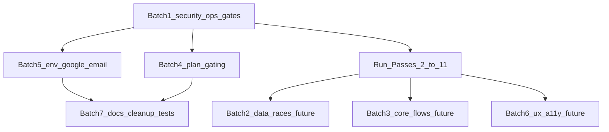

# Audit summary (rollup)

**Date:** 2026-11-04  
**Sources:** [`01-inventory.md`](01-inventory.md) + [`evidence/`](evidence/); [`docs/ENGINEERING_RULES.md`](../ENGINEERING_RULES.md)  
**Register:** [`findings.csv`](findings.csv)  
**Scope limit:** Only **Pass 1 (inventory)** exists under `docs/audit/`. Passes 2–11 were not run. This rollup does not invent security/data/flow findings for unexecuted passes.

---

## 1. Executive summary

The product builds and typechecks, has a large App Router surface (173 pages, ~100 server-action modules, 131 public tables with RLS enabled at the flag level), and has substantial authored unit tests for connections, website/consent, hackathon scoring/flags, and permissions. Against ENGINEERING_RULES Definition of Done, the repo is **not launch-ready**: lint and knip fail, `npm audit` is dirty, and `test:unit` never reaches the suite because of a Connections import-boundary gate.

**Overall health (Pass 1 only):** *Foundation present; quality gates and dependency hygiene broken; deep security and product-flow assurance absent until later passes.*

### Counts (merged register)

| Severity | Count |
|----------|------:|
| Critical | 0 *(Pass 1 “Critical” Next CVE downgraded on re-check — see below)* |
| High | 4 |
| Medium | 5 |
| Low | 4 |
| Info | 4 |
| **Total open** | **17** |

| Area | Count |
|------|------:|
| security | 4 |
| ops | 4 |
| docs | 4 |
| quality | 3 |
| plans | 1 |
| integrations | 1 |

### Top 10 risks (why they matter)

1. **AUD-GAP-002 — Passes 2–11 not done** — Auth bypass, RLS holes, payment races, privacy map, and Google/email abuse paths are unvalidated. Real organizers/attendees would be flying blind on the highest-impact domains.
2. **AUD-1-002 — Next 16.2.6 on advisory range** — Still must upgrade for S16 and DoS advisories; the Turbopack+i18n middleware bypass does **not** match this app’s config (re-check below), but staying unpatched is still a launch risk.
3. **AUD-1-001 — Lint/knip/audit DoD fail** — ENGINEERING_RULES §5 is violated; regressions and dead code can merge unnoticed.
4. **AUD-1-005 — Unit tests never run** — Gate fails on `attendeeImport.service.ts` importing Google Drive outside `connections/{server,providers}`. Authored tests for flags, OAuth, quotas, consent do not protect CI.
5. **AUD-1-009 — Token/ticket routes outside proxy** — Tickets, judge links, apply/forms tokens rely on page-level checks; without Pass 2 this is the highest *plausible* auth exposure class.
6. **AUD-1-003 — Specs 12 / 15 / 20 missing** — No signed feature×role×plan matrix; plan gating and product intent disputes are inevitable.
7. **AUD-1-008 — Custom Forms ungated** — Possible free giveaway of a paid-intent feature; monetization and abuse surface unclear.
8. **AUD-1-006 — Env gaps** — Unsubscribe HMAC and email caps may silently misbehave in production.
9. **AUD-GAP-019 — No secret-history scan** — S19 unpaid; unknown history leaks.
10. **AUD-1-014 — Cron schedule not in repo** — Outbox, plan expiry, sheet sync may stop without anyone noticing.

### Launch blockers (before real organizers and attendees)

Treat as **provisional** until Passes 2–4 (and ideally 7–8) complete:

| Blocker | Why |
|---------|-----|
| Upgrade Next past GHSA-fixed versions + re-audit | S16; residual DoS; policy |
| Unblock and green `test:unit` (C6 import) | No automated safety net |
| Run Pass 2 (auth matrix on proxy-excluded routes + actions) | Ticket/token/public DTO risk unknown |
| Run Pass 3 (RLS policy quality, not just `rls_enabled`) | Flag ≠ safe policies |
| Confirm `CRON_SECRET` + host schedules for all `/api/cron/*` | Silent ops failure |
| Owner decisions on Custom Forms plan + docs 12/15/20 | Pricing/legal contract |
| gitleaks/trufflehog (or equivalent) on git history | S19 |

**Not launch blockers by themselves (Pass 1):** knip unused-export noise, vitest-vs-node:test doc drift, legacy Google callback redirect, hackathon URL compatibility redirects.

### Critical/High re-check (this rollup)

| ID | Pass 1 claim | Re-check | Rollup decision |
|----|--------------|----------|-----------------|
| AUD-1-002 Critical | `next@16.2.6` critical via npm audit | GHSA-6gpp needs Turbopack **and** single `i18n.locales`. Repo: no `i18n` in `next.config.ts`; `next build` / default `dev` use webpack; auth gate is `src/proxy.ts` (Node). Bypass **not reproduced / not applicable** under those conditions. Package still in vulnerable range; DoS advisory remains. | **Downgrade to High**; keep upgrade recommendation |
| AUD-1-001 High | lint/knip/audit fail DoD | Evidence files + commands still show fail | **Keep High, confirmed** |
| AUD-1-003 High | docs 12/15/20 missing | Glob still empty | **Keep High, confirmed** |
| AUD-GAP-002 High | Passes 2–11 absent | Only `01-inventory.md` in `docs/audit/` | **Added High, confirmed** |
| AUD-1-004 Medium | separate hackathon tree | `hackathon/page.tsx`, `create`, `[eventId]` **redirect** into unified `/events` | **Downgrade to Low**; prefer **update doc** |

---

## 2. Findings register

Canonical machine-readable register: [`findings.csv`](findings.csv).

Columns: `id,severity,area,title,location,impact,recommendation,effort,confidence,depends_on,batch,decision,status`.

All rows: `decision` empty, `status` = `open`. Duplicates across passes: N/A (single pass). Best evidence retained from Pass 1 + code re-check.

---

## 3. Flow / area health scorecard

Ratings from executed Pass 1 only. Unaudited product flows = **Not testable**.

| Flow / area | Rating | Source |
|-------------|--------|--------|
| Typecheck | Works | Pass 1 |
| Production build | Works | Pass 1 |
| Lint | Broken | Pass 1 |
| Knip | Broken | Pass 1 |
| Unit test runner (`test:unit`) | Broken | Pass 1 |
| npm audit / dependency hygiene | Works with issues | Pass 1 |
| Route / action / table inventory | Works | Pass 1 |
| Env documentation | Works with issues | Pass 1 |
| Spec pack docs 11–20 | Works with issues | Pass 1 (12/15/20 missing) |
| Supabase tables present + RLS flag | Works | Pass 1 MCP list |
| Auth proxy (matched prefixes) | Works with issues | Pass 1 |
| Custom Forms | Works with issues | Pass 1 |
| Connections (code + tests authored) | Works with issues | Pass 1 (C6 gate) |
| Authorization matrix (roles × routes/actions) | Not testable | Pass 2 not run |
| RLS policy quality / storage / secrets deep dive | Not testable | Pass 2–3 |
| Schema vs code / races / soft-delete | Not testable | Pass 3 |
| Create/publish/register/pay/check-in/certificates | Not testable | Pass 4 |
| Hackathon CTF/scoreboard/judges | Not testable | Pass 5 |
| Orgs / plans / tenant isolation | Not testable | Pass 6 |
| Google OAuth / Gmail / Resend ops | Not testable | Pass 7 (partial unit evidence only) |
| Marketing CMS / privacy DATA MAP | Not testable | Pass 8 |
| Frontend a11y / Lighthouse | Not testable | Pass 9 |
| Cron reliability / cost / monitoring | Not testable | Pass 10 |
| Code quality deep / CI coverage | Not testable | Pass 11 |
| Browser E2E against demo | Not testable | Not run in Pass 1 |

---

## 4. Fix plan (safe order)

| Batch | Theme | Finding IDs | Effort | Notes |
|------:|-------|-------------|--------|-------|
| 1 | Security / legal / gate blockers | AUD-1-002, AUD-1-001, AUD-1-003, AUD-1-005, AUD-1-009, AUD-GAP-002, AUD-GAP-019 | L | Upgrade Next; unblock tests; start Pass 2; secret scan; restore specs |
| 2 | Data integrity / races | *(none yet — Pass 3)* | — | After Pass 3 |
| 3 | Broken core flows | *(none yet — Pass 4)* | — | After Pass 4 |
| 4 | Plan gating / tenant | AUD-1-008 | S | After owner pricing decision |
| 5 | Google / email / env | AUD-1-006, AUD-1-010, AUD-1-014 | S–M | `.env.example` + Zod; cron docs |
| 6 | UX / perf / a11y | *(none yet — Pass 9)* | — | After Pass 9 |
| 7 | Cleanup / docs / knip | AUD-1-004, AUD-1-007, AUD-1-011, AUD-1-012, AUD-1-013, AUD-1-015 | S–L | Doc fixes are quick wins |

**Dependencies:** AUD-1-001 cleanup partly depends on AUD-1-002 (audit clean). AUD-1-008 depends on AUD-1-003 / owner decision. AUD-1-012 knip cleanup safer after AUD-1-005 so tests catch accidental deletes.

### Quick wins (high impact, low effort)

| ID | Win |
|----|-----|
| AUD-1-005 | Fix or allowlist one import → entire unit suite runnable |
| AUD-1-006 | Fill `.env.example` + Zod for unsubscribe/cap secrets |
| AUD-1-002 | Bump `next` (M but one PR) |
| AUD-1-004 / AUD-1-015 / AUD-1-011 | Doc-only updates |
| AUD-1-014 | Write cron schedule into ops doc / confirm host |

---

## 5. Owner decisions (with recommended defaults)

| # | Question | Recommended default |
|---|----------|---------------------|
| 1 | Restore or rewrite **docs/12, 15, 20**? | Rewrite short SoT stubs from `completeContext` + plans; mark docs/15 N/A only if Connections security review remains the SoT |
| 2 | Keep **`/organizer/.../hackathon*`** URLs? | **Keep redirects** for bookmarks; document as compatibility in docs/11 (do not rebuild a second shell) |
| 3 | **Custom Forms** paid or free? | **Free** for organizers until docs/20 exists; add module key later if monetizing |
| 4 | MCP Supabase project staging or prod? | Treat as **staging**; forbid Pass 3+ writes until owner confirms |
| 5 | Cron schedules + `CRON_SECRET` on all envs? | **Must confirm before launch**; default: document in `docs/` and Vercel crons for all five `/api/cron/*` |
| 6 | Upgrade **Next** now? | **Yes** — bump to patched ≥16.2.11 / current 16.4.x before Pass 2 |
| 7 | Is missing Pass 2–11 acceptable for a closed beta? | **No for public organizers/attendees**; closed internal dogfood only after Pass 2 smoke on tickets/tokens |

---

## 6. Spec drift (code vs docs)

| Drift | Fix code or update doc? |
|-------|-------------------------|
| docs/11 “no separate hackathon list” vs `/hackathon*` routes | **Update doc** — routes redirect into `/events` |
| docs/11 shell path `/events/{eventId}` vs organizer `/organizer/.../events/...` | **Update doc** — distinguish public vs organizer |
| ENGINEERING_RULES C12 “vitest” vs `node --test` | **Update doc** |
| ENGINEERING_RULES §5 DoD vs failing lint/knip/audit | **Fix code/process** (gates) |
| docs/17 C6 boundary vs attendee import Google provider import | **Fix code** (preferred) or documented allowlist |
| docs 12 / 15 / 20 missing | **Update/create docs** |
| Custom Forms vs plan module catalog | **Owner decision** then code or docs |
| `.env.example` vs `env.ts` / runtime usage | **Update `.env.example`** (+ Zod where fail-fast required) |

---

## 7. What's good

- Typecheck and production **build pass**.
- Central **`src/env.ts`** public/server Zod split (C9 pattern).
- **`TABLES`** unique count matches linked Supabase public table count (131); RLS **enabled flag** on listed tables.
- Broad **authored** unit tests (permissions, hackathon flags/scoreboard/settings, connections OAuth/PKCE/quotas/C2–C6, website/consent/CMS).
- Proxy matcher covers organizer, vendor, attendee, admin, department, clubs consistently.
- `.gitignore` for `.env*`; Pass 1 hygiene found no >1 MB tracked blobs and no credential filenames beyond `.env.example`.
- Hackathon organizer URLs already **redirect** toward the unified events shell (aligns with docs/11 intent).
- Platform email lanes, Connections, marketing CMS, and custom forms are present in the tree as real features—not vaporware.

---

## 8. What this summary could not assert

- Any **confirmed** auth bypass, RLS mispolicy, oversell, double payment, XSS, or privacy-policy gap (Passes 2–8 not run).
- Production exploitability of Next advisories beyond version presence (bypass path not applicable under current config; DoS not load-tested).
- Cron actual schedule on the host.
- Full `test:unit` pass/fail matrix (gate blocks execution).

*Do not fix product code from this rollup alone — register and prioritize only.*
