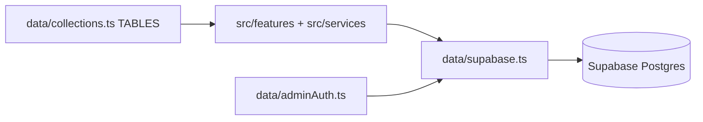

# Firebase → Supabase cutover retrospective

**Status:** done (2026-10-07)  
**Related:** [project-standardization](2026-10-07-project-standardization.md) (archived plan), [plans-archive-and-verification](2026-10-11-plans-archive-and-verification.md)

## Goal

Remove the Firestore-shaped façade (`data/admin_db.ts`) and make every feature use `supabaseAdmin` / `createSupabaseServer` + `TABLES` from `data/collections.ts`.

## Architecture after cutover

## Delivered by wave

| Wave | What | Key paths |
| --- | --- | --- |
| Guards | Service-role required; Cursor rule; `types:db` | `data/supabase.ts`, `.cursor/rules/supabase-only.mdc`, `completeContext.md` |
| Leftovers | Deleted dead Firebase-era files | `event.controller.ts`, `src/mockdata/`, `seeding.js`, `data/db.ts` |
| Access | Invites, guest list, registration decisions | `src/features/access/**` |
| Hackathon | Teams/CTF/live/judging/tracks; `teamWrite.ts` | `src/features/hackathon/**` |
| Certs + admin | Certificates + admin services/actions | `src/services/certificate*.ts`, `src/features/admin/**` |
| Bookings + vendors | Bookings + vendor profiles; batched `.in()` | `src/features/bookings/**`, `src/features/event_vendors/**` |
| Remaining | Registration, attendees, orgs, taxonomy, analytics | `src/services/*`, other features |
| Delete façade | `admin_db.ts` gone; `adminAuth.ts`; `statusMaps.ts`; ESLint ban | `eslint.config.mjs` |
| Standards | Naming shims, CI, unit tests | `src/services/*` shims, `.github/workflows/ci.yml`, `test:unit` |

## Deleted

- `data/admin_db.ts`
- `data/db.ts`
- `seeding.js`
- `src/mockdata/**`
- `src/features/events/event.controller.ts`

## New / canonical data helpers

- `data/supabase.ts` — typed client; requires `SUPABASE_SERVICE_ROLE_KEY`
- `data/adminAuth.ts` — Auth helpers previously on the façade
- `data/statusMaps.ts` — status/payment/booking enum maps at DTO boundary
- `data/collections.ts` — `TABLES` / `COLLECTIONS`

## Optimizations landed with cutover

- Parallel batched reads (e.g. organizer booking list `.in("user_id"|"id", ids)`)
- Real Postgres writes (no fake `runTransaction`)
- Single status vocabulary via `statusMaps`

## Quality gates (post-cutover)

- `npx tsc --noEmit` — pass
- `npm run build` — pass
- `npm run test:unit` — pass (`eventState`, `bookingValue`)

## Remaining debt (tracked in INDEX)

- ESLint mass cleanup
- Staff mutation grant hardening
- Stale Firestore comments
- Dual UI kits

## Verification (2026-10-11)

- Static: `tsc`, `test:unit`, `build` green; no live `admin_db` / `FieldValue` imports
- RBAC: demo-seed plan modules + proxy staff exception checked; checklist in `docs/TESTING.md` § 0c
- Page speed: Part E hotspots parallelized/batched (see 2026-10-11 plan + TESTING.md “Page load performance”)

## Auth / RBAC (unchanged choke points)

- Proxy: `src/proxy.ts`
- Ownership: `src/features/events/ownership.ts` (`assertOwnedEvent`)
- Modules: `src/features/permissions/permissions.service.ts`
- Service role bypasses RLS — every write must call auth helpers
