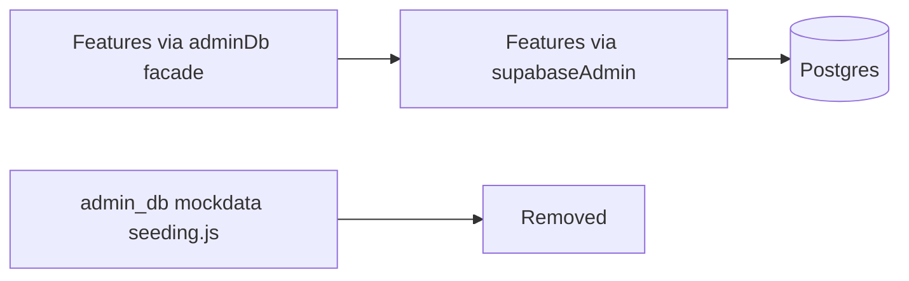
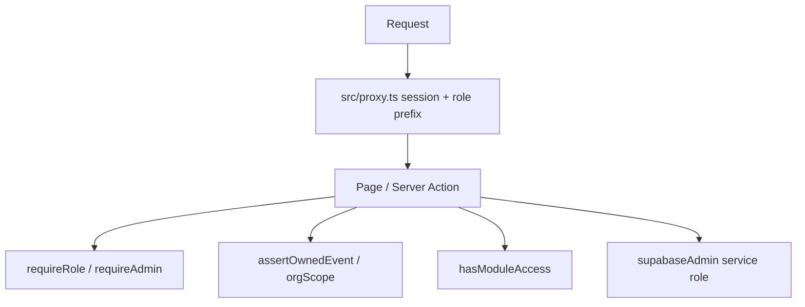
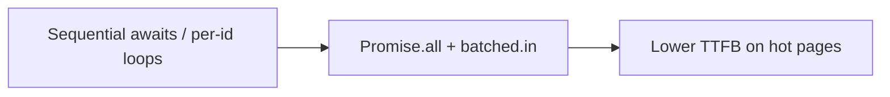

# Standardization retrospective + plans archive + verification + page speed

## What you asked for

1. Full detail of product standardization changes, quality, bugs, optimization  
2. Deep structure / security / RBAC / flows analysis  
3. Proper testing toward zero issues  
4. A **`plans/` folder** that holds every plan (past + all future)  
5. **Fast site:** parallel DB calls + load-path optimization so pages fetch and render details quickly  

This plan is the next executable step. The **analysis content below** will be written into `plans/` as permanent project docs when you approve.

---

## Part A — What standardization changed (completed work)

### Goal achieved
Firebase packages were already gone; the remaining **Firestore-shaped façade** [`data/admin_db.ts`](data/admin_db.ts) was removed. All data access is `supabaseAdmin` / `createSupabaseServer` + [`TABLES`](data/collections.ts).



### Delivered by wave

| Wave | What | Key paths |
|------|------|-----------|
| Guards | Service-role required (no anon fallback); canonical standards; Cursor rule; `types:db` | [`data/supabase.ts`](data/supabase.ts), [`.cursor/rules/supabase-only.mdc`](.cursor/rules/supabase-only.mdc), [`completeContext.md`](completeContext.md) |
| Leftovers | Deleted dead Firebase-era files | `event.controller.ts`, `src/mockdata/`, `seeding.js`, `data/db.ts` |
| Access | Invites, guest list, registration decisions | [`src/features/access/**`](src/features/access/) |
| Hackathon | Teams/CTF/live/judging/tracks; `teamWrite.ts` | [`src/features/hackathon/**`](src/features/hackathon/) |
| Certs + admin | Certificates + admin services/actions | [`src/services/certificate*.ts`](src/services/), [`src/features/admin/**`](src/features/admin/) |
| Bookings + vendors | Bookings + vendor profiles; batched `.in()` | [`src/features/bookings/**`](src/features/bookings/), [`src/features/event_vendors/**`](src/features/event_vendors/) |
| Remaining | Registration, attendees, orgs, taxonomy, analytics, etc. | `src/services/*`, other features |
| Delete façade | `admin_db.ts` gone; Auth helpers → [`data/adminAuth.ts`](data/adminAuth.ts); status maps → [`data/statusMaps.ts`](data/statusMaps.ts); ESLint bans re-import | `eslint.config.mjs` |
| Standards | Naming shims, CI, unit tests | shims under `src/services/*`, [`.github/workflows/ci.yml`](.github/workflows/ci.yml), `test:unit` |

### Optimizations already landed
- Parallel **batched** reads (e.g. organizer booking list `.in("user_id"|"id", ids)`) instead of per-id Firestore-style gets  
- Real Postgres writes (no fake `runTransaction`)  
- Single status vocabulary via `statusMaps` at the DTO boundary  

### Quality gates after cutover (last known good)
- `npx tsc --noEmit` — pass  
- `npm run build` — pass  
- `npm run test:unit` — pass (`eventState`, `bookingValue`)  

### Not “zero issues” yet (honest inventory)

| Area | Status |
|------|--------|
| Live Firebase API | Gone |
| Stale “Firestore” comments in `src/` | Remain (~10+ files) — doc debt |
| Typo service paths | Shims exist; old names still primary |
| ESLint | Large pre-existing debt (~300 issues earlier) — not cleared by cutover |
| Dual UI kits | Still `components/ui` + `shared_components/ui` |
| RBAC tests | Happy-path walkthrough in [`docs/TESTING.md`](docs/TESTING.md); **no** adversarial IDOR suite |
| Hydration `bis_skin_checked` | Browser extension noise, not app bug |
| Staff over-privilege | `assertOwnedEvent` treats event staff like owner for mutations; page grants are mostly UI |
| Page TTFB | Several server pages still waterfall or N+1 (Part E) |

**Definition of “zero issues” for this tranche:** `tsc` + `build` + `test:unit` green; no `admin_db` imports; RBAC smoke checklist passes with demo seed; hot pages use parallel batched fetches (no sequential per-id loops on the critical path); no new critical/high security findings. ESLint cleanup and staff grant enforcement on every action remain tracked follow-ups in `plans/`.

---

## Part B — Structure, security, RBAC (analysis summary)

### Structure (current standard)
- Thin routes: `src/app/**`  
- Domain: `src/features/<name>/{types,*.service,actions,components}`  
- Data: `data/supabase.ts`, `data/collections.ts`, `data/adminAuth.ts` — **no façade**  
- Docs map: [`completeContext.md`](completeContext.md)  

### Auth / RBAC layers



- **Proxy:** gates organizer/vendor/attendee/admin/department/clubs; staff RPC exception; admins pass (support preview)  
- **Ownership:** [`src/features/events/ownership.ts`](src/features/events/ownership.ts) is the IDOR choke point  
- **Modules:** [`permissions.service.ts`](src/features/permissions/permissions.service.ts)  
- **Risk:** service role bypasses RLS — every write must call auth helpers  

### Flows covered by demo seed
Owner / dept / club / organizer (free·pro·enterprise) / vendor / attendee — see [`docs/TESTING.md`](docs/TESTING.md) § 0b. Missing: cross-tenant URL attacks, staff action over-privilege, suspended POST.

---

## Part C — Create `plans/` archive (required deliverable)

**Canonical location:** repo root [`plans/`](plans/) (versioned with the product). Cursor’s `.cursor/plans/` remains the IDE workspace; we **copy** finished plans into `plans/` so the repo is the source of truth.

### Layout to create

```
plans/
  README.md                          # how to add the next plan; naming rules
  INDEX.md                           # table of all plans + status
  2026-10-07-firebase-supabase-cutover.md   # full standardization retrospective
  2026-10-07-project-standardization.md     # original standardization plan snapshot
  2026-10-11-plans-archive-and-verification.md  # THIS plan after approval
```

### `plans/README.md` rules (enforced)
1. Every new agent plan is saved under `plans/YYYY-MM-DD-short-slug.md`  
2. Update `plans/INDEX.md` in the same session  
3. Add a Cursor rule [`.cursor/rules/plans-archive.mdc`](.cursor/rules/plans-archive.mdc): “After CreatePlan / completing a plan, write/copy the plan into `plans/` and update INDEX”  
4. Point `completeContext.md` at `plans/` as the plan archive  

### Content of the cutover retrospective file
Will include: change matrix (above), deleted files, new files, optimization notes, remaining debt, RBAC diagram, verification results from Part D, performance work from Part E.

---

## Part D — Verification pass (execute after approval)

1. **Static:** `npx tsc --noEmit`, `npm run test:unit`, `npm run build` (with env present)  
2. **Grep gates:** zero `@/data/admin_db` / `adminDb` / `FieldValue` imports  
3. **RBAC smoke** (demo seed accounts, incognito, extensions off):  
   - `org.free` cannot open enterprise-only modules  
   - `org.enterprise` opens Teams + hackathon  
   - Attendee cannot open `/organizer/{other}/events/...` (expect redirect/denied)  
   - Vendor cannot open organizer dashboard  
   - Staff assigned team can open assigned event; unassigned attendee cannot  
4. **Fix blockers** found in steps 1–3 only (build/tsc/security). Log ESLint / comment debt into `plans/INDEX.md` as open follow-ups — do not claim ESLint zero.  
5. Update `completeContext.md` changelog + `docs/TESTING.md` with a short “RBAC smoke” subsection.  

---

## Part E — Page speed: parallel DB + load-path optimization (required)

Goal: every hot server page loads its details with **minimal round-trips** — `Promise.all` of independent queries, and **batched `.in()`** instead of per-id loops (matches [`.cursor/rules/supabase-only.mdc`](.cursor/rules/supabase-only.mdc)).



### Rules applied on every fix
- Parallelize only **independent** reads (auth/ownership first when required).  
- Batch related rows with `.in("id", ids)` / `.in("team_id", teamIds)` — never `for` + single-row get.  
- Cap signed-URL fan-out where possible (batch storage paths or defer non-visible URLs).  
- No new client-side `supabaseAdmin`; keep service reads in server components/services.  
- After each hotspot fix: keep `tsc` green; note the path in `completeContext.md` changelog.

### Priority hotspots (fix in this order)

1. **Event shell (every organizer event tab)** — [`src/app/organizer/[organizer_id]/events/[eventId]/layout.tsx`](src/app/organizer/[organizer_id]/events/[eventId]/layout.tsx)  
   - Today: sequential `await staffMayOpenTab` in a `for` over tabs.  
   - Fix: `Promise.all` tab ACL checks (or one batched permission read if the helper can be shared).

2. **Organizer event overview** — [`src/app/organizer/[organizer_id]/events/[eventId]/page.tsx`](src/app/organizer/[organizer_id]/events/[eventId]/page.tsx)  
   - Today: waterfall regs → teams → groups → recent → public.  
   - Fix: single `Promise.all` after ownership.

3. **Attendees** — [`src/app/organizer/[organizer_id]/events/[eventId]/attendees/page.tsx`](src/app/organizer/[organizer_id]/events/[eventId]/attendees/page.tsx)  
   - Today: N `getSignedUrl` via `.map(async)`.  
   - Fix: keep parallel, but batch where the media helper allows; avoid duplicate path signing; skip URLs not shown above the fold when cheap.

4. **Staff + organizer teams** — [`.../staff/page.tsx`](src/app/organizer/[organizer_id]/events/[eventId]/staff/page.tsx), [`.../teams/page.tsx`](src/app/organizer/[organizer_id]/teams/page.tsx)  
   - Today: per-team `getTeamMembers` / positions / applicants / forms.  
   - Fix: batch by `team_id` (or event-scoped list APIs) then group in memory.

5. **Vendor dashboard + profile + public view** —  
   [`src/app/vendor/[vendor_id]/dashboard/page.tsx`](src/app/vendor/[vendor_id]/dashboard/page.tsx),  
   [`.../profile/page.tsx`](src/app/vendor/[vendor_id]/profile/page.tsx),  
   [`src/app/view-vendor/[vendor_id]/page.tsx`](src/app/view-vendor/[vendor_id]/page.tsx)  
   - Today: per-`eventId` `getEventByID`.  
   - Fix: one `.in("id", eventIds)` fetch, map by id.

6. **Compete + public event** — [`src/app/events/[eventId]/compete/page.tsx`](src/app/events/[eventId]/compete/page.tsx), public [`src/app/events/[eventId]/page.tsx`](src/app/events/[eventId]/page.tsx)  
   - Today: sequential waterfalls (event → session → teams → track → config; regs/orgs/tracks/teams).  
   - Fix: collapse independent reads into `Promise.all` after the minimum dependency (event id / session).

7. **Hackathon workspace** — [`src/features/hackathon/components/HackathonWorkspace.tsx`](src/features/hackathon/components/HackathonWorkspace.tsx)  
   - Today: per-judge links + per-track `getHackathonConfig` after main batch.  
   - Fix: batch configs / precompute judge links in one pass.

8. **Speakers** — [`src/app/events/[eventId]/speakers/page.tsx`](src/app/events/[eventId]/speakers/page.tsx)  
   - Today: per-speaker session queries.  
   - Fix: one sessions query for event, group by speaker id.

### Out of scope for this tranche (log in INDEX, do not block)
- Full CDN/image pipeline redesign  
- Redis / edge caching layer  
- ESLint mass cleanup  
- Staff mutation grant hardening on every action  

### Done when
- Listed hotspots no longer use sequential per-id DB loops on the critical path  
- `tsc` + `test:unit` + `build` still green  
- Short “Page load performance” note in `docs/TESTING.md` (what was parallelized + how to spot regressions: await-in-map / for+await)  
- Changelog line under `completeContext.md`  

---

## Execution order when you approve

1. Create `plans/` + README + INDEX + write retrospective + archive prior standardization plan text  
2. Add `.cursor/rules/plans-archive.mdc`  
3. Run verification (Part D); fix any real blockers  
4. Apply Part E performance fixes on the priority hotspot list  
5. Changelog + TESTING.md (RBAC smoke + page-load performance notes)  
6. Update `plans/INDEX.md` with open follow-ups (ESLint, staff grants, comment sweep)  
