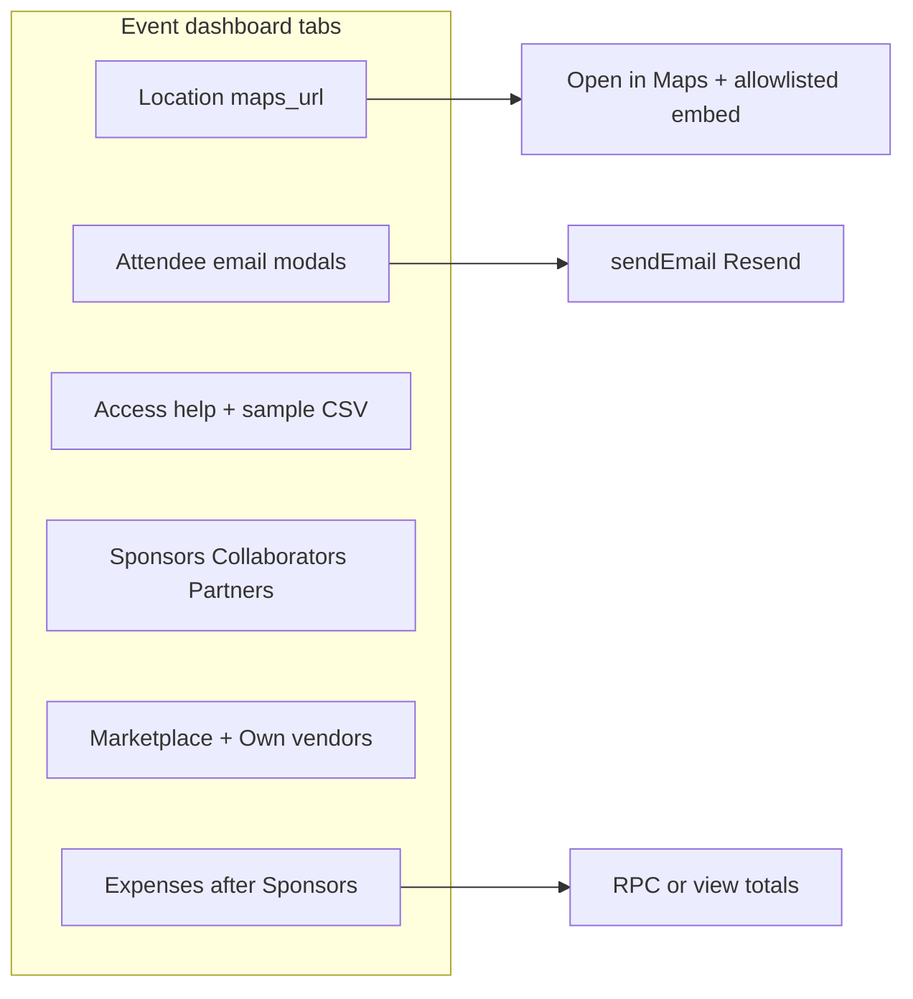

# Phase 4 — Event Tabs: Location, Emails, Access, Sponsors, Vendors, Expenses

This prompt wins over [`docs/11-events-and-hackathon-complete-spec.md`](docs/11-events-and-hackathon-complete-spec.md) (especially Collaborator/Partner). Follow [`docs/ENGINEERING_RULES.md`](docs/ENGINEERING_RULES.md): migrations + types, `safeAction`/zod, `can()` / `assertEventActor`, private receipts bucket, rate limits on bulk email, update `completeContext.md` + doc 11 Part 10 in-session.

## Baseline (code today)

- **Location:** Wizard has venue/address/city/`mapUrl` ([`ScheduleLocationStep.tsx`](src/features/events/components/wizard/steps/ScheduleLocationStep.tsx)); DB has `events.coordinates` jsonb + `map_url` (no lat/lng columns). Overview shows lat/lng text; public page has venue string only — no Open in Maps.
- **Emails:** Inline cards in [`EventEmailPanels.tsx`](src/features/event_attendee/components/EventEmailPanels.tsx) / [`AttendeeClientSide.tsx`](src/features/event_attendee/components/AttendeeClientSide.tsx); send via [`eventEmail.service.tsx`](src/features/event_attendee/eventEmail.service.tsx) → Resend. Tokens exist; no insert menu / live preview / two-button modal flow.
- **Access:** [`AccessSettingsForm`](src/features/access/components/AccessSettingsForm.tsx) + [`GuestListPanel`](src/features/access/components/GuestListPanel.tsx); no “How access works” panel or sample CSV download.
- **Sponsors:** [`OrganizationForm`](src/features/organizations/components/OrganizationForm.tsx) still has collaborator role/track + partner kinds Media/Venue/Community only; doc 11 Part 6 #6 track access is superseded — **remove** that product path.
- **Vendors:** Marketplace bookings only ([`event_venders.services.ts`](src/features/event_vendors/event_venders.services.ts)); no `event_external_vendors`.
- **Expenses:** No event tab; org-scoped `budget_entries` only. Tab order in [`layout.tsx`](src/app/organizer/[organizer_id]/events/[eventId]/layout.tsx): … Vendors → Sponsors → …

---

## 4A Location

**Migration** `supabase/migrations/*_phase4_location_maps.sql`:
- Confirm no `latitude`/`longitude` columns (none today).
- Drop `events.coordinates` after grepping app (update [`event.service.ts`](src/services/event.service.ts), [`event.model.tsx`](src/services/models/event.model.tsx), Overview page).
- Rename `map_url` → `maps_url` (or add `maps_url` + backfill + drop `map_url` — **chosen: rename** so one column).

**App:**
- Remove `coordinates` / lat/lng from `EventFormData`, wizard defaults, Overview Fact rows.
- Wizard Location: Venue, Address, City, Country, “Google Maps link” + hint (copy from Maps share). Validate on save: `https:` only; allow hosts including `maps.google.com`, `www.google.com/maps`, `maps.app.goo.gl`, and any other `https` URL (per prompt).
- Shared helper `src/lib/mapsUrl.ts`: `isValidMapsUrl`, `isGoogleEmbedUrl`, `openInMapsHref`.
- Public + Overview: **Open in Maps** button when `mapsUrl` set; iframe embed **only** when URL is a Google embed form; CSP report-only add `frame-src` for `https://www.google.com` (and maps hosts). Keep OSM wizard preview optional or switch preview to link-only if not Google embed.

---

## 4B Attendee emails

Replace inline email cards with two entry points on Attendees (and keep filters as recipient source):

1. **Email these results** — modal: template kind (`custom` / presets), recipients mode (**team leads / every member** — only if event has teams/groups/hackathon), subject, body + **Insert token** menu, **Include in email** checklist (Team name, Team members, Competition, Event date & venue, Ticket link; hide team-only on solo), live preview (server action returns HTML for sample recipient → sandboxed iframe), count + first 5 emails, confirm → existing `sendBulkAttendeeEmailAction` / refined `safeAction` path through `sendEmail()`.
2. **Registration emails** — modal edits `registration_received` / `registration_confirmed` per event ([`event_email_templates`](src/features/event_attendee/)).

**Free events:** if `is_free` / zero price, hide payment fields in attendee drawer, team card, email blocks, and payment tokens.

**Resend test banner:** when `RESEND_FROM_EMAIL` is the onboard/test sender (env check), show banner: only the account owner’s address can receive mail.

Recipients always resolved server-side from current attendee filters (never trust client recipient lists).

Reuse [`Modal`](src/components/ui/Modal.tsx) 90vh + sticky footer; extract preview render into `eventEmail.service` (sample interpolation).

---

## 4C Access tab help

On [`access/page.tsx`](src/app/organizer/[organizer_id]/events/[eventId]/access/page.tsx):
- Collapsible **How access works** — content authored from doc 11 Access + this prompt’s A6 outline (no prompt-pack file in repo): each access type, whitelist vs invite, statuses, short recipes, troubleshooting.
- Sample box: exact format `email, name, tier` (one per line; name/tier optional; header ignored) with **Copy sample** + **Download sample CSV**.
- Tooltips on every access option; status legend on Guest list (whitelist vs invite-link statuses).

---

## 4D Sponsors / Collaborators / Partners

**Schema migration** (allowlist columns; stop using removed fields in app):
- Collaborator: store contribution in jsonb/extra or new columns `contribution_kind`, `contribution_custom`, `collaboration_terms` (required text). Clear/stop writing `role`, collaborator dashboard-access, track-scoped collaborator fields. Keep optional agenda session links if already modeled (or `extra.session_ids`).
- Partner: expand kinds; new table `partner_types` (`organizer_id`, `label`, `description`, unique `(organizer_id, label)`).
- Sponsor: unchanged (tier, contract value, benefits).
- Remove Part 6 open item #6 from doc 11 (product decision: no collaborator dashboard access — Teams grants in Phase 6).

**UI** [`OrganizationForm.tsx`](src/features/organizations/components/OrganizationForm.tsx):
- Collaborator: contribution combobox (Session, Swag, Venue, Media coverage, Prizes in kind, Speaker, Other+custom) + required Collaboration terms; no role/track/dashboard.
- Partner: Partner type combobox (Media, Venue, Community, Technology, Education, Logistics, Marketing, Hospitality + custom → save `partner_types`) + “What partner types mean” definitions list including customs.

---

## 4E Vendors

**Migration:** `event_external_vendors` (`event_id`, `name`, `vendor_type`, `description`, `budget` numeric nullable, `contact`, `status` planned|confirmed|paid|cancelled, `created_by`, timestamps) + RLS deny-by-default / service-role pattern; indexes on `event_id`.

**UI:** Vendors tab — “Add my own vendor” modal (free all plans). List marketplace bookings + own vendors with **Marketplace / Own** badge. Optional “Create expense from this vendor” → prefill Expenses modal (`external_vendor_id`).

---

## 4F Expenses tab (new, after Sponsors)

**Migration:**
- `events.budget_total numeric(12,2) null`
- `event_expenses`: fields per prompt; FKs to `bookings` / `event_external_vendors` nullable; receipt path in private bucket `expense-receipts` (signed URL ≤5m); indexes `(event_id, status)`, `(event_id, category)`.
- RPC or SQL view `event_expense_totals(event_id)` → budget, spent (expenses − credits), remaining, per-category breakdown — **no client-side total math**.
- Permission: `expenses:manage` checked via `can()` / staff position grants; tab free on all plans (no module gate).

**UI:** New route `.../events/[eventId]/expenses`; nav after Sponsors in [`layout.tsx`](src/app/organizer/[organizer_id]/events/[eventId]/layout.tsx). Summary cards + over-budget warning; filters/search; create/edit/delete modal; xlsx export (reuse existing Excel util). Categories: Vendor, Stationery, Food, Transport, Printing, Venue, Marketing, Other + custom (store custom in row or small `event_expense_categories` — **chosen: free-text category with suggested list**, no extra table unless needed for reuse).

---

## Docs & verification

- Doc 11: new **Part 10 — Event location, emails, access help, orgs, vendors, expenses**; rewrite Sponsors collaborator/partner bullets; clear Part 6 #6.
- [`completeContext.md`](completeContext.md): routes, tables, changelog.
- Archive `plans/2026-10-12-phase4-event-tabs.md` + INDEX.

**Verify:** `typecheck` / `test:unit`; maps button; email modal → Resend; free hides payment; access sample CSV; collaborator has no role; own vendor + expense totals from SQL; Expenses after Sponsors in nav.
