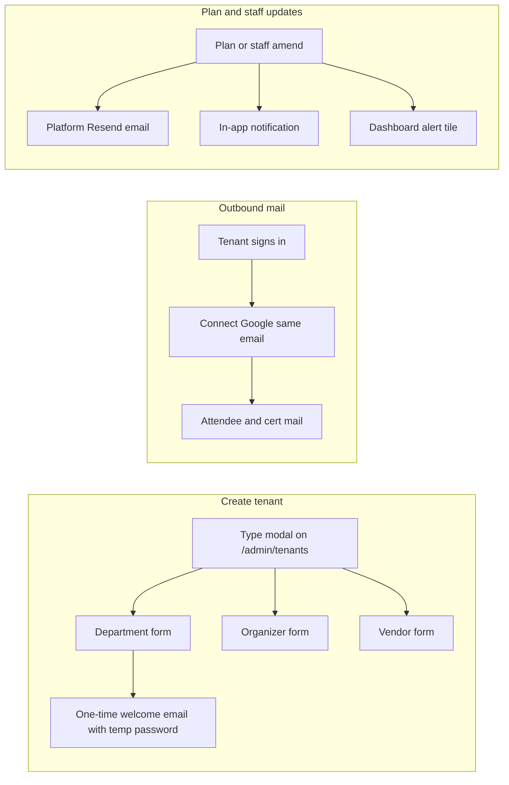

# SaaS owner admin UX overhaul

## Locked decisions

- **Email connect:** Remove Connect/Provision **SMTP** UI and actions everywhere (`OrganizerEmailConnectPanel`, admin organizer detail). Keep **Google connect only**. Tenant-created accounts must connect Google with the **same email** used at create (`login_hint` + callback reject on mismatch). Self-serve accounts connect their own Google freely.
- **Audit logs:** Remove standalone [`/admin/audit`](src/app/admin/audit/page.tsx) from the rail (not a primary owner job). Keep per-entity moderation history on event/organizer/vendor detail pages.
- **Department Verify/Unverify:** Remove that control from [`/admin/departments/[id]`](src/app/admin/departments/[id]/page.tsx). Account/plan status lives under Tenants / linked organizer account.
- **Create path:** Structure-only Add Department/Club on Departments & clubs goes away. All new logins go through **Tenant accounts** (type-specific modal). Clubs are created only by department users in the department app (not by SaaS admin).
- **Self-signup approval:** Organizers and vendors who register themselves start **pending review** (vendors already do; organizers get `review_status: pending` until admin approves). Tenant-created accounts stay auto-approved.

## Architecture (after)

---

## Phase 1 — Admin shell and cards

### Dashboard ([`src/app/admin/page.tsx`](src/app/admin/page.tsx), [`platform.service.ts`](src/features/admin/platform.service.ts))
- Replace **Registrations** metric with **Vendors** (use existing `totals.vendors`).
- Replace “Flagged events” + “Tenant oversight” with **Approvals and alerts**: pending vendors, pending organizers, open support, plan-expiry / plan-change alerts (Phase 2 fills data). Flagged events stay on Events → Flagged tab only.
- Drop the bottom Tenant oversight CTA block (rail already links those areas).

### Nav highlight ([`AdminRail.tsx`](src/shared_components/AdminRail.tsx))
- Treat `/admin/departments/*` and `/admin/clubs/*` as active for **Departments and clubs** (`/admin/orgs`), so Dashboard does not light up on those details.

### Departments and clubs ([`OrgManagementView.tsx`](src/features/teams/components/OrgManagementView.tsx), detail pages)
- Remove **Add Department** and **Add Club** buttons and create modals.
- Card grid: name, type, plan (linked tenant), custom pricing if any, billing cycle, next charge / period end.
- Club detail: personal details **view-only** (already mostly true).
- Department detail: editable **name + plan** only; remove Verify/Unverify and broad profile edits that duplicate organizer dossier.
- **Dual identity fix:** On both `/admin/departments/[id]` and `/admin/organizers/[id]`, show the same linked-account card (user, email, plan, status) so department-as-organizer is one dossier with two entry points, not two different UIs.

### Organizers / vendors lists
- Card view with personal details + plan + status; keep search/filters.
- Pending self-signups surface Approve/Reject on the card.

### Tenants create (modal, not `/admin/tenants/new` as primary)
- On [`/admin/tenants`](src/app/admin/tenants/page.tsx): **Create account** opens a preview modal → pick type → type-specific form (department gets email, phone, name, plan, and existing fields).
- Wire [`createTenantAccount`](src/features/saas/actions/tenants.action.ts); retire or redirect `/admin/tenants/new` to the list + modal.
- **Welcome email (once):** always send temp password + “change ASAP within this timeframe; if unable contact info@aroxes.com”. Persist `welcome_email_sent_at` (or equivalent) so retries do not resend. Update [`PlatformWelcomeEmail`](emails/platform-welcome.tsx) / [`sendTenantInviteEmail`](src/features/email/platformMail.service.ts).

### Feature grant/deny
- Remove free-text **Target org UUID**. Organizer Select + department/club **Select** only ([`tenants/page.tsx`](src/app/admin/tenants/page.tsx)).

### Platform staff ([`AdminForms.tsx`](src/features/admin/components/AdminForms.tsx), [`/admin/admins`](src/app/admin/admins/page.tsx))
- Default: staff **cards** (photo, name, email, access summary). Forms closed.
- **Add staff** (side): step 1 personal details → step 2 access → appears as card.
- Card opens **preview**; **Revoke** opens confirm form from preview.
- Email staff on create / permission change / revoke (Phase 2 shared mail helpers).

### Bank details ([`/admin/settings/billing`](src/app/admin/settings/billing/page.tsx))
- Card(s) for bank account(s) + side **Add bank**.
- **JazzCash** and **EasyPaisa** as separate forms/cards (not fields on the bank form).

### Text-as-buttons
- On all admin surfaces touched in this phase, replace underline/text-only CTAs with `buttonClass` primary/secondary where the control is an action (keep true links for navigation labels only).

---

## Phase 2 — Notifications and email connect

### Google-only connect
- Strip SMTP from [`OrganizerEmailConnectPanel.tsx`](src/features/email/components/OrganizerEmailConnectPanel.tsx) and hide panel provision on admin organizer detail.
- Soft-deprecate SMTP save/provision actions (reject new saves; keep transport fallback for any legacy rows until revoked).
- Google OAuth: `login_hint` = account email; callback rejects if Google email ≠ `users.email` for tenant-provisioned accounts (`provisioned_by` / `must_reset` / `created_via: tenant` flag set at create).

### Plan amendments
- Extend existing `sendPlanChangedEmail` path: also create in-app notification + row for dashboard alerts when plan, custom pricing, or feature grant/deny changes for that tenant type.
- Cron or scheduled check: email accounts **5 days before** plan period end (platform Resend).

### Staff and tenant updates
- Platform mail on staff create/update/revoke and on every tenant plan/pricing amendment (already partial for plan change).

---

## Phase 3 — Signup approval, vendor free limits, taxonomy QA

- Organizer self-signup: default `review_status: pending`; gate dashboard until approved (mirror vendor pending). Tenant-created remain approved.
- Vendor free plan: hard cap **5 services**; block video/portfolio posting; document in plan modules.
- Vendor marketing: new module key (e.g. `vendor_event_marketing`) — available as paid add-on or included on a higher vendor plan in Plans admin (no separate payment product beyond existing plan/modules).
- Taxonomy: focused QA pass on [`CategoryManagementView`](src/features/taxonomy) checklists + custom fields; fix bugs found; add smoke tests if gaps.

---

## Phase 4 — Quotation templates and image pipeline

- **Quotation templates:** mirror certificate template pattern (table + editor + apply to quote PDF) under vendor quotes — substantial new surface; ship after Phase 1–3.
- **Image uploads:** client-side compress (canvas/quality) in [`MediaUpload.tsx`](src/features/media/MediaUpload.tsx) / upload action — accept native dimensions, reduce quality before storage. Apply to admin/organizer/vendor image pickers that use the shared component.

---

## Docs and context (same session as code)

- Update [`completeContext.md`](completeContext.md) Admin routes, email-connect (Google-only), tenant modal, dashboard metrics.
- Update [`docs/TESTING.md`](docs/TESTING.md) owner walkthrough for new create/approval flows.
- Archive this plan to `plans/YYYY-MM-DD-saas-admin-ux-overhaul.md` + [`plans/INDEX.md`](plans/INDEX.md) when work starts.

## Out of implementation order note

Implement **Phase 1 then 2** as the first shippable PR(s). Phases 3–4 follow in the same initiative once shell + mail are stable.