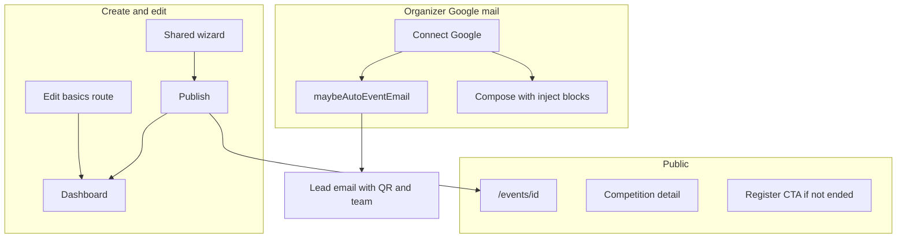

# Organizer event dashboard and create overhaul (B+C)

## Locked decisions

- **Scope:** Full B+C (wizard + dashboard + emails + certificates links + hackathon compete + teams/staff + public pages). Same create/dashboard for organizer, department, and club (existing shared `/organizer/{id}/events/*` paths).
- **Archive:** Soft-hide — set `events.status = archived`; Events list gets an **Archived** filter/tab; Restore returns to `draft` or `published` as before. Keep hard **Delete** separate with confirm.
- **Images:** Standard **4:5** (Instagram portrait) for event banner, gallery stills, and competition images; client compress via existing [`compressImage.ts`](src/features/media/compressImage.ts) (quality reduce, max edge).
- **Timezone UI:** Remove timezone selector from create/edit; store/display in event-local naive schedule as today (PKT parsing already used for lifecycle). Do not invent multi-TZ scheduling in this tranche.
- **Competition type:** Replace kind dropdown with a single **CTF (cyber hackathon)** checkbox per competition; non-CTF competitions are normal tracks without CTF engine.
- **Certificates in email:** Prefer **link** to `/certificate/[code]/download` (and verify); no stored PDF in Storage (already D9). Optional attach stays off by default.
- **Engineering:** Follow [`docs/ENGINEERING_RULES.md`](docs/ENGINEERING_RULES.md) — `safeAction` + zod, `Promise.all` batched reads, no `select('*')`, Google connection required for organizer outbound mail, on-demand certs, parallel SC fetches, update `completeContext.md` each phase.

---

## Phase 1 — Create/edit wizard and dashboard shell

**Primary files:** [`EventWizardLayout.tsx`](src/features/events/components/wizard/EventWizardLayout.tsx), steps under [`wizard/steps/`](src/features/events/components/wizard/steps/), [`DescriptionEditor.tsx`](src/features/events/components/wizard/DescriptionEditor.tsx), [`event.service.ts`](src/services/event.service.ts) `create_event` / `update_event`, [`events/[eventId]/layout.tsx`](src/app/organizer/[organizer_id]/events/[eventId]/layout.tsx), [`events/[eventId]/page.tsx`](src/app/organizer/[organizer_id]/events/[eventId]/page.tsx), [`events/page.tsx`](src/app/organizer/[organizer_id]/events/page.tsx).

- **Rich description:** Fix list/number rendering in editor + public `RichDescription` (proper `ul`/`ol`, text color, highlight). Sanitize on save (S13).
- **Dates:** Validate `endDate >= startDate` (and times on same day); block publish/submit on failure. Remove timezone field from [`ScheduleLocationStep.tsx`](src/features/events/components/wizard/steps/ScheduleLocationStep.tsx) and review copy.
- **Images 4:5:** Update Basic + HackathonTracks upload UI/aspect; enforce aspect crop or letterbox + compress before upload.
- **Hackathon competitions:** CTF checkbox only; wizard gate: at least one named competition required before continue/publish.
- **Free/paid:** Clear free path (no tiers required); paid requires ≥1 active tier when not free. Discount/promo: enforce **one compensation at a time** (no stacking duplicate promo + tier discount on same registration — validate in registration service).
- **Seats:** Checkbox **Unlimited** ↔ `totalSeats = 0`; otherwise positive cap.
- **Custom form fields:** Ensure edit + delete/archive visible and working in wizard and Access RegistrationQuestions (already partial — close gaps).
- **Access at create:** Persist Review-step `AccessTypeSelector` correctly into event access settings on create (public/private/vip/etc.).
- **Post-create edit:** Add `.../events/[eventId]/edit` (reuse wizard steps in edit mode) for title, description, schedule, banner, gallery, seats, free/paid basics — not a second product.
- **Dashboard:** Remove duplicate top thumb **or** hero (keep one: long header media bar; drop Overview square duplicate). Modernize overview cards; parallel `Promise.all` loads in layout/page.
- **Archive:** Organizer Archive action → `archived`; list **Archived** tab; Restore; keep Delete.
- **Page not found:** Audit organizer/dept/club event tab hrefs and staff-grant `notFound()`; prefer redirect to allowed tab or friendly empty; ensure create/detail links from dept/club tables resolve; fix stale Tickets links already redirecting.

---

## Phase 2 — Registration emails, compose inject, edit attendee

**Primary files:** [`eventEmail.service.tsx`](src/features/event_attendee/eventEmail.service.tsx), [`EventEmailPanels.tsx`](src/features/event_attendee/components/EventEmailPanels.tsx), [`emailTypes.ts`](src/features/event_attendee/emailTypes.ts), [`registerAttendee.action.ts`](src/features/registration/actions/registerAttendee.action.ts), [`registrationDecision.action.ts`](src/features/access/actions/registrationDecision.action.ts), attendee drawer.

- Gate all auto/bulk sends on **active Google** connection (already fail-closed); clearer organizer CTA.
- Auto flows stay: free → confirmed + QR/ticket; paid/approval → received then confirmed after pay/approve.
- Team: email **lead** with team members block + QR when includes enabled.
- Compose: checkboxes inject into body live (team details, event details, **QR** as image or ticket deep-link block — add QR CID/data-URL or link block `{{qrCode}}` / ticket URL).
- Bulk email structure: preview → confirm; rateLimit; leads-only option.
- **Edit attendee:** organizer action to update name/email/phone/custom answers (zod + ownership); re-issue ticket/QR email optional.

---

## Phase 3 — Certificates as links + public event/competition pages

- Certificate emails: link-first to download + verify; default no PDF attach ([`emailCertificates.action.ts`](src/features/certificates/actions/emailCertificates.action.ts)).
- Public [`/events/[eventId]`](src/app/events/[eventId]/page.tsx): shareable link, Register only when lifecycle not completed/cancelled and reg window open; hide Register when ended.
- Competition detail on public page + dedicated track detail; registration_closes_at respected; share buttons.
- Parallel fetches on public page; `next/image` 4:5 thumbs.

---

## Phase 4 — Hackathon participant + organizer settings

- Participant compete: Scoreboard (that competition only), Phases/Tasks, Instructions — fix bugs; live scoreboard when setting on ([`compete/page.tsx`](src/app/events/[eventId]/compete/page.tsx)).
- Organizer settings: timers, integrity options per matrix [`docs/hackathon-settings-matrix.md`](docs/hackathon-settings-matrix.md). Hard browser lockdown stays **log + warn** unless a supported API exists — document; do not fake OS-level lock.
- Competition leads / team leads access on `teams_advanced_roles` plan — verify `page_*` + `trackIds` grants.

---

## Phase 5 — Teams / Staff rename + recruitment emails

- Event **Staff** tab label → **Team** (ops team for this event); keep hackathon occupancy tab as **Competitors** or **Hackathon teams** to avoid clash.
- Sync library Teams ↔ event assignments; manage roles/access.
- Recruitment/interview/onboard: emails via **organizer Google** where event-scoped; customize templates like attendee compose; shortlist/onboard sends.

---

## Docs and DoD (every phase)

- Update [`completeContext.md`](completeContext.md) + [`docs/TESTING.md`](docs/TESTING.md) walkthroughs.
- Archive plan to `plans/YYYY-MM-DD-organizer-event-overhaul.md` + INDEX when execution starts.
- Phase DoD: typecheck; no new advisor findings on migrations; auth on every write; loading/empty states.

## Delivery order

Ship **Phase 1 → 2** first (unblocks create/edit and mail). Phases 3–5 follow in the same initiative.