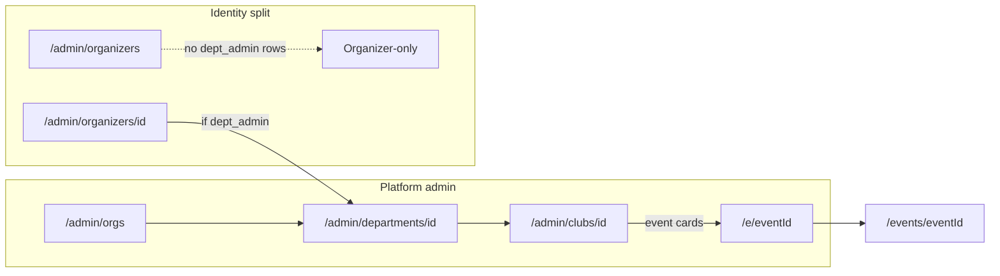

# Admin Departments & clubs + public event rebuild

## Locked decisions

- List URL: keep rail target as `**/admin/orgs**` (existing area key) and add `**/admin/departments` → redirect to `/admin/orgs**` so the requested path works; UI copy says “Departments & clubs”.
- Public page: implement redesign in [`src/app/events/[eventId]/page.tsx`](src/app/events/[eventId]/page.tsx); keep [`/e/[eventId]`](src/app/e/[eventId]/page.tsx) as short redirect preserving query. All admin/dept/club “open event” links use `**/e/[eventId]**`.
- Organizers list: **exclude** users with `org_memberships.role = department_admin` (or department-owned `organizer_profiles.org_id`). Opening `/admin/organizers/[id]` for a department login **redirects** to `/admin/departments/[orgId]`.
- Remove **Outbound email / OrganizerEmailConnectPanel** from SaaS organizer detail entirely (organizer connects Google themselves under `/organizer/.../email`).
- Follow [`docs/ENGINEERING_RULES.md`](docs/ENGINEERING_RULES.md) + Part 2 of [`docs/11-events-and-hackathon-complete-spec.md`](docs/11-events-and-hackathon-complete-spec.md): shared `StatusBadge` / `EventThumb` / `EmptyState` / `DataTable` / `ConfirmDialog` / modals; `Promise.all`; allowlisted DTO; zod + auth on writes.



---

## Phase 1 — Departments & clubs list UI

**Files:** [`OrgManagementView.tsx`](src/features/teams/components/OrgManagementView.tsx), [`admin/orgs/page.tsx`](src/app/admin/orgs/page.tsx), new thin redirect [`admin/departments/page.tsx`](src/app/admin/departments/page.tsx), enrich list service (counts: clubs/events per dept, active/suspended, admin email).

- Replace long banner with one-line subtitle + info tooltip.
- Metric tiles: Departments, Clubs, Active, Suspended.
- Search (name/email) + filter chips (status, plan); keep Hierarchy / Departments / Clubs.
- Hierarchy: collapsible dept cards (default collapsed); avatar/initials; badges; counts; admin email; `⋯` menu (Open, Quick edit modal, Delete ConfirmDialog with typed name + impact counts + moderation audit). Nested club cards when expanded.
- Departments / Clubs tabs: `DataTable` with row → detail.
- Top-right primary **Tenant accounts** button; EmptyState / no-results.

---

## Phase 2 — Department & club detail + identity split

**Department** [`admin/departments/[id]/page.tsx`](src/app/admin/departments/[id]/page.tsx):

- Remove Open dossier and all links to `/admin/organizers/[id]`.
- **Account** card: email, status, plan, created, last active; only Suspend/Reactivate (reason required → moderation log + notify). Confirm impact; optional “Also suspend N clubs” (default off).
- No organizer panels (outbound email, organizer stats, delete organizer). Add moderation history card.
- Keep name/plan edit, read-only profile, clubs cards → club page, events → `/e/[id]` with EventThumb.
- Replace “Current tenure” with **Club tenures** list (club + tenure label or “No tenure yet” → club page).

**Club** [`admin/clubs/[id]/page.tsx`](src/app/admin/clubs/[id]/page.tsx): logo in header, parent dept link, short read-only notice; tenure card (dates, president/execs, history link or empty copy); events → `/e/[id]`.

**Organizers:**

- [`listOrganizers`](src/features/admin/admin.service.ts): exclude department_admin memberships.
- [`admin/organizers/[organizerId]/page.tsx`](src/app/admin/organizers/[organizerId]/page.tsx): if department tenant → redirect to department page; **remove** `OrganizerEmailConnectPanel`.

---

## Phase 3 — Schema + public DTO + access

**Migration** `supabase/migrations/YYYYMMDD_event_public_show_toggles.sql`:

```sql
alter table public.events
  add column if not exists show_sponsors boolean not null default false,
  add column if not exists show_collaborators boolean not null default false,
  add column if not exists show_partners boolean not null default false;
```

Apply via MCP; `npm run types:db`; update [`data/collections`](data/collections.ts) / types.

`**getPublicEventView(eventId, viewer)**` in e.g. [`src/features/events/publicEvent.service.ts`](src/features/events/publicEvent.service.ts):

- Explicit allowlisted DTO (no organizer contact, whitelist, meeting password, access codes, promo codes, bank, attendee/team secrets, tasks/flags, sponsor contract terms).
- Nested selects / one RPC-style shape; parallel secondary fetches if needed.
- Visibility: public published → full DTO; private/invite → title + gate until server-validated code/email/token (rateLimit); draft/archived/unpublished → guest “unavailable”; owner/staff/dept/club → full + **Admin preview** banner + link back.

Wire wizard + Sponsors tab switches: “Show on public page” for sponsors / collaborators / partners.

---

## Phase 4 — Public event page rebuild

Rebuild [`events/[eventId]/page.tsx`](src/app/events/[eventId]/page.tsx) (and shared components under `src/features/events/components/public/`):

- Wide hero + gradient, title, tags, status pill, organizer chip, Share (hero only), Add to calendar (.ics).
- Desktop two-column sticky Register; mobile Register first. No truncation of date/venue.
- Key facts (times+TZ, reg window, venue/maps_url, format without public meeting link/password, seats, admission).
- Register card: tiers + dates; **remove Shareable link**; form from `event_form_fields`; if empty seed/fallback so name/email/phone show; hide “Your details” heading when no fields. Button state matrix (open / opens at / closed / waitlist / sold out / ended / admin preview).
- About (sanitized), gallery lightbox, promo video allowlist.
- Tiers & automatic discounts (never promo codes).
- Agenda timeline + Speakers grid.
- Hackathon Competitions cards (image, type, team size, fee, prizes, rules, dates, sponsor logo if toggled, per-competition Register team).
- Sponsors / collaborators / partners only if toggles on.
- Footer organizer + Report.
- SEO: metadata, OG banner, schema.org Event JSON-LD; `next/image`; loading skeleton; revalidate on event update.

Fix empty form: ensure create/edit seeds system fields; public page if `listActiveFields` empty call `seedDefaultsForEvent` once (or render system defaults from formFields.service).

---

## Phase 5 — QA, tests, docs

- Clear Next.js “Issues” hydration/key warnings on these surfaces (ignore `bis_skin_checked` extension noise).
- Vitest: DTO forbidden fields absent; register button state matrix; private gate; sponsor toggles; department page has no organizer link; organizer URL for dept redirects; admin event links → `/e/[id]`.
- Update [`docs/11-events-and-hackathon-complete-spec.md`](docs/11-events-and-hackathon-complete-spec.md) and [`completeContext.md`](completeContext.md); archive plan to `plans/YYYY-MM-DD-admin-orgs-public-event.md` + INDEX.
- follow proper doc/ENGINEERING_RULES and ARCHITECTURE and audit no code leak or issues

## Delivery order

Phase 1 → 2 (admin identity) first; Phase 3 migration then Phase 4 public page; Phase 5 tests/docs.