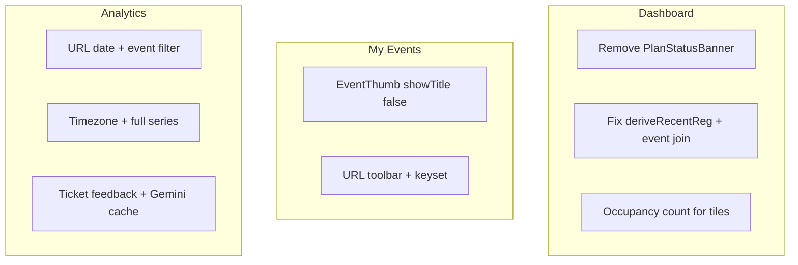

# Organizer Dashboard, My Events, and Analytics cleanup

## Findings to surface (user asked)

**Recent registrations — “Unknown attendee” / no event**

- Hydrate puts contact on `attendee.name` / `attendee.email` ([`hydrateRegistrationRow`](src/services/registeration.service.ts)).
- [`deriveRecentReg`](src/services/anaylService.ts) still reads legacy flat `attendeeName` / `eventName`, which are empty → UI falls back to `"Unknown attendee"` and `"—"`.
- No join to `events.title`; team/group leads are not collapsed to one row.

**My Events — double title**

- One cell renders [`EventThumb`](src/shared_components/ui/EventThumb.tsx) (always shows `title` text) **and** `CellStack.primary` with the same title ([`events/page.tsx`](src/app/organizer/[organizer_id]/events/page.tsx) ~157–176). Fix: add `showTitle={false}` (image-only) on EventThumb when the title is rendered beside it.

**Analytics chart — flat at 0 / axis ends early**

- [`deriveDailyRegistrations`](src/services/anaylService.ts): buckets with UTC `toISOString().slice(0,10)` while the day loop uses local dates (timezone mismatch → missed keys → zeros).
- Downsamples 30 days to 8 points (`step = floor(30/8)`, `slice(0,8)`) so the last plotted day is ~8 days before today while the label still says “Last 30 days”.
- Date range UI is display-only / hardcoded “Last 30 days”, not a filter.

**Feedback / Gemini**

- Ticket page has **no** attendee feedback form; `registrations.feedback_submitted` and `reviews` exist.
- AI today uses `AI_API_KEY` / `AI_URL`, not `GEMINI_API_KEY`. Plan adds `GEMINI_API_KEY` + `GEMINI_MODEL` (server-only) and `feedback_analyses` cache table.

---

## Shared conventions (all three pages)

- Primary CTAs: ink [`buttonClass("primary")`](src/lib/ui.ts) — not indigo `@/components/ui/Button`.
- Registration occupancy = Attendees tab rule: one team/group booking = one registration via existing `occupyingHackathonRegs` / `occupyingGroupRegs` ([`registration.service.ts`](src/features/registration/registration.service.ts)); exclude withdrawn where the tab does.
- Parallel loads: `Promise.all` (or one RPC later); skeletons + designed empty states.
- Update [docs/11-events-and-hackathon-complete-spec.md](docs/11-events-and-hackathon-complete-spec.md) + [completeContext.md](completeContext.md); archive plan under `plans/`.

---

## Phase A — Dashboard ([`dashboard/page.tsx`](src/app/organizer/[organizer_id]/dashboard/page.tsx))

1. **Remove** [`PlanStatusBanner`](src/features/department/components/PlanStatusBanner.tsx) from the dashboard. On [`profile/page.tsx`](src/app/organizer/[organizer_id]/profile/page.tsx): plan name badge, included modules, expiry, grant/deny chips, “Upgrade / Contact support” (reuse plan fetch + feature_overrides; keep existing club banner if still relevant).
2. Header: welcome; Create event + Chat with AI via `buttonClass`.
3. Tiles (one aligned row): Registrations (occupancy count + sub-line “N teams · M people” or “across N active events”); Active events; Revenue; Avg rating as `"—"` / “No reviews yet” when none (never show 0 as a fake rating).
4. Body: Today’s schedule | Upcoming side-by-side with EventThumb; chart titled **Registrations this week** (total + date range, labeled axes, empty state).
5. **Recent registrations** (fix [`anaylService`](src/services/anaylService.ts) + [`RecentRegistrations.tsx`](src/features/dashboard/components/RecentRegistrations.tsx)):
   - Map `attendee.name` / email / form name keys; join `events` for title + banner; never `"Unknown attendee"`.
   - One row per occupying registration (team/group): team name, competition if any, event+thumb, member count, lead, status, amount, time; expandable members; solo = name+email.
   - Row → `/organizer/.../events/{eventId}/attendees?team={id}`; “View all” button (replace Analytics text link); latest 8.
6. Tests: team of 2 → 1 row with 2 members + correct event; no Unknown; tile matches Attendees occupancy; plan banner absent on dashboard / present on Profile.

---

## Phase B — My Events ([`events/page.tsx`](src/app/organizer/[organizer_id]/events/page.tsx))

1. **Double title:** `EventThumb` gains `showTitle?: boolean` (default `true` for existing call sites); list cell uses `showTitle={false}` + title once in CellStack (2-line clamp, not single-line truncate). Test: row title string appears once in rendered markup helper.
2. Header: “My Events”, subtitle `"{live} live · {archived} archived"`; Create via `buttonClass("primary")`.
3. Toolbar (URL): type segmented (All / Events / Hackathons); Status dropdown with counts (0 muted); search; Sort (Newest / Starts soon / Most registrations); List/Grid toggle; chips + Clear all; **server pagination 20/page**.
4. List columns: wide/thumb EventThumb, StatusBadge + Hackathon chip, dates/venue wrapping, Registered `N / capacity` + progress (occupancy), Checked in `x of N`, revenue via money util; Manage + public eye + ⋯ (Duplicate, Archive, Delete with ConfirmDialog; type title if regs > 0).
5. Grid: cards with banner, title, status, date, venue, small regs stat.
6. Bundle service: one list query + one status-count aggregate; no per-row queries; skeletons / empty / no-results.
7. Tests: URL filters round-trip; status counts; title once; team = one reg; delete confirm; archive/restore.

---

## Phase C — Analytics ([`analytics/page.tsx`](src/app/organizer/[organizer_id]/analytics/page.tsx))

1. **Filters (URL):** date presets (7/30/90/This year/All time/Custom), default last 30 days ending today; event = All or one id. Remove duplicate range labels. Export xlsx (tiles + daily series + event table).
2. **Tiles (SQL/service, vs previous period):** Registrations (occupancy + people sub-line); Revenue (paid once per team); Net after costs (bookings confirmed/paid + expenses − credits); Satisfaction `"—"` if none; Events breakdown; Check-in rate. Never fake zeros where data is missing.
3. **Chart fix:** local/event-TZ day keys (not UTC mismatch); full series to today (zero-fill); remove 8-point downsample for ≤90 days (weekly buckets beyond); toggles Registrations / People; stacked top-5 + Other; previous-period dashed line; tooltip; empty state. Series = all organizer events in range.
4. **Event performance table:** thumb+title, type, date, regs, check-in, satisfaction, revenue, real vendor+expense costs, net; sortable; totals; row sets event filter.
5. **Feedback + Gemini:**
   - Minimal post-event feedback form on ticket (rating 1–5, comment, optional tags) → `reviews` + `feedback_submitted`; rate-limit.
   - Dev-only seed script (refuse production) for ~12 sample reviews.
   - Server-only module: `GEMINI_API_KEY` + `GEMINI_MODEL` from env; `responseMimeType: application/json` + schema; zod validate; one retry; strip PII; ignore instructions in comments; cache in new `feedback_analyses`; Refresh ≤5/day/organizer; need ≥3 comments.
   - Fallback without key/API: rating distribution / avg / word counts; page never breaks.
   - UI: donut, bars, themes, strengths/problems, actions, comments table; “Generated by AI from N responses”.
6. Tests: tiles match Attendees/Overview rules; chart sum = tile; filters move numbers; Gemini validation, injection resistance, cache hit, no-key fallback, PII stripped.

---

## Primary files

- Dashboard: [`dashboard/page.tsx`](src/app/organizer/[organizer_id]/dashboard/page.tsx), [`anaylService.ts`](src/services/anaylService.ts), [`RecentRegistrations.tsx`](src/features/dashboard/components/RecentRegistrations.tsx), [`profile/page.tsx`](src/app/organizer/[organizer_id]/profile/page.tsx)
- Events: [`events/page.tsx`](src/app/organizer/[organizer_id]/events/page.tsx), [`EventThumb.tsx`](src/shared_components/ui/EventThumb.tsx), new `organizerEvents.filters.ts` / list service
- Analytics: [`analytics/page.tsx`](src/app/organizer/[organizer_id]/analytics/page.tsx), [`anaylService.ts`](src/services/anaylService.ts), ticket feedback action, [`ai.service.ts`](src/services/ai.service.ts) / new gemini module, migration `feedback_analyses`

## Delivery order

A (dashboard data bugs + banner) → B (events double title + toolbar) → C (analytics chart + Gemini).
