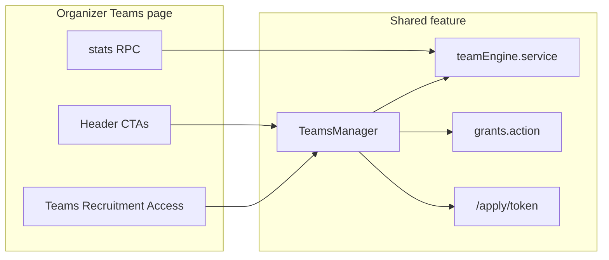

# Organizer Teams tabbed manager

## Canonical naming (decision)

- Event dashboard tab label: **Team** everywhere (UI already uses this; update [`docs/11`](docs/11-events-and-hackathon-complete-spec.md) `### Staff` → `### Team`).
- Keep href `/staff` and export kind `staff` (ACL/`TAB_PERMISSION` / grants stay stable; no route mass-rename).
- Left-rail stays **Teams** → `/organizer/{id}/teams`.
- Hackathon **Competitors** (`/teams`) untouched — not ops library.
- There is no `docs/12*`; Phase 6 source of truth is [`plans/2026-10-12-phase6-teams.md`](plans/2026-10-12-phase6-teams.md) + docs/11 Team section.

## Scope

Primary rebuild: organizer page [`src/app/organizer/[organizer_id]/teams/page.tsx`](src/app/organizer/[organizer_id]/teams/page.tsx) + shared [`TeamsManager`](src/features/teams/components/TeamsManager.tsx).

Event [`.../staff/page.tsx`](src/app/organizer/[organizer_id]/events/[eventId]/staff/page.tsx) keeps assign-library + event-scoped recruitment; it consumes the same modals/actions/types after the rename/cleanup (no second manager). Club/dept callers keep working via `scope.kind`.

---

## Plan gating

Server + page: `hasModuleAccess(organizerId, 'teams_basic' | 'teams_advanced_roles')` before every advanced action (already on grants/staffAdvanced — harden uniformly).

- **Basic:** Teams tab fully usable (CRUD, one lead, export). Recruitment + Access tabs render [`LockedModulePanel`](src/features/permissions/components/LockedModulePanel.tsx) (short copy + upgrade CTA). Stats that need advanced show `"—"`.
- **Paid:** all three tabs; positions, interview schedule, grant access.

URL: `?tab=teams|recruitment|access` (+ `q`, `team`, `role`, `access`, `page`). Basic deep-link to paid tab → locked panel (not redirect-away).

---

## A. Layout

Replace permanent Create card + header “Recruitment” / “Grant access” buttons with:

1. Header: title **Teams**, one-line subtitle; CTAs ink `buttonClass`: **Add team** (primary), **Add member**, **Export**.
2. Stats row from **one RPC** `organizer_teams_stats(organizer_id)` → Teams, Members, Leads with access, Open recruitment forms, New applicants (7d), In interview, Pending access invites. Advanced-only counts → `"—"` on Basic.
3. Tabs: Teams | Recruitment | Access; search/filters/pagination in URL; `Suspense` + `loading.tsx` + designed [`EmptyState`](src/shared_components/ui/EmptyState.tsx).

---

## B. Teams tab

Rebuild list from accordion-only into cards/rows: name, lead (avatar/name/email|phone), member count, events assigned (`event_staff_assignments` count), access count, status. Click → side drawer (preferred) or in-place expand: members table (avatar, name, role Lead/Member/position, email, phone, access status None|Invited|Active|Revoked, joined); actions Edit / Remove / Make lead / Grant access (paid). Drawer header: Edit team, Add member, Export team, Delete team.

**Modals** (Part 2: Modal, labeled fields, black primary — no permanent forms):

| Modal | Steps / fields |
| --- | --- |
| Add team | (1) name, description, type → (2) lead name/email/phone/designation/notes + “Lead is me” → (3) optional members → (4) Preview → Create. Paid toggle “Invite lead to dashboard” continues into Access step. |
| Edit team / Edit member | Same contact fields; position when paid. Lead change demotes previous lead (exactly one). |
| Add member | Team dropdown (required; preselect from drawer), contact, role, position (paid), preview. zod email/phone; block duplicate email per team (DB unique already on form applicants; add/enforce member uniqueness). |
| Delete | [`ConfirmDialog`](src/shared_components/ui/ConfirmDialog.tsx) with impact (events using team, members, active grants). Revoke active access before delete; never delete Auth accounts. |

Wire orphaned [`TeamRosterView`](src/features/teams/components/TeamRosterView.tsx) logic into drawer/actions; stop aliasing “Add member” to “Add team”.

**Schema (add only where needed):** prefer `teams.extra` / `team_members.extra` for `description`, `type`, `designation`, `notes` unless filtering requires columns. Add unique index `(team_id, lower(btrim(email)))` on `team_members` where email present. Indexes: `team_members(team_id, email)`, `applicants(form_id, status)`, `access_grants(grantee_user_id)` / active partial — create if missing.

---

## C. Recruitment tab (paid)

Lift organizer-scoped recruitment out of event-only [`StaffRecruitmentSection`](src/features/teams/components/StaffRecruitmentSection.tsx):

- Forms list: title, target team/position, Open/Closed [`StatusBadge`](src/shared_components/ui/StatusBadge.tsx), applicant counts, copy link + QR, closing date; Edit / Preview / Duplicate / Close / Delete.
- **New form:** reuse wizard [`FormBuilder`](src/features/events/components/wizard/FormBuilder.tsx) + Preview toggle + [`CustomFieldsRenderer`](src/features/registration/forms/CustomFieldsRenderer.tsx) — no second builder. Settings: title, intro, target team/position, closing date, cap, open switch. Publish → `/apply/[token]` (≥128-bit token, rate-limited, honeypot; closed → polite message; files → private bucket). Existing [`apply/[token]`](src/app/apply/[token]/page.tsx) + apply actions.
- Applicants: DataTable + Kanban toggle. Statuses: Applied, Shortlisted, Interview scheduled, **Onboarded** (map DB `accepted` → UI “Onboarded”), Rejected, **Withdrawn** (add status to check + types). Drawer: answers from field defs, timeline, private notes; Shortlist/Reject; Schedule interview (timestamptz + tz, link/location in `extra` or columns, notes) → email via organizer connection; Onboard → create member from answers → optional Grant access.
- Unique `(form_id, lower(btrim(email)))` already exists — keep and test.

Rename UI strings from Staff* to Team* where user-facing; keep file names if rename churn is high (or rename in a follow-up pass).

---

## D. Access tab (paid)

New list (not invite-modal-only): Invited / Active / Expired / Revoked, team, scope, permissions summary, last active; Edit / Resend / Revoke.

**Grant access modal:** member picker or typed email → scope (all organizer events | selected events) → presets aligned to product copy (extend [`PERMISSION_PRESETS`](src/lib/permissions.ts): Registration lead, Marketing lead, Check-in desk, Viewer + keep useful existing) + custom checkboxes from `PERMISSION_GROUPS` → optional expiry → Preview → Send.

Writes `access_grants` + invite token **hashed at rest** (add `invite_token_hash` / `invite_sent_at` columns if missing). Every tab/action: `can(user, permission, scope)`. Revoke immediate. Audit grant/edit/revoke.

**Temp password option** (already sketched in [`GrantInviteModal`](src/features/teams/components/GrantInviteModal.tsx)): show once to organizer, force change at first login, never email/log/store plaintext.

---

## E. Email

Add thin server helper `requireConnectedSender(organizerId)` in [`organizerTransport.service.ts`](src/features/email/organizerTransport.service.ts) that returns the active connection or `{ ok:false, code:'NO_CONNECTION' }` — wraps existing `sendViaOrganizerConnection` fail-closed path (no platform Resend for these).

Rules for interview invite, access invite, resend:

- Recipients only from applicant / member / typed grant email (no free list).
- One send per recipient; escape HTML; plaintext part; `email_log` with `organizer_id`.
- Not connected: disable Send; Copy link / copy message / `.ics` for interviews; “Connect your email…” prompt.
- **Never email a password** (docs/16 + ENGINEERING_RULES S11).

---

## F. Export

Extend [`ExportTeamsModal`](src/features/teams/components/ExportTeamsModal.tsx) / [`exportTeams.action.ts`](src/features/teams/actions/exportTeams.action.ts):

- Scope: all teams (Team column), selected teams, one form’s applicants.
- Column picker: contact, position, access status, joined, recruitment answers.
- Format xlsx | csv via existing `deliverWorkbook` / sheet util.
- Lead present on every member row.

---

## G. Security / performance / tests / docs

- zod + ownership + plan + `can()` on every action; RLS unchanged/deny-default; rate limits on public apply + invite; no tokens/PII in logs.
- Page load: stats RPC + parallel team/member/assignment/grant/applicant fetches; server pagination; skeletons/empty.
- Tests (vitest): add-team requires lead + preview; one lead; duplicate member/applicant; server plan gating; apply rate limit + closed; onboard creates member; invites use organizer account not platform / never password; revoke blocks; export columns.
- Update docs/11 (Team section + Part 3A-style organizer Teams home note), [`completeContext.md`](completeContext.md), archive plan under `plans/YYYY-MM-DD-organizer-teams-rebuild.md` + INDEX.

---

## Primary files to change

- Page: [`teams/page.tsx`](src/app/organizer/[organizer_id]/teams/page.tsx)
- UI shell: [`TeamsManager.tsx`](src/features/teams/components/TeamsManager.tsx) → tabbed; new tab components under `src/features/teams/components/`
- Service/actions: [`teamEngine.service.ts`](src/features/teams/teamEngine.service.ts), [`teamEngine.action.ts`](src/features/teams/actions/teamEngine.action.ts), [`staffAdvanced.action.ts`](src/features/teams/actions/staffAdvanced.action.ts), [`grants.action.ts`](src/features/teams/actions/grants.action.ts), [`exportTeams.action.ts`](src/features/teams/actions/exportTeams.action.ts)
- Email: [`recruitmentEmail.ts`](src/features/teams/recruitmentEmail.ts), [`organizerTransport.service.ts`](src/features/email/organizerTransport.service.ts)
- Permissions: [`permissions.ts`](src/lib/permissions.ts), [`grants.service.ts`](src/features/permissions/grants.service.ts)
- Migration: stats RPC + indexes + applicant `withdrawn` + grant invite hash columns as needed
- Docs: docs/11, completeContext, plans archive

## Delivery order

1. Naming + stats RPC + page shell/tabs/URL filters  
2. Teams tab (drawer + Add/Edit/Delete modals + lead invariant)  
3. Recruitment tab (organizer-scoped forms/applicants + interview/onboard)  
4. Access tab (list + Grant modal + hashed invites + audit)  
5. Email helper + export picker  
6. Tests + docs/11 + completeContext + plan archive  
