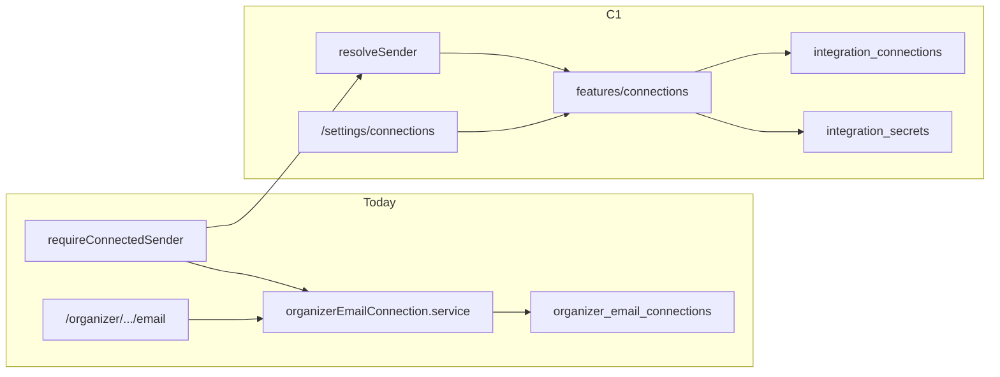

---
name: Connections C1 Foundation
overview: "Implement docs/17 C1: a new `src/features/connections` module with schema, OAuth+PKCE, encrypted tokens, Gmail send, organizer Connections UI, and migration off `organizer_email_connections` so no other feature calls Google directly."
todos:
  - id: c1-schema
    content: Migration integration_* + email_log.connection_id + outbox stub + org kill flag; types; TABLES; data backfill from organizer_email_connections
    status: completed
  - id: c1-tokens-catalog
    content: env aliases + tokens.service AES-GCM + rotation script + catalog.ts (email.send only active)
    status: completed
  - id: c1-oauth-google
    content: OAuth start/callback PKCE + GoogleProvider Gmail send/error mapping + server services
    status: completed
  - id: c1-ui
    content: ConnectionsPage/cards/dialog/rows + organizer settings route + checklist + NeedsConnection + /email redirect
    status: completed
  - id: c1-migrate-send
    content: resolveSender + rewire requireConnectedSender/call sites; admin read-only + reconnect; kill switches
    status: completed
  - id: c1-tests-docs
    content: Unit/SQL tests; completeContext + docs/17 C1 note + plans archive
    status: in_progress
isProject: false
---

# Connections C1 foundation (docs/17)

## Scope lock

**In:** Sections 2, 4, 5.1–5.4, 6, 9, 10 as listed in the C1 prompt; migrate live table [`organizer_email_connections`](supabase/migrations/20261018120000_organizer_email_connections.sql) (there is no `email_accounts` table); organizer Settings → Connections; dashboard checklist + `NeedsConnection`; `requireConnectedSender` → `resolveSender` (personal default only); kill switches; unit/SQL tests.

**Out (C2+):** Org grants UI / full sender picker, vendor/dept mounts, Calendar/Meet/Drive/Picker, docs/18 batch scheduling UI. Schema may include `connection_grants` / stub `email_outbox` columns so C2/C18 do not re-migrate core FKs.

## Current → target

## 1. Module skeleton + routes

Create [`src/features/connections/`](src/features/connections/) per docs/17 §4:

- `catalog.ts`, `types.ts`
- `providers/provider.ts`, `providers/google/{oauth,email,errors}.ts` (calendar/drive stubs only)
- `server/{oauth,tokens,connections,sender,quota,audit}.service.ts` — all `"server-only"`
- `actions/*.action.ts` — connect/disconnect/reconnect/test/setDefault/dismissChecklist
- `components/` — ConnectionsPage, IntegrationCard, ConnectDialog, ConnectionRow, NeedsConnection, PermissionList, checklist card
- Routes:
  - [`src/app/api/connections/[provider]/start/route.ts`](src/app/api/connections/[provider]/start/route.ts)
  - [`src/app/api/connections/[provider]/callback/route.ts`](src/app/api/connections/[provider]/callback/route.ts)
  - [`src/app/organizer/[organizer_id]/settings/connections/page.tsx`](src/app/organizer/[organizer_id]/settings/connections/page.tsx)
- Redirect [`/organizer/[id]/email`](src/app/organizer/[organizer_id]/email/page.tsx) → settings/connections; update profile “Outbound email” link and rail/nav.
- Deprecate/thin [`organizerEmailConnection.service.ts`](src/features/email/organizerEmailConnection.service.ts) / [`organizerTransport.service.ts`](src/features/email/organizerTransport.service.ts) to call connections (no direct Google from email feature).

## 2. Migration + types

New migration e.g. `supabase/migrations/20261101200000_connections_c1.sql`:

- Tables from §9: `integration_connections`, `integration_secrets`, `integration_capabilities`, `sender_preferences`, `connection_usage`, `oauth_states`, `connection_audit` (+ `connection_grants` empty for C2).
- Minimal `email_outbox` (`id`, `connection_id`, `status`, `paused`, `payload`, `not_before`, …) so invalid_grant can pause the queue; full batch fields stay for docs/18.
- `email_log.connection_id` nullable FK.
- RLS: owners read own/org memberships; **zero** grants on `integration_secrets` for `anon`/`authenticated`; writes via service role only.
- Indexes on every FK and `(owner_type, owner_id)`.
- Data migrate: Google rows from `organizer_email_connections` → connection + capability `email.send` + secret (`key_version=1`); SMTP-only rows → `needs_reconnect` (no silent SMTP keep — docs/17 drops SMTP).
- Keep old table temporarily as read-only backup or drop after backfill in same migration with a commented scream window — prefer **backfill then leave old table**, follow-up drop in a later migration after verify.
- `TABLES` in [`data/collections.ts`](data/collections.ts); `npm run types:db`.

Tenant kill switch: `organizations.connections_google_disabled` + reason/audit, or `site_settings`/tenant flags table — use **`organizations.connections_google_disabled boolean default false`** + audited updates.

## 3. Env + tokens.service

[`src/env.ts`](src/env.ts) / [`.env.example`](.env.example):

- `CONNECTIONS_ENCRYPTION_KEY` (required for connect; ≥16)
- `CONNECTIONS_GOOGLE_ENABLED` (`true`/`false`, default treat missing as `true` when OAuth configured)
- `GOOGLE_OAUTH_CLIENT_ID`, `GOOGLE_OAUTH_CLIENT_SECRET`, `GOOGLE_OAUTH_REDIRECT_URI`
- **One-step alias:** if new names unset, fall back to `EMAIL_CONNECTION_SECRET` / `GOOGLE_CLIENT_*` / `GOOGLE_REDIRECT_URI` so existing Vercel envs keep working.

[`tokens.service.ts`](src/features/connections/server/tokens.service.ts): AES-256-GCM, versioned key material, in-memory access-token cache (short TTL), health check, [`scripts/rotate-connections-key.mjs`](scripts/rotate-connections-key.mjs) for re-encrypt.

## 4. Catalog

[`catalog.ts`](src/features/connections/catalog.ts): five cards from §3; only `email.send` `active: true` this phase; scopes/tier/gates; plain-language allows + “never” copy.

## 5–6. OAuth + GoogleProvider

- Start: one-time `oauth_states` (hashed state, encrypted PKCE verifier, user, owner, capability, same-origin `returnTo`, 10m expiry).
- Google URL: `openid email` + capability scopes, `include_granted_scopes`, `access_type=offline`, `prompt=select_account consent`.
- Callback: single-use state, PKCE exchange, ID token verify (iss/aud/exp/email_verified), **granted vs required scopes**, `access_denied` / admin-block mapping → `blocked_by_admin`, key by `sub`, upsert unique `(owner_type, owner_id, provider, provider_account_id)`.
- Gmail: `users.messages.send`, RFC822 UTF-8 multipart, Reply-To; `invalid_grant` → `needs_reconnect` + pause outbox for that connection; `429` → backoff/reschedule.

## 7. UI

- Shared `ConnectionsPage({ ownerType, ownerId })` for organizer user scope.
- Cards, dialog, rows, badges, disconnect (Google revoke + delete secret), reconnect, test-to-self, quota remaining.
- Dashboard dismissible checklist (local preference or `user_preferences`/settings jsonb).
- `NeedsConnection` for gated email UIs (reuse/replace `EmailConnectionRequiredBanner` patterns).

## 8. Sender + call sites + admin

- `resolveSender({ actor, … })` C1: actor’s active `email.send` connection only (steps 2 of §6); else block.
- `requireConnectedSender(organizerId)` becomes thin wrapper around `resolveSender`.
- Wire send paths ([`eventEmail.service.tsx`](src/features/event_attendee/eventEmail.service.tsx), certificates, guests, recruitment, grants) through connections send; stamp `email_log.connection_id` where platform/org logging applies for organizer sends if they start logging.
- Admin organizer page: **read-only** connection status + “Send reconnect link” (tokenized link, no secrets); support never selects secrets.

## 9. Kill switches

- Global: `CONNECTIONS_GOOGLE_ENABLED=false` blocks start + send (audited attempt).
- Per-tenant: `organizations.connections_google_disabled` + reason; audited; send/connect fail closed.

## 10. Tests

Under `src/features/connections/__tests__/`: PKCE/state, scope untick rejection, encrypt round-trip, quota overflow, disconnect revoke+secret delete. SQL smoke: secrets not grantable to authenticated. Migration assert: sample Google row preserves provider_email/sub. Wire into `npm run test:unit`.

## Docs / context

- Update [`completeContext.md`](completeContext.md) email/connections sections + change log.
- Mark C1 progress in [`docs/17-connections-system.md`](docs/17-connections-system.md); archive plan to `plans/2026-11-01-connections-c1-foundation.md` + INDEX when shipping.

## Implementation order

1. Migration + types + TABLES + env aliases  
2. tokens + catalog + providers (oauth/email/errors)  
3. oauth/connections/sender/quota/audit services + API routes  
4. Actions + UI + organizer mount/redirect + dashboard checklist  
5. Retarget requireConnectedSender / transport call sites  
6. Admin read-only + reconnect link  
7. Tests + completeContext + plans archive  

