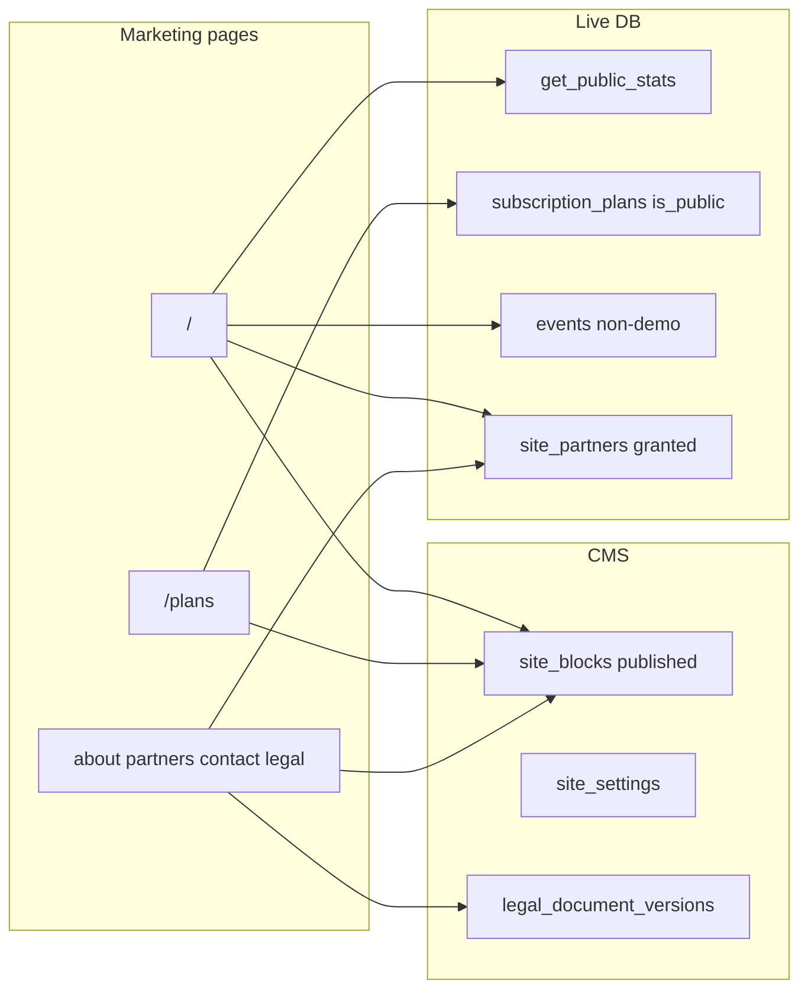

# Marketing public pages (W2)

Builds on W1 ([`plans/2026-11-01-marketing-website-foundation.md`](plans/2026-11-01-marketing-website-foundation.md)). Replace hardcoded home + [`MarketingStub`](src/app/(marketing)/_components/MarketingStub.tsx) pages with CMS + live DB reads. Do **not** invent stats, customers, logos, or testimonials—hide empty sections.

## Locked decisions

- **Captcha:** Cloudflare Turnstile (`TURNSTILE_SECRET_KEY` server + `NEXT_PUBLIC_TURNSTILE_SITE_KEY`). Skip widget render when keys unset in local/dev; still enforce honeypot + rate limit. Add Turnstile host to CSP `script-src` / `frame-src` in [`next.config.ts`](next.config.ts).
- **Featured events:** add `events.website_featured boolean not null default false` (indexed partial). Sort upcoming marketing list: featured first, then start date. Admin Plans-display-style toggle can wait for W3; seed leaves all false.
- **Plan display seed:** set organizer `free` + `pro` (or current paid key) `is_public=true`; one `is_recommended=true`; leave vendor plans private. Fill tagline/highlights/billing_note from §7-aligned short copy only (no fake prices beyond existing DB prices).
- **Email limits in comparison table:** read from `subscription_plans` jsonb/`extra` or dedicated columns if present; if missing, show module checks only and a single billing-note line (do not invent cap numbers). Prefer adding nullable `email_daily_cap` / `email_monthly_cap` on plans in the same migration if columns do not exist yet, seeded null until admin sets them.
- **Analytics:** cookieless path—no GA/cookie banner in W2.

---

## 1. Seed (§7 blocks + §8 legal + stats settings)

Migration/script `supabase/migrations/YYYYMMDDHHMMSS_marketing_w2_seed.sql` (apply via MCP + local file):

- Upsert published `site_pages`: `home`, `about`, `partners`, `contact` (+ seo jsonb titles/descriptions from §7/§3, no invented claims).
- Insert ordered `site_blocks` for **home** from §7: hero (headline/sub/CTAs), stats_strip (keys only), feature_grid (six tiles + §7 lines), steps (four), audience_tabs (copy-only roles), pricing_teaser (config: show recommended), faq (§7 questions/answers short), cta. Logo wall / testimonials / event_showcase blocks present but empty or “live” mode flags so renderers hide until data exists.
- About/partners/contact: rich_text / timeline / contact_info blocks with §3 Aroxes/Distroline wording only (no fake team photos).
- Seed `site_stats_settings` rows for each `get_public_stats` key with labels + sensible `min_threshold` (e.g. hide until ≥1 or ≥3—thresholds only, not inflated numbers).
- Seed `legal_documents` + first `legal_document_versions` from §8 outlines (keep `[brackets]` placeholders); set `current_version_id`.
- Update plan display columns as above; `revalidate` tags not needed in SQL.

Optional: `scripts/seed-marketing-cms.mjs` for idempotent re-seed in non-prod.

---

## 2. Live data services ([`src/features/website/`](src/features/website/))

| Helper | Behavior |
| --- | --- |
| `getStatsStrip()` | `getPublicStats()` + `site_stats_settings`; drop keys below `min_threshold` or `visible=false` |
| `listPublicPlans()` | `is_public AND is_active`, order `sort_order`; tag `site:plans` |
| `getModuleComparison()` | `module_catalog` × plan `included_modules` (+ email caps columns) |
| `listMarketingEvents()` | upcoming public/hybrid, `is_demo=false`, banner, `website_featured` desc, limit ~6; tag `site:events` |
| `listGrantedPartners(category?)` | `consent_status=granted AND visible` |
| `getLegalDocument(slug)` | current version + title/effective/published dates |
| `submitContactMessage` | see §4 |

Enhance renderers:

- **StatsStrip:** consume live `getStatsStrip()` (not static CMS numbers).
- **LogoWall / Testimonials:** load partners / consented testimonials when block visible; return null if empty.
- **EventShowcase:** live `listMarketingEvents` + `EventCard`/`next/image`.
- **PricingTeaser:** live `listPublicPlans`, emphasize `is_recommended`.

Shared page composer: `renderMarketingPage(slug)` → published blocks via [`BlockRenderer`](src/features/website/components/BlockRenderer.tsx) with live context props.

Wire [`revalidateTag`](src/features/website/cacheTags.ts): extend `publishPage`; on SaaS plan display updates ([`src/features/saas`](src/features/saas) / admin plans actions) call `revalidateTag('site:plans')` + `site:all` so `/plans` and home teaser refresh within seconds.

---

## 3. Public routes

Replace stubs under [`src/app/(marketing)/`](src/app/(marketing)/):

| Route | Implementation |
| --- | --- |
| `/` | Dark hero + ordered CMS blocks; live stats/events/plans/partners; `prefers-reduced-motion` friendly fades |
| `/plans` | Plan cards + comparison table + enterprise → `/contact?topic=enterprise&plan=` + pricing FAQ from `site_faqs` scope `plans` or CMS faq block + billing note |
| `/about` `/partners` | CMS blocks; partners page groups by category, hide empty groups |
| `/contact` | Contact info from settings/block + client form |
| `/privacy` `/terms` | Legal markdown → sanitized HTML + TOC + version/last updated; print-friendly CSS |

Also:

- [`src/app/sitemap.ts`](src/app/sitemap.ts), [`src/app/robots.ts`](src/app/robots.ts) (allow marketing; disallow app prefixes).
- Marketing-styled [`not-found.tsx`](src/app/not-found.tsx) or `(marketing)/not-found.tsx`.
- `generateMetadata` per page from `site_pages.seo` + defaults; canonical; OG/Twitter.
- JSON-LD: Organization + SoftwareApplication on home; FAQPage when FAQ present; Legal nowhere personal.

Design: reuse `.marketing-shell` / §2 tokens; primary ink buttons; mobile-first; Lucide icons; `next/image` for banners/logos.

---

## 4. Contact form (security)

- Action: `src/features/website/actions/contact.action.ts` — zod name/email/topic/message; strip `\r\n` from headers; honeypot field must be empty; `rateLimit` per IP hash; verify Turnstile server-side when secret set; store `contact_messages` with `ip_hash` (no raw IP); `spam_score` optional.
- Email: `sendPlatformEmail` lane `notifications` → `info@aroxes.com`, **Reply-To** visitor; never From visitor. Optional short auto-reply to visitor after successful send.
- Client: labeled fields, success/error states; Turnstile widget when site key present.

---

## 5. Tests

Unit (wire into `test:unit`):

- Stats thresholds hide below min.
- Plan sort + recommended badge selection.
- Empty partners/testimonials/events → section null.
- Contact: honeypot reject, rate limit, header injection stripped; metadata helper returns title/description.
- Pure legal TOC extraction from markdown headings.

SQL smoke optional: granted partners readable; pending not.

---

## 6. Docs

Update [`completeContext.md`](completeContext.md) Public/marketing routes; note W2 in [`docs/19`](docs/19-marketing-website.md); archive `plans/YYYY-MM-DD-marketing-public-pages.md` + INDEX.

## Out of scope (W3+)

Full `/admin/website` editors, media library WebP pipeline, organizer partner opt-in UI, community/insights tabs, cookie policy / GA.