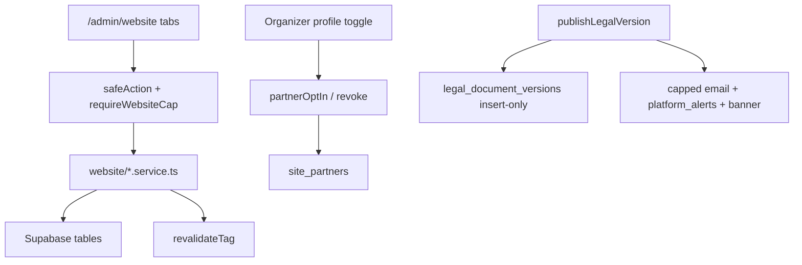

# W3: Owner dashboard CMS (`/admin/website`)

## Scope lock

- **In:** Pages, Plans display, Partners (+ organizer opt-in), Stats, Legal, FAQ+testimonials, Contact inbox, Navigation/footer/banner, SEO, Media library, sanitization, tests.
- **Out (W4):** Community list/export and Insights aggregates — keep existing EmptyState + `w3Hint` (update hint to “W4”) on those two tabs only.
- **Reuse:** [`Modal`](src/components/ui/Modal.tsx), [`ConfirmDialog`](src/shared_components/ui/ConfirmDialog.tsx), [`DataTable`](src/shared_components/ui/DataTable.tsx), [`FileUploadField`](src/shared_components/ui/FileUploadField.tsx), [`StatusBadge`](src/shared_components/ui/StatusBadge.tsx), [`EmptyState`](src/shared_components/ui/EmptyState.tsx); caps in [`WEBSITE_CAPS`](src/features/admin/types.ts); [`saveDraftBlock` / `publishPage`](src/features/website/siteContent.service.ts); [`sanitizeLegalMarkdown`](src/features/website/legalMarkdown.ts); [`logModeration`](src/features/admin/actions/moderation.ts).

## Architecture

Cap gates on actions (not only page view):

| Area | Cap |
|---|---|
| Draft edits (pages, plans flags, partners CRUD, stats, nav, seo, faq, media) | `website:edit` |
| Publish page / restore revision | `website:publish` |
| Legal publish + notify | `legal:publish` |
| Contact inbox | `contact:manage` |
| Page shell | `website:view` |

## 1. Schema delta (small migration)

Add [`supabase/migrations/20261101170000_marketing_w3_cms.sql`](supabase/migrations/20261101170000_marketing_w3_cms.sql):

- `site_media.tags text[] not null default '{}'`
- `site_settings` key `stats` jsonb `{ "refreshSeconds": number }` (refresh rate; per-stat rows stay in `site_stats_settings`)
- No change to legal immutability triggers (already present)

Regenerate types (`npm run types:db`).

## 2. Pages CMS

Replace empty `AdminBlockEditor` mount with a real page workspace under [`src/features/website/components/`](src/features/website/components/):

- **`PagesCmsPanel`** (server): load `site_pages` + blocks; client **`PageBlockList`**: reorder (sort ±1 / drag-free up-down buttons), show/hide, select block → **`AdminBlockEditor`** bound to `saveDraftBlockAction`.
- Add/remove block actions (insert typed draft, soft-hide or delete with ConfirmDialog).
- Draft vs published indicator; **Publish** → existing `publishPageAction` + ConfirmDialog.
- **Revisions** drawer/Modal: list `site_revisions` for page; **Restore** → new `restorePageRevision` in [`siteContent.service.ts`](src/features/website/siteContent.service.ts) that applies snapshot into **draft** fields (and sort/visible), leaves published until re-publish; `restorePageRevisionAction` gated by `website:publish`; audit log.

Extend [`website.action.ts`](src/features/website/actions/website.action.ts) for reorder, create/delete block, restore.

## 3. Plans / Stats / Nav / SEO tabs

New audited actions + thin panels (forms, not free JSON where avoidable):

- **Plans display** — update only display cols on `subscription_plans`: `is_public`, `is_recommended`, `badge_text`, `tagline`, `highlight_features`, `cta_label`, `cta_href`, `sort_order`. Never touch prices/modules. Revalidate `SITE_PLANS` + `SITE_ALL` (same as SaaS plans action).
- **Stats** — edit `site_stats_settings` (label, visible, min_threshold, format) + `site_settings.stats.refreshSeconds`. Panel shows **raw** value from `get_public_stats()` **beside** displayed/thresholded value.
- **Navigation** — edit `site_settings` keys `nav`, `footer`, `social`, `contact`, `announcement` (start/end dates). Revalidate `SITE_NAV` / `SITE_SETTINGS`.
- **SEO** — page `seo` jsonb per `site_pages` + `seo_defaults` in `site_settings`.

## 4. Partners + organizer opt-in

- **Admin Partners tab:** DataTable CRUD on `site_partners`; StatusBadge for `consent_status`; approve (`granted` + `consent_at`) / revoke (`revoked`, `visible=false`) via ConfirmDialog; logo via FileUploadField → `site_media`.
- **Organizer settings:** on [`src/app/organizer/[organizer_id]/profile/page.tsx`](src/app/organizer/[organizer_id]/profile/page.tsx) add toggle **“Show my organization on the Avoeline partners page”**:
  - Opt-in → upsert `site_partners` row (`organizer_id`, name from org, `consent_status: pending`, `visible: false`, `consent_source: organizer_settings`).
  - Revoke → set `revoked` + `visible: false` immediately (public logo wall already filters granted+visible).
- Owner approve on Partners tab flips to `granted` and may set `visible`.

## 5. Legal editor

- Markdown textarea + live preview via existing sanitize/render helpers.
- **Publish** (`legal:publish`): insert new `legal_document_versions` row (version = max+1, effective_date, change_summary, sanitized `body_md`); point `legal_documents.current_version_id`; never UPDATE/DELETE versions (DB triggers enforce).
- Optional **Notify organizers and vendors**:
  - Add `legal_update` to [`PLATFORM_EMAIL_KINDS`](src/lib/email/kinds.ts).
  - Fan-out via `sendPlatformEmail` + `createPlatformAlert` (`kind: legal_update`) to organizer + vendor account emails.
  - **Cap:** hard max **100** recipients per publish; leftover skipped; write moderation + structured log of sent/skipped counts.
  - When notify checked, also upsert marketing `announcement` banner (title/body/href to legal page, short window).
- History Modal: list versions; **diff** previous vs selected with a small line-diff util (no new heavy deps).

## 6. FAQ, testimonials, media, contact

- **FAQ tab:** two sections — FAQs (`site_faqs`) and testimonials (`site_testimonials`). Testimonials require `consent_confirmed === true` before `visible` can be true (server reject otherwise).
- **Media library:** new `uploadSiteMediaAction` — MIME allowlist images only, required non-empty `alt`, folder `site` added to [`uploadMedia.action.ts`](src/features/media/uploadMedia.action.ts) allowlist; server **WebP** conversion via new `sharp` dependency; insert `site_media` with tags; DataTable list/edit alt/tags.
- **Contact inbox** (`contact:manage`): DataTable of `contact_messages`; status New / In progress / Done; notes; assignee (staff id); search; spam_score visible; **Reply** = `mailto:` link with Reply-To visitor (no outbound send from inbox).

## 7. Sanitization

- All markdown fields (legal, FAQ answers, rich-text blocks on save) run through `sanitizeLegalMarkdown` (or shared strip) **on the server** before write.
- Block drafts already zod-strict; reject unknown keys.
- Uploads: type/size checks + WebP pipeline; reject empty alt.

## 8. Tests

Under [`src/features/website/__tests__/`](src/features/website/__tests__/):

- Cap matrix: edit vs publish vs legal vs contact actions reject without cap.
- Publish page writes revision; restore applies draft snapshot.
- Partners/testimonials: public/query helpers only surface granted + consent_confirmed.
- Legal: update/delete version attempted via service returns error / DB reject; publish inserts new version only.
- Notify helper: with >100 mock recipients, only 100 sent and log records cap.

## 9. Docs / archive

- Update [`completeContext.md`](completeContext.md) (admin website tabs, organizer opt-in, new actions).
- Archive plan to `plans/2026-11-01-marketing-w3-admin-cms.md` + [`plans/INDEX.md`](plans/INDEX.md); mark W3 shipped in [`docs/19-marketing-website.md`](docs/19-marketing-website.md) when done.

## Key files to touch

| Area | Files |
|---|---|
| Shell | [`src/app/admin/website/page.tsx`](src/app/admin/website/page.tsx), [`adminTabs.ts`](src/features/website/adminTabs.ts) |
| Actions/services | [`website.action.ts`](src/features/website/actions/website.action.ts), new `partners.action.ts`, `legal.action.ts`, `contactInbox.action.ts`, `media.action.ts`, `settings.action.ts`; extend `siteContent.service.ts` |
| UI panels | new under `src/features/website/components/admin/` |
| Organizer | profile page + `partnerOptIn.action.ts` |
| Media | `uploadMedia.action.ts`, add `sharp` |
| Email/alerts | `kinds.ts`, `platformAlerts.service.ts` |
| Migration | `20261101170000_marketing_w3_cms.sql` |