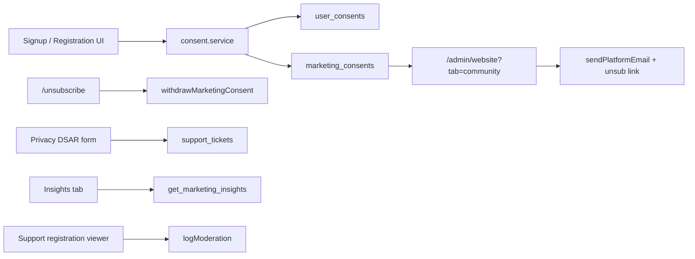

# W4: Consent and privacy plumbing

## Scope lock

- **In:** legal acceptance writes, optional community checkbox (default unticked), unsubscribe tokens, Community/Insights tabs, staff PII-with-reason view, Privacy DSAR form, tests.
- **Out:** cookieless analytics / cookie banner (docs §10 decision); partner_offers marketing; any platform bulk export of `registrations` for outreach.
- **Hard rule:** Community send/export reads **only** `marketing_consents` where `withdrawn_at is null`. Registration tables never feed this list.

## Architecture

## 1. Schema harden (small migration)

Add [`supabase/migrations/20261101180000_marketing_w4_consent.sql`](supabase/migrations/20261101180000_marketing_w4_consent.sql):

- Unique active consent: partial unique index on `marketing_consents (lower(email), scope) where withdrawn_at is null`
- Index on `unsubscribe_token_hash` (lookup for withdraw)
- RPC `get_marketing_insights()` `SECURITY DEFINER`: returns jsonb aggregates only — events by month, category, city; registration counts; certificates issued; **omit any bucket with count &lt; 5**; exclude `is_demo`
- Optional: `support_tickets.topic` allow `data_request` if constrained (or store in existing free-text topic)

Regenerate types.

## 2. Consent services (pure + server)

New under [`src/features/website/`](src/features/website/):

- [`consent.logic.ts`](src/features/website/consent.logic.ts) — reuse hash style from [`contact.logic.ts`](src/features/website/contact.logic.ts) (`sha256` email/IP); mint raw unsubscribe token + hash; `isActiveMarketingConsent`; small-group `suppressBuckets(rows, min=5)`
- [`consent.service.ts`](src/features/website/consent.service.ts) (server-only):
  - `recordLegalAcceptance({ userId?, email, documentSlug, version, context, ipHash })` → `user_consents` for both `privacy` and `terms` using current versions from `legal_documents` / `legal_document_versions`
  - `grantMarketingConsent({ email, userId?, scopes: ['product_updates','community'], source, ip? })` — one checkbox inserts **both** scopes; generates `unsubscribe_token_hash` per row; no-op if active row exists
  - `withdrawByToken(rawToken)` / `withdrawById` — set `withdrawn_at`
  - `listActiveMarketingConsents({ scope?, q?, source? })` — active only
- Signed unsubscribe URL: HMAC with server secret (`UNSUBSCRIBE_SECRET` or derive from existing env) embedding email+scope+nonce; verify before withdraw. Store only hash in DB.

## 3. Signup + public registration UI

Shared presentational block [`ConsentCheckboxes.tsx`](src/features/website/components/ConsentCheckboxes.tsx):

- Required: “I agree to the [Terms](/terms) and [Privacy Policy](/privacy)” (links open current public pages)
- Optional, **default unchecked**: “Send me updates and connect me with the Avoeline community”
- Expose controlled props so parents own state; unit-test default `communityOptIn === false`

Wire into:

- [`src/app/auth/signup/SignupPageClient.tsx`](src/app/auth/signup/SignupPageClient.tsx) (all roles) — block submit without legal accept; after successful signup call consent service with `context: signup_<role>`, `source: signup`
- Google path: same checkboxes before/at `GoogleAuthButton` completion (or post-auth setup step if Google returns before profile exists) — record with `source: google_signup`
- [`RegistrationForm.tsx`](src/features/registration/components/RegistrationForm.tsx) + [`registerAttendee.action.ts`](src/features/registration/actions/registerAttendee.action.ts) — require legal accept; if opted in, grant marketing consents with `source: event_registration` and hashed request IP (same helper as contact)

## 4. Unsubscribe + marketing send

- Public route [`src/app/(marketing)/unsubscribe/page.tsx`](src/app/(marketing)/unsubscribe/page.tsx) — one-click confirm; withdraw; show success (no login)
- Add platform kind `community_update` to [`kinds.ts`](src/lib/email/kinds.ts) (lane `notifications`)
- Community send action (`community:view` + treat send as needing `website:edit` or owner): batch from active consents only; append unsubscribe URL; rate-limit (reuse `rateLimit`); cap batch size (e.g. 100/run, same pattern as legal notify); log via `logModeration`
- Helper ensures every `community_update` email body/footer includes the link

## 5. Admin Community tab

Replace EmptyState in [`src/app/admin/website/page.tsx`](src/app/admin/website/page.tsx) for `tab=community`:

- Gate with `requireWebsiteCap("community:view")`
- DataTable: email, scopes, granted_at, source; filters scope / source / search; **withdrawn filter** (default active-only; optional show withdrawn)
- Export CSV of **active** consents only (still not registrations)
- Compose/send Modal → capped platform email

## 6. Admin Insights tab

- Call `get_marketing_insights()`; render aggregate charts/tables (reuse existing chart primitives if present, else simple tables)
- No names/emails/phones in response shape; client also runs `suppressBuckets` as defense in depth
- Gate with `website:view` (read-only aggregates; no new cap)

## 7. Staff registration PII + no platform bulk export

- New support viewer under admin (e.g. [`src/app/admin/support/registrations/page.tsx`](src/app/admin/support/registrations/page.tsx) or event-scoped drawer): search by event + registration id/email
- Open detail only after **required reason** (ConfirmDialog / Modal) → `logModeration` with action `updated` or dedicated reason string in `extra: { kind: "registration_pii_access", reason }`
- Explicitly **do not** add platform-wide attendee CSV export; leave organizer-scoped exports in [`src/features/exports/`](src/features/exports/) unchanged

## 8. Data requests on Privacy page

- Form on [`src/app/(marketing)/privacy/page.tsx`](src/app/(marketing)/privacy/page.tsx) (or child component): name, email, type (`access` | `deletion`), message; honeypot + rate limit (mirror contact)
- Server action inserts `support_tickets` with topic `data_request` (and type in body/extra); notify owner via existing platform email if available
- Status visible in `/admin/support` queue (existing ticket statuses)

## 9. Tests

Under [`src/features/website/__tests__/`](src/features/website/__tests__/):

- Consent checkbox default unticked; legal required
- Withdraw-by-token marks `withdrawn_at`; active list excludes withdrawn
- Community list helper never merges registration emails
- `suppressBuckets` hides groups with count &lt; 5
- Staff PII action rejects empty reason; records audit payload shape
- SQL smoke: insights RPC returns no PII keys; marketing_consents RLS still anon-denied for direct reads

## 10. Docs

- Update [`completeContext.md`](completeContext.md); mark W4 shipped in [`docs/19-marketing-website.md`](docs/19-marketing-website.md); archive to `plans/2026-11-01-marketing-w4-consent-privacy.md` + [`plans/INDEX.md`](plans/INDEX.md)

## Key files

| Area | Files |
|---|---|
| Migration | `supabase/migrations/20261101180000_marketing_w4_consent.sql` |
| Consent core | `src/features/website/consent.{logic,service}.ts`, `actions/consent.action.ts` |
| UI | `ConsentCheckboxes.tsx`, signup client, `RegistrationForm`, unsubscribe page, Privacy DSAR |
| Admin | `admin/website/page.tsx` Community/Insights panels; support registrations viewer |
| Email | `kinds.ts`, community send action |
| Tests / docs | `__tests__/consent*.test.ts`, completeContext, plans archive |