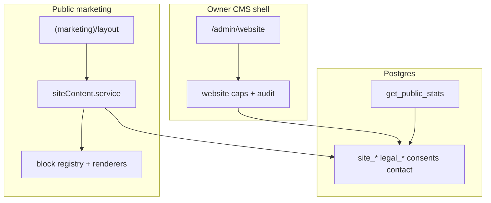

# Marketing website foundation (W1)

Scope is docs/19 §§1, 2, 5, 6 only. No Home/Plans/About page content beyond moving the existing root landing; no fake stats, customers, logos, or testimonials.

## Decisions locked in

- **Fonts / tokens:** Reuse root [`src/app/layout.tsx`](src/app/layout.tsx) Space Grotesk + Inter and [`globals.css`](src/app/globals.css) brand tokens. Add marketing-only CSS variables from §2 (`--mkt-ink` `#0B1020`, accent indigo, type scale) as aliases on the marketing layout—do not fork a second design system.
- **Permissions:** Add admin area `website` to [`ADMIN_AREAS`](src/features/admin/types.ts) for rail access. Fine-grained caps (mirror `TENANT_CAPS`): `website:view`, `website:edit`, `website:publish`, `legal:publish`, `contact:manage`, `community:view`. Owner has all; `requireWebsiteCap(cap)` on every action + `logModeration`.
- **Demo marking:** Add `events.is_demo` / `organizations.is_demo`; backfill `true` where `extra->>'demo_seed' = 'avoeline-demo'`; update [`scripts/seed-demo.mjs`](scripts/seed-demo.mjs) to set the columns.
- **Headers:** Configure in `next.config` `headers()`: marketing paths get CSP + security headers; app prefixes (`/organizer`, `/vendor`, `/attendee`, `/admin`, `/department`, `/clubs`, `/auth`) get `X-Robots-Tag: noindex`. Proxy matcher stays app-only (marketing remains public).

---

## 1. Route group and chrome

- Create [`src/app/(marketing)/layout.tsx`](src/app/(marketing)/layout.tsx): announcement banner (from `site_settings` key `announcement` when active dates allow; empty → hide), marketing header, footer, `max-w-[1200px]` content width.
- Move [`src/app/page.tsx`](src/app/page.tsx) → `(marketing)/page.tsx` (URL stays `/`). Keep current body; do not add invented sections.
- Stub route files (no invented copy): `/plans`, `/about`, `/partners`, `/contact`, `/privacy`, `/terms` as thin pages that render “Coming soon” or empty CMS shells only if a published page row exists—prefer empty states from CMS with no seed text beyond existing product landing.
- Update [`SiteHeader`](src/shared_components/chrome/SiteHeader.tsx) marketing links to §1 nav: Features (`/#features` or `#product`), Plans, Partners, About, Contact, Sign in, primary Get started → `/auth/signup`. Footer: product + legal + `info@aroxes.com` + “An Aroxes company” (link `https://aroxes.com`); social from settings when present.
- Metadata: marketing pages indexable; app layouts/segments set `robots: { index: false }` where missing.

---

## 2. Migrations (section 5)

Single migration `supabase/migrations/YYYYMMDDHHMMSS_marketing_website_foundation.sql` (apply via Supabase MCP + local file):

**New tables** (exact shapes from docs/19 §5): `site_settings`, `site_pages`, `site_blocks`, `site_revisions`, `site_media`, `site_partners`, `site_faqs`, `site_testimonials`, `site_stats_settings`, `legal_documents`, `legal_document_versions`, `user_consents`, `marketing_consents`, `contact_messages`.

**Alters:**
- `subscription_plans`: `is_public`, `is_recommended`, `badge_text`, `tagline`, `cta_label`, `cta_href`, `billing_note`, `highlight_features text[]` (keep existing `sort_order` / pricing).
- `module_catalog (key pk, label, description, category, sort)` — seed from [`moduleKeys.ts`](src/features/permissions/moduleKeys.ts) / `MODULE_LABELS` (categories Events, Teams, Hackathons, Sponsors, Certificates, Vendors, Email, Analytics, AI, Other).
- `events.is_demo boolean not null default false`, `organizations.is_demo boolean not null default false`; backfill demo_seed rows; update seed script.

**`get_public_stats()`:** `SECURITY DEFINER`, `SET search_path = public`, revoke execute from `anon`/`authenticated` or grant only as needed for public read via RPC; returns **numbers only**: `events_count`, `registrations_count`, `active_organizers_count`, `institutions_count`, `certificates_count`. Exclude `is_demo = true` events/orgs; registrations/certs only for non-demo events. No emails/names.

**RLS:** Enable on all new tables. Public `SELECT` only for: published `site_pages`/`site_blocks.published`, `site_partners` where `consent_status = 'granted' AND visible`, visible FAQs/testimonials with `consent_confirmed`, current legal versions, public plan display columns, `site_stats_settings`, public `site_settings` keys whitelist. Writes: service role / platform admin only (app uses `supabaseAdmin` after cap checks). Indexes on FKs and common filters (`page_id, sort`, `consent_status`, `slug`, etc.).

Regenerate [`database.types.ts`](src/lib/database.types.ts); add `TABLES.*` in [`data/collections.ts`](data/collections.ts).

---

## 3. CMS building blocks

New feature folder `src/features/website/`:

| Piece | Role |
| --- | --- |
| `blocks/schemas.ts` | zod per block type from §4 Pages tab: `hero`, `stats_strip`, `logo_wall`, `feature_grid`, `steps`, `audience_tabs`, `event_showcase`, `pricing_teaser`, `testimonials`, `faq`, `cta`, `rich_text`, `team`, `timeline`, `contact_info` — `.strict()` so unknown fields fail |
| `blocks/registry.ts` | typed map: type → schema + Renderer + AdminEditor fields descriptor |
| `blocks/renderers/*.tsx` | One presentational renderer each (empty/minimal—no invented copy; hide when data empty) |
| `components/AdminBlockEditor.tsx` | Shell: select block, form bound to zod, live preview slot, show/hide, reorder hooks (full CRUD in W3) |
| `siteContent.service.ts` | `getPublishedPage(slug)` / `getPublishedBlocks(pageId)` via `unstable_cache` or `cache` + tags `site:page:{slug}`, `site:nav`, `site:stats`; `publishPage` / `publishSettings` call `revalidateTag` |
| `cacheTags.ts` | Central tag constants |

No markdown HTML injection: store markdown strings; sanitize later in W3—W1 schemas treat body as string only.

---

## 4. `/admin/website` shell

- Route: [`src/app/admin/website/page.tsx`](src/app/admin/website/page.tsx) (+ optional `layout.tsx`) behind `requireAdminArea('website')` or `requireWebsiteCap('website:view')`.
- Tab skeleton (URL `?tab=`): Pages, Plans display, Partners, Stats, Legal, FAQ & testimonials, Contact inbox, Navigation & footer, SEO, Media, Community, Insights — panels are placeholders with short description + EmptyState until W3.
- Rail: add Website to [`AdminRail`](src/shared_components/AdminRail.tsx) / admin layout nav.
- Actions stub file `src/features/website/actions/*.ts` using `safeAction` + cap check + `logModeration` (e.g. `saveDraftBlock`, `publishPage` writing revisions and revalidating tags). No fake seed content.

---

## 5. Tests

- SQL or vitest+RPC: `get_public_stats` ignores demo rows; result keys are numeric only (no email-like values).
- RLS tests (follow existing `supabase/tests/*` style if present): anon can select granted partners / published blocks; cannot select pending partners or drafts.
- Unit: block schema `.strict()` rejects unknown keys; `cacheTags` / publish helper documents expected tags (mock `revalidateTag` call list).
- Cap helper: non-owner without `website:edit` fails authorize.

Wire new unit files into `package.json` `test:unit`.

---

## 6. Docs

Same session: update [`completeContext.md`](completeContext.md) (Public/marketing, TABLES, admin area `website`, change log) and a short note in docs/19 or docs/11 pointer; archive plan under `plans/YYYY-MM-DD-marketing-website-foundation.md` + INDEX.

## Out of scope (W2+)

Full page compositions from §3/§7, Turnstile contact send, legal markdown editor, media WebP pipeline, organizer partner opt-in UI, community export, Insights aggregates.