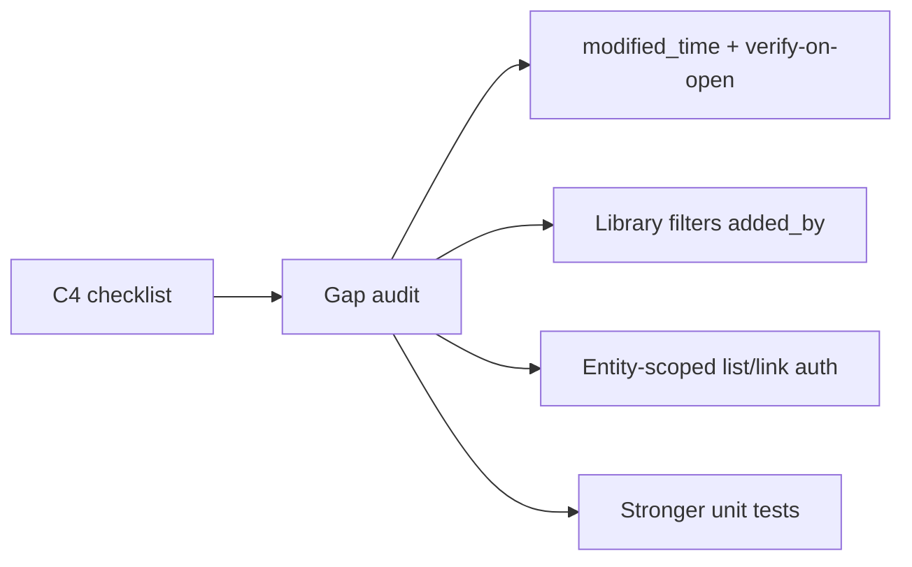

# C4 Drive checklist closeout

## Context

docs/17 **C4 is already implemented** (migration, `GoogleDriveClient`, picker-token, Library/Files mounts, create Doc/Sheet/Slides, cron, `c4Drive.test.ts`). Status line in [`docs/17-connections-system.md`](docs/17-connections-system.md) says shipped 2026-11-02.

This plan is a **compliance closeout** against your pasted items 1–6 — only fix gaps. Scope stays `drive.file` only (never `drive` / `drive.readonly`).

## Checklist vs codebase

| Item | Status | Gap |
|---|---|---|
| 1. Picker token + FilePickerButton + CSP notes | Done | [`picker-token/route.ts`](src/app/api/connections/google/picker-token/route.ts), [`FilePickerButton.tsx`](src/features/connections/components/FilePickerButton.tsx), [`docs/connections-picker-setup.md`](docs/connections-picker-setup.md) |
| 2. `linked_files` + verify + unlink | Mostly | Google `modifiedTime` is fetched but **not stored**; Open in Google does **not** verify first |
| 3. Create Doc/Sheet/Slides in Avoeline folder | Done | [`CreateDriveFileMenu.tsx`](src/features/connections/components/CreateDriveFileMenu.tsx) + `ensureAvoelineFolder` |
| 4. Library + Files sections | Mostly | Search title/entity/type partial; **no added_by filter/display**; Load more/cursor underused in UI |
| 5. No contents / no sharing | Done | Metadata-only; unlink deletes DB row only |
| 6. Tests | Thin | Pure helpers only — extend for status mapping + “only linked file ids” allowlist helper |

## Work

### 1. Persist `provider_modified_at`

- Migration: `linked_files.provider_modified_at timestamptz null`
- Set on link/create/verify from Drive metadata
- Surface in [`LinkedFilePublic`](src/features/connections/types.ts) + LibraryList subtitle

### 2. Verify on open

- In [`LibraryList.tsx`](src/features/connections/components/LibraryList.tsx): “Open in Google” calls `verifyLinkedFileAction` first; if `missing`/`no_access`, block navigation and show status + fix copy; if `ok`, open `webUrl`
- Keep manual “Check access” button

### 3. Library filters

- Extend `listLinkedFiles` / `listLinkedFilesAction` with optional `addedBy`
- Organizer Library ([`OrganizerLibraryClient.tsx`](src/features/connections/components/OrganizerLibraryClient.tsx)): filter chips for mime family (doc/sheet/slides/other), entity type (already), **added by me** toggle; wire `nextCursor` “Load more”
- Show added_by name when resolved (batch user lookup on list)

### 4. Tighter entity permission on write/list

- Before link/create/list for `entity_type=event`: `assertEventActor` / owned event
- `team` / `booking`: assert actor owns organizer/vendor context already on the mounting page, but **re-check in actions** (eventId/teamId/bookingId ownership) so API cannot link arbitrary entity ids
- `club`: require club president / org membership (reuse existing club helpers)
- Fail closed with clear errors

### 5. Tests + docs

- Extend [`c4Drive.test.ts`](src/features/connections/__tests__/c4Drive.test.ts): verify-on-open gate helper; status mapping; picker allowlist (already); “accessible file set = linked provider ids only” pure helper
- Confirm catalog/oauth never request restricted Drive scopes (already in C6 — cite, do not duplicate)
- Append change-log to [`completeContext.md`](completeContext.md); note closeout in docs/17 C4 status line

## Out of scope

- C5 sheets/templates (already shipped)
- Reading file contents, changing Google sharing, whole-Drive search
- Replacing the existing C4 architecture

## Implementation order

1. Migration `provider_modified_at` + service write path
2. Verify-on-open UX
3. Library filters + load more + added_by
4. Action-level entity auth
5. Tests + context/docs touch
