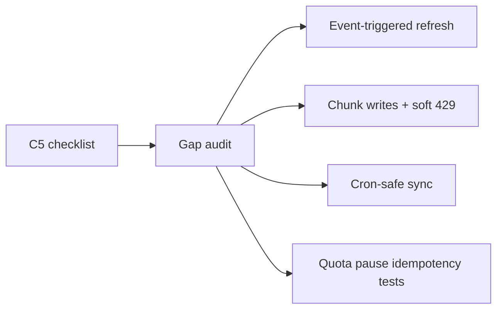

# C5 Sheets checklist closeout

## Context

docs/17 **C5 is already implemented** (`sheet_syncs`, Export once / Keep in sync on Exports, formula sanitize + RAW writes, templates, cron `/api/cron/sheet-syncs`, `c5Sheets.test.ts`). Status in [`docs/17-connections-system.md`](docs/17-connections-system.md): shipped 2026-11-02.

This is a **compliance closeout** against checklist items 1–4. Scope stays **`drive.file` only** on sheets/docs the app created (never `drive` / `drive.readonly`).

## Checklist vs codebase

| Item | Status | Gap |
|---|---|---|
| 1. Export once + Keep in sync (regs/teams/check-ins, form columns) | Mostly | Manual + cron only — **no event-triggered refresh**; cron uses `exportOrSyncSheet` with fake/`created_by` actor and can fail grant checks without pausing |
| 2. Sanitize, batch, quota backoff, pause on deleted | Mostly | Sanitize + pause-on-missing/403 **done**; writes are **one full PUT** (no chunking); 429 retries then often **pauses** instead of deferring |
| 3. Templates (run-of-show, sponsor tracker, MoU) | Done | Plumbing done; run-of-show is thin placeholders — enrich from agenda |
| 4. Tests | Thin | Formula + fingerprint + pause **strings** only — no quota backoff / HTTP→pause / skip-write coverage |

Key files: [`sheetSync.service.ts`](src/features/connections/server/sheetSync.service.ts), [`sheetSanitize.ts`](src/features/connections/lib/sheetSanitize.ts), [`drive.ts`](src/features/connections/providers/google/drive.ts) (`clearAndWriteSheetValues`, `googleFetch`), [`GoogleSheetsExportPanel.tsx`](src/features/connections/components/GoogleSheetsExportPanel.tsx), [`c5Sheets.test.ts`](src/features/connections/__tests__/c5Sheets.test.ts).

## Work

### 1. Event-triggered one-way sync + cron-safe path

- Add **`runActiveSheetSync(row)`** (connection token + active connection only; **no** `assertMayUseConnection` / user actor). Used by cron and hooks.
- Keep **`exportOrSyncSheet`** for user Export / Keep in sync (auth stays).
- Add **`refreshActiveSheetsForEvent(eventId, kinds?)`**: load `sheet_syncs` where `event_id` + `keep_in_sync` + `status=active`, call `runActiveSheetSync` (fire-and-forget from callers; log errors, never throw into UX).
- Wire after successful mutations:
  - check-in → [`checkIn.action.ts`](src/features/event_attendee/actions/checkIn.action.ts) (`checkin` + `attendees`)
  - registration create/update/cancel path(s) that already touch roster → `attendees` (+ `checkin` if status affects check-in sheet)
  - hackathon team create/update/delete used by Exports teams sheet → `teams`
- Cron [`sheet-syncs/route.ts`](src/app/api/cron/sheet-syncs/route.ts) switches to `runActiveSheetSync` / updated `processSheetSyncs`.

### 2. Batch writes, softer quota, deleted/revoked pause

- In [`drive.ts`](src/features/connections/providers/google/drive.ts): after clear, write in **chunks of 400 rows** (sequential `values` updates with advancing `A{startRow}` ranges). Extract pure helpers `chunkSheetRows(matrix, size)` + `sheetChunkRange(sheetTitle, startRow, rowCount)` into [`sheetSanitize.ts`](src/features/connections/lib/sheetSanitize.ts) (or small `sheetWrite.logic.ts`) for tests.
- Extract **`computeGoogleRetryWaitMs(status, attempt, retryAfterMs?)`** from `googleFetch` retry policy for unit tests; keep max 3 retries.
- In sync catch path: **pause + clear message** only for missing / no_access (404/403/401) — reuse `pauseMessage`. On **429 after retries**: leave `status=active`, `keep_in_sync=true`, set `last_error` to a clear quota message so cron reorders via `last_synced_at` — do **not** pause.
- Panel: expose **Stop sync** via existing `setSheetKeepInSyncAction` when `keepInSync` is true.

### 3. Templates from platform data

- Enrich **run-of-show** body in [`templates.logic.ts`](src/features/connections/lib/templates.logic.ts) / create path: pull agenda days/items via existing agenda services (`getAgendaDays` / item list) into the Doc text; keep sponsor tracker + MoU as today (orgs + event/org names). Still create in Avoeline folder + `linked_files`.

### 4. Tests + docs

Extend [`c5Sheets.test.ts`](src/features/connections/__tests__/c5Sheets.test.ts):

- Formula: tab / CR leading cases already in sanitizer
- Idempotency: `shouldRewriteSheet` + assert chunk helper does not change fingerprint semantics
- Quota backoff: `computeGoogleRetryWaitMs` for 429 / 503 / Retry-After
- Deleted/revoked: pure mapper `classifySheetWriteFailure(httpStatus) → pause | defer | throw` matching service policy; assert `pauseMessage` text

Update [`completeContext.md`](completeContext.md) change log + docs/17 C5 status closeout line. Archive plan under `plans/`.

## Out of scope

- Rebuilding C5 architecture or requesting restricted Drive scopes
- Email-style `connection_usage` metering for Sheets
- Plan-gate enforcement for `google_workspace_sync` (catalog metadata only today)
- C6 hardening (already shipped)

## Implementation order

1. Pure write/retry/classify helpers + tests
2. Chunked `clearAndWriteSheetValues` + soft 429 in sync service
3. `runActiveSheetSync` + cron + event hooks
4. Stop-sync UI + run-of-show agenda enrichment
5. Context/docs + plans archive
