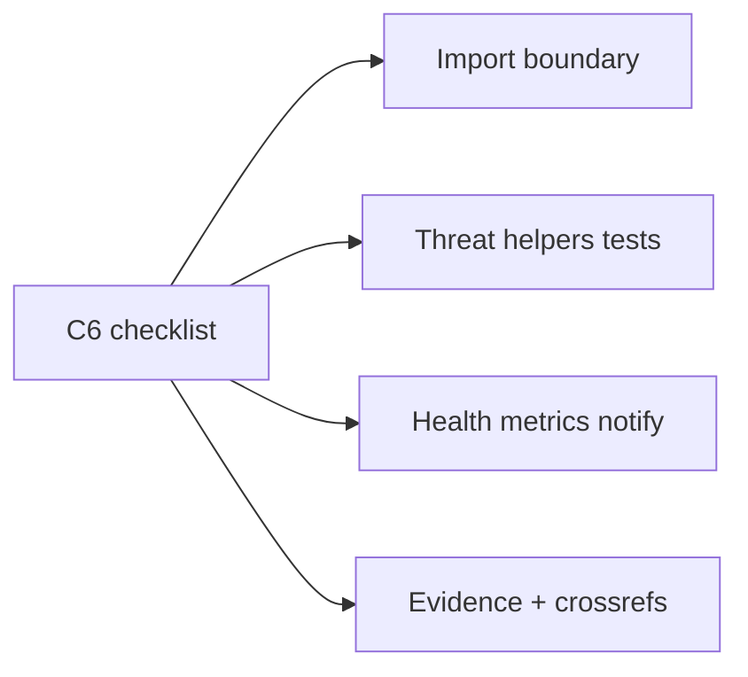

# C6 Hardening checklist closeout

## Context

docs/17 **C6 is marked shipped** ([`docs/connections-security-review.md`](docs/connections-security-review.md), [`docs/google-verification.md`](docs/google-verification.md), [`c6Hardening.test.ts`](src/features/connections/__tests__/c6Hardening.test.ts), `/api/cron/connections-health`). This is a **compliance closeout** against checklist items 1–5.

## Checklist vs codebase

| Item | Status | Gap |
|---|---|---|
| 1. Static checks | Mostly | Catalog/restricted scopes + organizer≠platform **done**; [`calendar.action.ts`](src/features/connections/actions/calendar.action.ts) still imports `GoogleCalendarClient` (outside `server`/`providers`); no automated import-boundary check |
| 2. Threat tests | Partial | returnTo, audit scrub, picker, ICS/header, formula **done**; OAuth state user/replay/expiry and entity-auth deny cases lack **pure** helpers + tests; RLS “secrets not selectable” is migration-only (document, no SQL suite in-repo) |
| 3. Operations | Partial | Health cron snapshots counts; **no** needs_reconnect in-app/email on mark/health; **no** 24h audit metrics rollup; rotate runbook does not cite [`scripts/rotate-connections-key.mjs`](scripts/rotate-connections-key.mjs) |
| 4. google-verification.md | Mostly | Scopes/demos/Limited Use/Workspace note **done**; missing §11 operational checklist (dev/prod projects, consent fields, testing limits) |
| 5. docs/11, 15/16, completeContext | Partial | docs/16 superseded; **no docs/15** in repo; docs/11 lacks Connections supersede banner; completeContext cron table missing `connections-health` + `sheet-syncs` |

## Work

### 1. Static import boundary

- Move `listCalendars` behind a server helper (e.g. `listCalendarsForConnection` in [`calendarSync.service.ts`](src/features/connections/server/calendarSync.service.ts)); [`calendar.action.ts`](src/features/connections/actions/calendar.action.ts) imports **only** `server/*`.
- Add [`scripts/check-connections-imports.mjs`](scripts/check-connections-imports.mjs): fail if any file outside `src/features/connections/{server,providers}` (and tests) imports `features/connections/providers/google`. Wire into `npm run test:unit` or a one-line call from C6 test bootstrap via `spawnSync` once.
- Keep restricted-scope + organizer-mail guards in [`securityChecks.logic.ts`](src/features/connections/lib/securityChecks.logic.ts) / `c6Hardening.test.ts`.

### 2. Threat helpers + tests

Add pure helpers (unit-testable) and extend [`c6Hardening.test.ts`](src/features/connections/__tests__/c6Hardening.test.ts):

- **`oauthStateGate`**: reject when `usedAt` set, `expiresAt` past, or `stateUserId !== actorId` (mirrors [`oauth.service.ts`](src/features/connections/server/oauth.service.ts) callback checks; wire service to call helper).
- **`scopeDowngradeBlocks`**: wrap `missingRequiredScopes` assertion already used on connect.
- **Entity / grant fail-closed**: assert `isAccessibleProviderFileId` + `mayUseDriveFiles` / `maySyncCalendar` negative cases already partial — add one explicit “wrong owner / no grant” case to C6 suite; document `linkedFileEntityAuth` as server+DB (no fake DB in unit tests).
- **RLS**: evidence row in security review pointing at C1 migration revoke on `integration_secrets` — no new SQL test harness.

### 3. Operations: notify + metrics

- Extend [`markNeedsReconnect`](src/features/connections/server/connections.service.ts): after status update, `sendNotification` to connection owner (`connected_by` / `owner_id` when user) with reconnect CTA; rate-limit with `rateLimit(\`reconnect-notify:${connectionId}\`, 1, 86400)` so at most one/day; optional single platform email when Resend configured (docs/17 §5).
- Extend [`runConnectionsHealthJob`](src/features/connections/server/health.service.ts): query last-24h `connection_audit` for counts of `connect`, failures (`scope_rejected` / reconnect actions), sends, and usage-ish actions; include in `health_snapshot` details. For each `needs_reconnect` connection, call the same notify path (deduped by rate limit).
- Update [`docs/connections-security-review.md`](docs/connections-security-review.md): threat **matrix** (exists vs missing), cite rotate script, list metrics fields, cron schedule expectation (`CRON_SECRET`, daily health).

### 4. google-verification.md

Append §11 checklist: separate Cloud projects; consent screen (app name, logo, support email, authorized domains, privacy/terms on `aroxes.com`); Testing mode 100 users / 7-day refresh; submit sensitive scopes only after demo; “publish after approval”; pointer to Workspace allow-list already present.

### 5. Cross-doc updates

- Banner atop [`docs/11-events-and-hackathon-complete-spec.md`](docs/11-events-and-hackathon-complete-spec.md): organizer Google mail / Connections → docs/17 + 18 (docs/11 remains event/hackathon UI SoT).
- In security review: **docs/15 not in repo** — N/A; docs/16 already superseded.
- [`completeContext.md`](completeContext.md): add `/api/cron/connections-health` and `/api/cron/sheet-syncs` to routes table; C6 closeout change-log line; docs/17 C6 status closeout note.
- Archive plan under `plans/2026-11-02-c6-hardening-closeout.md` + INDEX.

## Out of scope

- Full e2e OAuth against Google
- Redis rate limits / multi-region
- Enforcing `planGate` billing module
- Creating a fictional docs/15

## Implementation order

1. calendar listCalendars server wrapper + import check script
2. oauthStateGate + c6 threat tests
3. markNeedsReconnect notify + health metrics
4. Rewrite/expand security-review + google-verification
5. docs/11 + completeContext + plans archive
