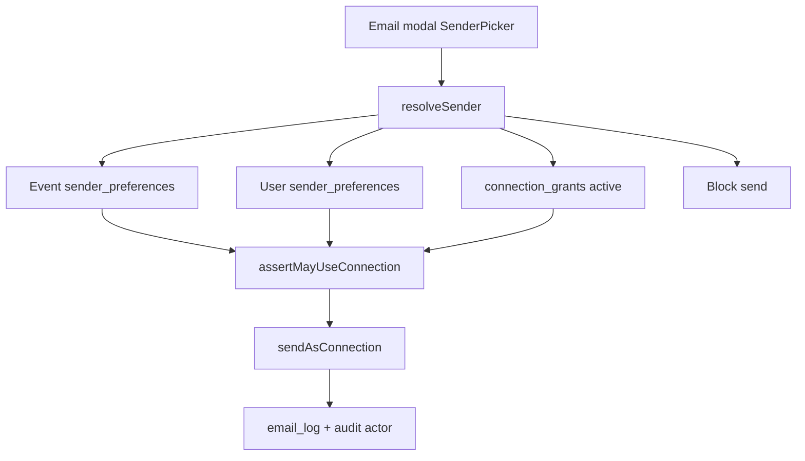

# Connections C2 — org grants, mounts, resolveSender

## Scope lock

**In:** docs/17 §§3, 5.5–5.7, 6 and C2 prompt items 1–6; pause for review after tests.

**Out:** Calendar/Meet (C3), Drive/Library (C4), live sheets (C5). Changing who may send via Resend (platform lanes stay platform-only). Docs/18 capacity math changes (capacity already keys by `connection_id` — org shared pools work once org connections exist).

**Locked defaults:**
- `connections:manage` = [`canManageOrg`](src/features/department/orgScope.ts) for departments, or [`canLeadClub`](src/features/department/orgScope.ts) for clubs (no new module catalog key).
- “Owner changed, re-authorize” = set connection `status = needs_reconnect`, `last_error = owner_changed`, audit `owner_left` (no new enum value).
- Vendor catalog cards: `email.send`, `calendar`, `meet`, `drive.files` (calendar/meet/drive remain `active: false` until C3/C4).
- Mount routes (new):
  - [`/vendor/[vendor_id]/settings/connections`](src/app/vendor/[vendor_id]/settings/connections/page.tsx) — `ownerType: user`
  - [`/department/settings/connections`](src/app/department/settings/connections/page.tsx) — `ownerType: org`, department id
  - [`/department/clubs/[clubId]/settings/connections`](src/app/department/clubs/[clubId]/settings/connections/page.tsx) — `ownerType: org`, club id
- Org Connections page shows **org** connections + Grants UI; a compact **Personal** section on the same page connects `ownerType: user` for the signed-in actor (sender picker “Me”).

## Baseline (C1 vs C2)

- Tables already exist: `connection_grants`, `sender_preferences`, `owner_type` org, kill columns — **unused by app logic**.
- [`resolveSender`](src/features/connections/server/sender.service.ts) is personal-only; ignores preferences/grants.
- [`ConnectionsPage`](src/features/connections/components/ConnectionsPage.tsx) mounted only under organizer; `ownerType` unused.
- [`AdminConnectionStatus`](src/features/connections/components/AdminConnectionStatus.tsx): read-only + reconnect path stub (`?t=` not validated); **no** kill-switch UI.
- No `SenderPicker`; no grant actions.

## 1. Auth helpers + grants service

Add [`src/features/connections/server/grants.service.ts`](src/features/connections/server/grants.service.ts) and [`assertConnectionsAccess.ts`](src/features/connections/server/assertConnectionsAccess.ts):

- `canManageConnections(user, orgId)` → orgScope as above.
- `assertMayUseConnection({ userId, connectionId, capability })` — personal owner **or** active grant (`revoked_at is null` and capability in array).
- `listGrants` / `grantUse` / `revokeUse` — write `connection_grants`, audit `grant` / `revoke`; revoke sets `revoked_at = now()` (immediate: every send re-checks).
- `listEligibleMembers(orgId)` for grant UI (active `org_memberships`).
- Hook membership/tenure removal (or a small helper called from existing revoke paths in department actions): if `connected_by` leaves org → `markOwnerLeft(connectionId)`.

OAuth/start/connect: when `ownerType === 'org'`, require `canManageConnections`; store `connected_by = actor`. Extend [`startConnectAction`](src/features/connections/actions/connections.action.ts) / callback already accepting org — enforce gate + catalog filter.

Light migration only if needed: unique partial index on `(connection_id, user_id) WHERE revoked_at IS NULL`; optional `reconnect_tokens` (hash, connection_id/owner, expires_at) for one-time admin links. Prefer migration `20261103200000_connections_c2.sql` for index + reconnect_tokens rather than overloading audit.

## 2. Multi-owner ConnectionsPage

- Extend `ConnectionsPage` props: `ownerType`, `ownerId`, `catalogScope: 'organizer' | 'vendor' | 'org' | 'personal'`, `basePath` (for batches link only when organizer/email.send).
- [`catalog.ts`](src/features/connections/catalog.ts): `catalogForScope(scope)` — vendor omits `sheets.sync`; org/organizer all five.
- New routes listed above; nav links from vendor profile, department chrome, club detail header.
- Org page: `ConnectionGrantsPanel` (pick member + capabilities checkboxes → grant; list with revoke).
- Banner states: `needs_reconnect` (incl. owner_changed copy), `blocked_by_admin` (see §4).

## 3. Full `resolveSender` + SenderPicker

Rewrite [`resolveSender`](src/features/connections/server/sender.service.ts) (extract pure order helpers to `lib/resolveSender.logic.ts` for tests):

1. Load event default from `sender_preferences` (`event_id = eventId`) → if set and `assertMayUseConnection` → use it.
2. Else user default (`owner_type=user`, `owner_id=actor`, `event_id null`) with `email.send`.
3. Else first active org connection for `orgContext` (event’s org / explicit org) with active grant for `email.send`.
4. Else `null` (callers keep NeedsConnection / disabled Send — **never** `sendPlatformEmail`).

Wire `orgContext` from event → organization when present; personal organizer events use actor only.

**SenderPicker** ([`components/SenderPicker.tsx`](src/features/connections/components/SenderPicker.tsx)): client control “Sending as …” listing personal + granted org options; calls `listSendableConnectionsAction`; optional `connectionId` override passed into confirm/send actions.

Mount in every organizer-origin compose surface:
- [`EventEmailPanels`](src/features/event_attendee/components/EventEmailPanels.tsx) (member + bulk)
- Certificate email path: compact picker above ConfirmButtons on [`certificateClient.tsx`](src/app/organizer/[organizer_id]/events/[eventId]/certificates/certificateClient.tsx)
- Recruitment compose modals under teams (where HTML compose exists)

Per-event default: small setting on event Access/Communications (or Connections checklist) writing `sender_preferences` with `event_id`. Per-user default: existing `setDefaultSenderAction` — make resolveSender **read** it.

Update [`sendAsOrganizer` / `sendViaOrganizerConnection`](src/features/email/organizerTransport.service.ts) to accept optional `connectionId` + pass `actorId` into audit/`email_log.user_id`.

## 4. Reconnect + `blocked_by_admin`

- Harden [`createReconnectLinkAction`](src/features/connections/actions/connections.action.ts): mint token → store hash + expiry (e.g. 72h) → return absolute URL; connections page validates `?t=` before allowing connect for that owner.
- On Google errors indicating admin restriction: `markBlockedByAdmin(connectionId)`; UI shows copyable note built from `GOOGLE_OAUTH_CLIENT_ID` + requested scopes (catalog), plus “Connect personal Gmail” CTA.
- Reconnect banner already partially present — ensure `login_hint` + pause queues (docs/18 outbox already respects connection status).

## 5. Platform owner tenant view

Extend admin surfaces (organizer detail + department/vendor tenant where connections apply):

- Status, capabilities, last used, last error — never tokens (keep listConnections DTO).
- Send reconnect link (validated tokens).
- **Kill switch** UI: toggle `organizations.connections_google_disabled` + reason (for org tenants); for personal organizers, continue using existing pause **or** set a user-scoped kill via first owned org / dedicated flag — **locked approach:** for `owner_type=user` organizers, kill switch sets all their active connections to `disabled` + audit reason, and `assertGoogleNotKilled` already checks orgs by `owner_user_id`; also expose org flag editor when tenant is a department/club. Audit `kill_switch` / `kill_switch_cleared`.

Reuse/expand [`AdminConnectionStatus`](src/features/connections/components/AdminConnectionStatus.tsx); mount on department admin detail if missing.

## 6. Tests + docs

Under `src/features/connections/__tests__/`:

| Test | Approach |
|---|---|
| No grant → cannot use org connection | `assertMayUseConnection` unit |
| Revoke immediate | grant then revoke → assert fails |
| Shared quotas | two actors, same `connection_id` → capacity `usedLast24h` shared (math/service stub) |
| Sender resolution order | pure `pickSenderCandidate` fixtures |
| Support cannot read secrets | DTO/listConnections has no secret fields; service_role-only select documented in test |
| No platform fallback | `sendViaOrganizerConnection` / resolve null never imports `sendPlatformEmail` (guard test / static assert) |

Wire into `npm run test:unit`. Update [`completeContext.md`](completeContext.md), [`docs/17-connections-system.md`](docs/17-connections-system.md) C2 status note, archive [`plans/2026-11-02-connections-c2-org-grants.md`](plans/2026-11-02-connections-c2-org-grants.md) + INDEX.

## Implementation order

1. Grants service + `canManageConnections` + owner_left hook + optional reconnect_tokens migration
2. Org OAuth gate + ConnectionGrantsPanel + dept/club/vendor mounts + catalog scopes
3. Full resolveSender + SenderPicker + preferences read + wire email modals
4. Reconnect token validation + blocked_by_admin copyable note
5. Admin kill switch + reconnect hardening on tenant pages
6. Unit tests + completeContext + plans archive → **pause for review**
