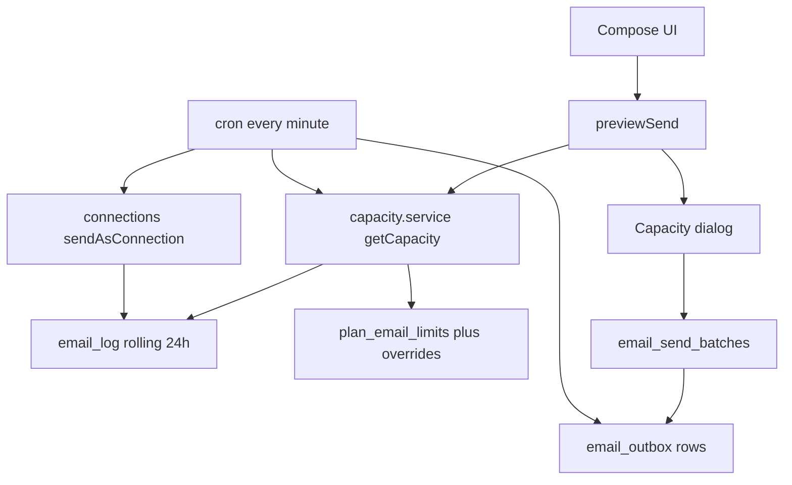

# Email send limits and scheduling (docs/18)

## Scope lock

**In:** docs/18 items 1-10; CapacityStrip / capacity dialog / Sent emails batches page; minute cron worker; admin plan limits + overrides + pause; tests; docs/11 + completeContext.md.

**Out:** Changing resolveSender routing or platform Resend lanes. Org grants UI (Connections C2) — capacity still keys off `connection_id` so shared pools work when org connections exist. Connection warm-up (docs/18 §8.4).

**Locked defaults:** provider daily 400 (Gmail) / 1500 (Workspace via ID token `hd`); per-minute 30; reserve 20% for time-sensitive; max_per_send default 500; schedule start default next 09:00 in organizer TZ (`Asia/Karachi` unless event timezone or new `organizer_profiles.timezone` is set). Plan seeds: `free` 200/1000/100; `pro` 1500/10000/500; other plans copy pro if no row.

**Delivery pauses (per docs/18 prompt):** ship and pause for review after Phase A (items 1–4), then Phase B (items 5–10).

**Who-may-send lock:** docs/18 references a missing `16-email-v2-…` file; keep routing from docs/17 §6 + existing `resolveSender` / `sendViaOrganizerConnection`. [`docs/16-platform-email.md`](docs/16-platform-email.md) stays Resend-only.

### Baseline (C1 vs docs/18)

- Stub outbox exists; **no** worker, batches, or `(status, not_before, priority)` index.
- Quota today is **calendar-day** [`connection_usage`](src/features/connections/server/quota.service.ts) (default 400 in capability settings); `per_minute_limit` stored, not enforced; connect always seeds 400 (no `hd` / Workspace 1500).
- Organizer sends do **not** write `email_log`; [`stampEmailLogConnection`](src/features/connections/server/sender.service.ts) has no callers — rolling 24h requires stamping every send.
- Bulk is sync in [`eventEmail.action.ts`](src/features/event_attendee/actions/eventEmail.action.ts) (`BULK_CAP = 500`); no CapacityStrip/dialog.
- Plan columns `email_daily_cap` / `email_monthly_cap` are marketing-only; [`savePlanImpl`](src/features/saas/actions/plans.action.ts) / PlansBoard do not edit them; no `plan_email_limits` / overrides / pause-sending.
- Cron pattern to copy: [`api/cron/plan-expiry`](src/app/api/cron/plan-expiry/route.ts) (`CRON_SECRET`); no outbox cron yet. Unsubscribe exists only for marketing consents.

## Phase A — schema, capacity, preview, UI (items 1–4)

### 1. Migration + types

New migration e.g. [`supabase/migrations/20261102200000_email_limits_scheduling.sql`](supabase/migrations/20261102200000_email_limits_scheduling.sql):

- `plan_email_limits` (plan_key PK → subscription_plans.key, daily_cap, monthly_cap, max_per_send) — seed from existing `subscription_plans.email_daily_cap` / `email_monthly_cap`; admin writes keep marketing columns in sync.
- `email_limit_overrides` (owner_id, daily_cap, monthly_cap, max_per_send, reason, set_by, expires_at).
- `email_send_batches` per docs/18 §5 statuses.
- Alter stub [`email_outbox`](supabase/migrations/20261101200000_connections_c1.sql): `batch_id`, `priority`, `time_sensitive`, `attempt_at`, `idempotency_key` (unique), `skip_reason`; recipient keys in `payload` (not logged).
- Alter `integration_connections`: `daily_limit`, `per_minute_limit`, `quota_exhausted_until`, `is_workspace`; `sending_paused_until` + `sending_paused_reason` for admin pause.
- `organizer_profiles.timezone` text nullable (resolve default Asia/Karachi).
- `email_suppressions` (owner_id, email_normalized, reason, created_at) unique (owner_id, email_normalized).
- Indexes: `email_log (connection_id, sent_at)`; `email_outbox (status, not_before, priority)`; `email_send_batches (owner_type, owner_id, created_at desc)`.
- RLS: service_role writes; owners read own batches; zero client grants on secrets.
- `TABLES` in [`data/collections.ts`](data/collections.ts); regenerate [`src/lib/database.types.ts`](src/lib/database.types.ts) (keep `UserRow` alias).

On Google connect in [`connections.service` upsert](src/features/connections/server/connections.service.ts) + OAuth: set `is_workspace` from ID token `hd`, `daily_limit` 1500/400, `per_minute_limit` 30. Action allows lowering `daily_limit` only.

### 2. capacity.service (server-only)

Add [`src/features/connections/server/capacity.service.ts`](src/features/connections/server/capacity.service.ts) and use it for send-path capacity (calendar-day [`quota.service.ts`](src/features/connections/server/quota.service.ts) no longer gates sends):

- Time-sensitive kinds: `registration_confirmed`, `ticket`, `access_code`, plus interview/access invites that already use `requireConnectedSender`. Bulk: `custom`, announcements, certificate blasts, recruitment bulk.
- `usedLast24h(connectionId)` from `email_log` where `connection_id` and `sent_at` within 24h. Every organizer send must stamp `email_log.connection_id` via [`sendAsConnection`](src/features/connections/server/sender.service.ts).
- Plan daily/monthly from `plan_email_limits` + non-expired override; monthly window in organizer TZ.
- `remainingNow = min(providerRem, planDailyRem, planMonthlyRem)`; for bulk subtract `floor(providerDaily * 0.20)` reserve.
- `nextFreeAt` from rolling timestamps; `nextMonthResetAt` for monthly block copy.
- Shared pool: usage counted by `connection_id`.

### 3. previewSend + enqueue

Actions under [`src/features/connections/actions/`](src/features/connections/actions/):

- `previewSendAction` — server resolves recipients (reuse roster filters from [`eventEmail.action.ts`](src/features/event_attendee/actions/eventEmail.action.ts)); enforce `max_per_send` (replace hardcoded `BULK_CAP`); return `{ total, sendNow, schedule[], eta, blockedReason }` with chunks at next 09:00 local + following days.
- `confirmSendAction` modes: `send_and_schedule` | `selection_cap` | `spread_days` | `cancel` — creates batches + outbox; immediate slice uses existing send path when capacity allows.
- `rateLimit` on preview/send. No addresses or bodies in logger/audit.

### 4. UI

- `CapacityStrip` on Connections settings and compose surfaces: [`EventEmailPanels`](src/features/event_attendee/components/EventEmailPanels.tsx) / `BulkAttendeeEmailModal`, [`emailCertificates.action.ts`](src/features/certificates/actions/emailCertificates.action.ts) UX, [`recruitmentEmail.ts`](src/features/teams/recruitmentEmail.ts) / grants bulk paths.
- Capacity dialog (four options + monthly blocked + bounce help text).
- Selection-cap mode: counter `x / sendNow`, disable boxes beyond cap.
- Organizer page `/organizer/[id]/settings/email-batches` (Sent emails) with keyset pagination; cancel rest / change start / send now when capacity exists / retry failures.
- Delayed time-sensitive banner: “N confirmations delayed” when reserve empty.

**Pause for review after Phase A.**

## Phase B — worker, safeguards, admin, tests, docs (items 5–10)

### 5–6. Worker + priority

- Cron [`src/app/api/cron/email-outbox/route.ts`](src/app/api/cron/email-outbox/route.ts) with same `CRON_SECRET` gate as plan-expiry; schedule every minute.
- Claim eligible queued rows (`not_before` passed, not paused, connection not exhausted/admin-paused); order `time_sensitive` desc, priority desc, `not_before`.
- Per connection: `remainingNow` + per-minute throttle with jitter; render + re-validate at send time; `skip_reason`; idempotency unique `(batch_id, recipient_key)`.
- Circuit breaker on Google `550 5.4.5` / `rateLimitExceeded` / `userRateLimitExceeded`: set `quota_exhausted_until` (backoff ≤ 24h), reschedule, notify organizer once.
- Time-sensitive never waits behind bulk in the same tick; if reserve empty they stay queued (web ticket pages remain the fallback — no Resend).

### 7. Safeguards

- One To: per message (existing Gmail path).
- Dedupe same recipient+kind within 24h before enqueue and at send.
- Non-transactional: unsubscribe link (HMAC, organizer-scope into `email_suppressions`) + honor suppression list.
- UI help: bounces not visible with `gmail.send` only.

### 8. Admin

- Extend [`PlansBoard`](src/features/saas/components/PlansBoard.tsx) / [`plans.action.ts`](src/features/saas/actions/plans.action.ts) to edit `plan_email_limits` (and sync `subscription_plans.email_*` for marketing). Per-organizer overrides (reuse feature_overrides UX pattern on tenants); usage view; pause-sending with reason; audit + notify. Permission-checked via existing admin/owner gates.

### 9. Security / perf

- All math and recipient resolution server-only; rate-limited actions; §5 indexes; batches keyset (`created_at`, `id`); never log recipients/bodies/tokens.

### 10. Tests + docs

Unit tests under `src/features/connections/__tests__/` covering rolling window across midnight, `remainingNow` min-of-three, multi-day schedule, selection-cap, reserve, batch cancel/start-time, send-time revalidation, circuit breaker/resume, TZ/DST, idempotent retry, monthly rollover, plan limit change mid-batch, shared pool by `connection_id`. Wire into `npm run test:unit`.

Update [`docs/11-events-and-hackathon-complete-spec.md`](docs/11-events-and-hackathon-complete-spec.md), [`completeContext.md`](completeContext.md), archive to `plans/2026-11-02-email-limits-scheduling.md` + INDEX when shipping.

## Implementation order

1. Migration + types + connect defaults (`hd` / limits)
2. `capacity.service` + stamp `email_log.connection_id` on organizer sends
3. preview/confirm actions + CapacityStrip/dialog on compose + Connections
4. Batches page shell → **pause for review**
5. Cron worker + circuit breaker + delayed banner
6. Suppressions/unsubscribe + admin limits/usage/pause
7. Tests + docs/11 + completeContext + plans archive
