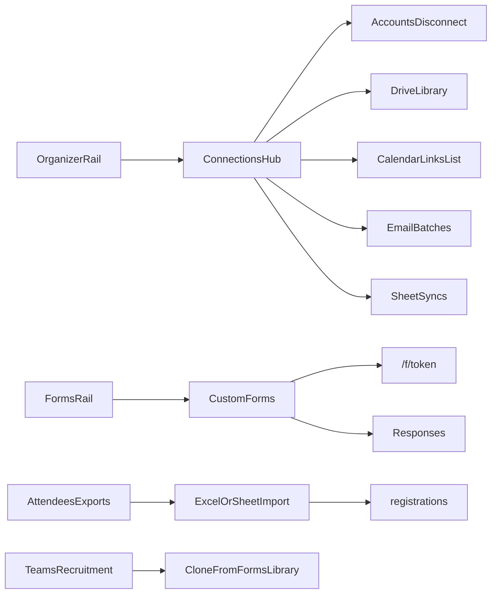

# Organizer Connections hub, import, Custom Forms, Teams polish

## Scope locked

- Full set: discoverability + attendee Excel/Sheets **import** + organizer-wide **Custom Forms** (builder + responses) + Teams Advanced status polish.
- Forms model: **reusable organizer library** (surveys/feedback/checklists). Event registration (`event_form_fields`) and team recruitment (`recruitment_forms`) stay as they are; library forms can be **cloned into** a recruitment form later.

## Current gaps (confirmed)

- Pages exist but organizer rail omits them: [`settings/connections`](src/app/organizer/[organizer_id]/settings/connections/page.tsx), [`library`](src/app/organizer/[organizer_id]/library/page.tsx), [`email-batches`](src/app/organizer/[organizer_id]/settings/email-batches/page.tsx). Disconnect already lives on [`ConnectionRow`](src/features/connections/components/ConnectionRow.tsx).
- No meetings inbox; calendar is push-only via [`CalendarSyncControls`](src/features/connections/components/CalendarSyncControls.tsx) + `calendar_links`.
- Sheets are **outbound only** (`sheet_syncs` + [`GoogleSheetsExportPanel`](src/features/connections/components/GoogleSheetsExportPanel.tsx)). No attendee Excel/Sheet **import**.
- No generic forms tables/routes. Shared UI: [`FormBuilder`](src/features/events/components/wizard/FormBuilder.tsx) + [`CustomFieldsRenderer`](src/features/events/components/CustomFieldsRenderer.tsx).
- Teams pipeline already exists on Recruitment (`applied` → `shortlisted` → `interview_scheduled` → `accepted`/`rejected`/`withdrawn`); polish UX, do not invent new DB statuses.

---

## Phase 1 — Connections discoverability hub

**Rail:** In [`src/app/organizer/layout.tsx`](src/app/organizer/layout.tsx), add **Connections** → `/organizer/{id}/settings/connections` (always when Google env is usable; otherwise still show page with “not configured”). Add **Forms** in Phase 3. Optionally keep Library reachable only via hub (no extra rail clutter).

**Hub UI** on Connections page ([`ConnectionsPage.tsx`](src/features/connections/components/ConnectionsPage.tsx)):

- Sub-nav tabs: **Accounts** | **Library** | **Calendar** | **Sheets** | **Sent email**
- Accounts = existing catalog + disconnect/reconnect
- Library embeds/links [`OrganizerLibraryClient`](src/features/connections/components/OrganizerLibraryClient.tsx) (or redirect to `/library` with same chrome)
- Calendar = list `calendar_links` for this owner (event/agenda/interview entities) with open-in-Google + unlink via existing remove actions
- Sheets = list `sheet_syncs` with link to event Exports + stop-sync
- Sent email = existing batches page content or deep-link with active tab styling

**Profile:** Keep Manage connections; add one-line pointers to Library / Forms.

**Vendor:** Add rail link to existing vendor Connections only (no Forms/import in this plan).

Update [`completeContext.md`](completeContext.md) organizer route table + Change log.

---

## Phase 2 — Attendee Excel + Google Sheets import

**Surfaces:** Event **Attendees** and **Exports** ([`.../exports`](src/app/organizer/[organizer_id]/events/[eventId]/exports/page.tsx)).

**Excel/CSV path**

- Upload via existing media/upload patterns; parse with `exceljs` (already used for export).
- Preview grid + column mapper (email required; name/phone/tier + `event_form_fields` keys).
- Dry-run: validate, dedupe by email against existing non-cancelled regs, report creates/skips/errors.
- Commit Server Action: batch insert `registrations` (confirmed/pending per event access rules); rate-limit; `assertEventActor(..., "attendees")`.
- No payment auto-complete for paid events unless row explicitly maps a free tier / organizer override flag (default: reject paid-required rows with clear error).

**Google Sheets path** (respect `drive.file`)

- User picks a spreadsheet via existing Picker ([`FilePickerButton`](src/features/connections/components/FilePickerButton.tsx) / picker-token), then read values with Sheets provider.
- Same mapper/dry-run/commit as Excel.
- Do **not** turn outbound `sheet_syncs` into two-way sync; import is a one-shot (or “re-import new rows”) action.

**Files:** new `src/features/event_attendee/import/` (parse, map, actions) + UI panel on Attendees/Exports; extend Google Drive/Sheets provider read helpers as needed under `src/features/connections/providers/google/`.

---

## Phase 3 — Organizer Custom Forms library

**Schema** (new migration; Supabase skill before write):

- `custom_forms`: `id`, `owner_user_id`, `title`, `description`, `fields` jsonb (`CustomField[]`), `public_token` unique, `status` (`draft`|`open`|`closed`), `kind` (`survey`|`feedback`|`checklist`|`other`), timestamps
- `custom_form_responses`: `id`, `form_id`, `respondent_name`, `respondent_email`, `answers` jsonb, `submitted_at`, optional `meta`
- RLS: owner via `owner_user_id = auth.uid()`; public submit via service-role action only (same pattern as `/apply/[token]`)

**Feature module:** `src/features/custom_forms/` — types, service, actions (`safeAction`), components (list, builder editor reusing `FormBuilder`, responses table, share link).

**Routes**

- `/organizer/[organizer_id]/forms` — list + create
- `/organizer/[organizer_id]/forms/[formId]` — edit + open/close + copy link
- `/organizer/[organizer_id]/forms/[formId]/responses` — responses + CSV export
- Public `/f/[token]` — submit via `CustomFieldsRenderer` + rate limit

**Rail:** **Forms** next to Teams in organizer layout.

**Out of scope for v1:** cloning into `event_form_fields`; analytics dashboards; file-field storage beyond existing upload helpers if FormBuilder allows file (gate file/image off for public library forms if upload path is unclear).

---

## Phase 4 — Teams Advanced status polish

On [`OrganizerRecruitmentTab`](src/features/teams/components/OrganizerRecruitmentTab.tsx) / event [`StaffRecruitmentSection`](src/features/teams/components/StaffRecruitmentSection.tsx):

- Explicit pipeline legend + counts per status (reuse `organizer_teams_stats` where possible).
- Clearer labels: Interview / Onboarded (`accepted`) / Rejected; empty-state CTA to create apply form.
- “Use library form” → clone `custom_forms.fields` into a new `recruitment_forms` row (Phase 3 dependency).
- No new applicant status enum values (keep DB check constraint).

---

## Docs / archive (same session as ship)

- Update [`completeContext.md`](completeContext.md) (routes, feature tree, Change log).
- Archive plan to `plans/2026-11-04-organizer-connections-forms-import.md` + [`plans/INDEX.md`](plans/INDEX.md).
- Short section in [`docs/connections-complete-guide.md`](docs/connections-complete-guide.md) pointing to hub tabs + import.

## Explicit non-goals

- Reading full Google Calendar inbox (only Avoeline→Google `calendar_links`).
- Two-way Sheets sync.
- Replacing Access registration questions or Teams Recruitment storage.
- Club-president-only Connections URL under `/clubs/...` (still organizer personal connections).
