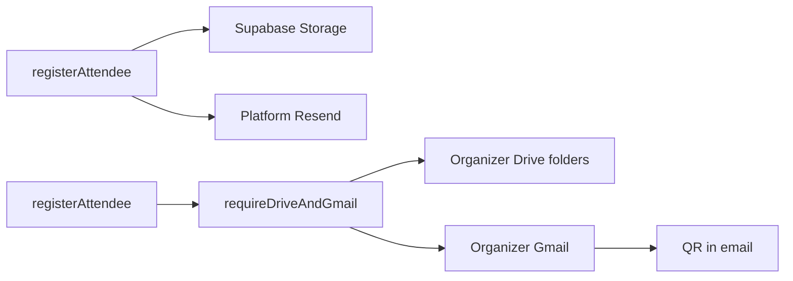

> **Shipped 2026-11-07.** Canonical archive of Phase A. Do not treat `.cursor/plans/` as source of truth.

# Event module Phase A — Drive + Gmail hard-require

**Locked decisions:** Hard-require Drive + Gmail before uploads / certificates / registration emails. First slice = Picker fix + Drive media path + organizer Gmail registration emails + QR in email.

**Backlog (after Phase A):** Overview/Access/Agenda/Sponsors/Expenses; Team-tab IA; Competitors removal; online mode / mentors / announcements / rubric / spectator leaderboard / roster-lock field removals; Phases file UX; Scoreboard polish.

## Current code anchors

- Registration confirmation still uses platform Resend in [src/features/registration/registrationEmail.ts](src/features/registration/registrationEmail.ts). Event templates already use fail-closed [organizerTransport.service.ts](src/features/email/organizerTransport.service.ts).
- Uploads: [uploadMedia.action.ts](src/features/media/uploadMedia.action.ts) to Supabase buckets.
- QR: [registration/qr.ts](src/features/registration/qr.ts) stores images in Supabase then embeds in email.
- Picker: [picker-token/route.ts](src/app/api/connections/google/picker-token/route.ts) + `GOOGLE_PICKER_API_KEY` / `GOOGLE_PICKER_APP_ID` ([docs/connections-picker-setup.md](docs/connections-picker-setup.md)). "API developer key is invalid" is Google rejecting the browser key (wrong project, referrer restriction, or API disabled).
- [GoogleDriveClient](src/features/connections/providers/google/drive.ts) can create blank files but has **no binary upload** yet.

## A0 — Picker developer key

1. Verify Vercel env per picker setup doc: browser API key with HTTP referrers for production, `*.vercel.app`, localhost; Picker + Drive APIs enabled; `GOOGLE_PICKER_APP_ID` = Cloud project number; OAuth client same project.
2. Improve client error copy when Picker returns invalid developer key (point to Connections / referrer checklist; never print the key).
3. Add troubleshoot subsection to picker setup + docs/17.
4. Accept: Files tab and Sheet picker open with a connected Drive account on prod/preview.

## A1 — Hard capability gate

Add `assertOrganizerDriveAndGmail(organizerId)` in connections/server:

- Requires active `drive.files` and send-capable Gmail (`resolveSender` / `requireConnectedSender`).
- Call sites: payment-proof upload, registration file fields, certificate issue/email, event-owned organizer media uploads, `registration_received` / `registration_confirmed` sends.
- Public register UI: block paid/file submit with CTA to organizer Connections if gate fails (no silent Resend/Storage fallback).
- Unit tests for allow/deny codes `NO_DRIVE` / `NO_GMAIL`.

## A2 — Drive upload + folders

1. Add multipart file upload to `GoogleDriveClient`.
2. Service `uploadEventAssetToOrganizerDrive`: Avoeline root folder, then `Event – {title}`, subfolders Payment proofs / Certificates / Media / Submissions; upsert `linked_files`; return file id + webViewLink.
3. Wire Phase A callers: payment proof + file fields in [registerAttendee.action.ts](src/features/registration/actions/registerAttendee.action.ts); certificate issue output; event banner/gallery/speaker/sponsor uploads that today use `uploadMedia` for event assets.
4. Persist Drive ids/links on registration payment / certificate rows; update verify/ticket readers accordingly.
5. New QRs: generate buffer, attach or upload under Drive Media/QR; ticket page can regenerate from payload if image missing (avoid growing Supabase qr-codes for new regs).

## A3 — Registration email via Gmail + QR

1. Switch `sendRegistrationEmail` to organizer Gmail only (fail closed).
2. Keep `maybeAutoEventEmail` on organizer path; ensure `qrCode` / `teamMembers` include-blocks work.
3. Hackathon/group: lead confirmation email includes member list + each member QR; ticket URLs retained.
4. Tests: builder includes QR; send mocked through organizer transport; gate blocks without connection.

## A4 — Certificates to Drive + email

1. On issue: render → Drive Certificates folder → store link.
2. Email via organizer Gmail with Drive link and/or site verify/download URL.
3. Gate issue/email on Drive+Gmail.

## A5 — Docs

Update docs/17, picker setup, completeContext; archive plan under `plans/`.

## Risks

- Live organizers without Connections cannot complete proof upload or get auto registration mail until they connect (intentional).
- Picker fix is primarily Cloud Console env/referrers; code only improves diagnosis/UX.
- No bulk migrate of existing Supabase objects in Phase A.
