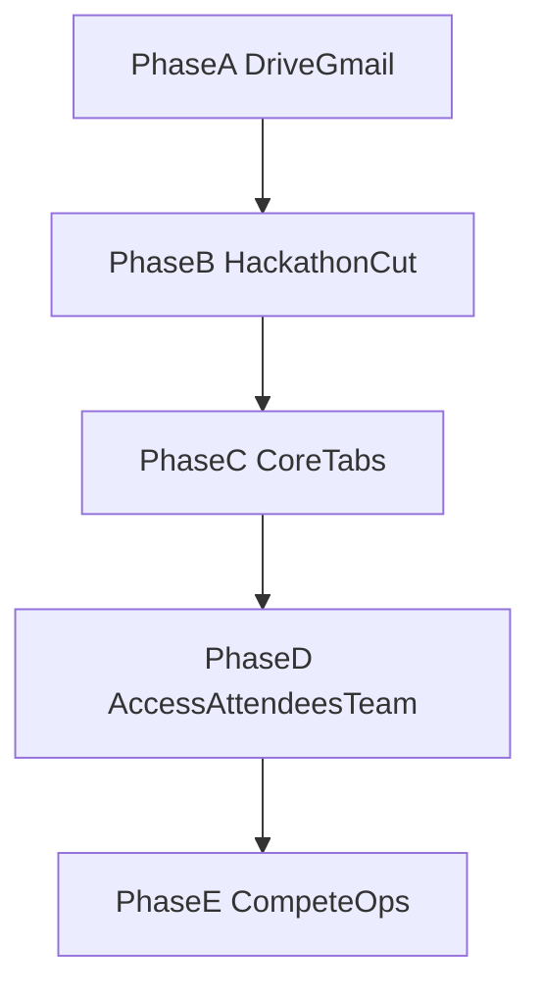

> **Shipped 2026-11-07.** Phases B–E landed; see `completeContext.md` Change log. Canonical archive — do not treat `.cursor/plans/` as source of truth.

# Event module Phase B+ — full event redesign

**Done (Phase A):** Drive+Gmail hard gate; proofs/media/QR/certs → organizer Drive; registration/cert mail via organizer Gmail + QR; Picker invalid-key UX/docs. Archive: [`plans/2026-11-07-event-drive-gmail-phase-a.md`](plans/2026-11-07-event-drive-gmail-phase-a.md).

**Locked for B+:** Hard-remove from **code and integrations** (UI + write paths; leave Postgres columns until a later schema pass unless trivial): online mode, mentors, announcements, judging rubric, spectator leaderboard, Competitors tab, roster locks, submission deadline / “opens” fields on add-competition. Competition type UI → **CTF checkbox only**. Rules = Instructions (one surface). Scoreboard owns standings. Recruitment stays on organizer **Teams** (right rail), not event Team tab. Join codes move into **Attendees** after confirmation checks.

---

## Answers embedded (product questions you asked)

### Access — how it works today
Canonical types in [`src/features/access/types.ts`](src/features/access/types.ts) (`ACCESS_TYPE_META` + [`HowAccessWorks.tsx`](src/features/access/components/HowAccessWorks.tsx)):

| Type | Listing | Who can register |
| --- | --- | --- |
| **public** | Listed | Anyone |
| **private** | Not listed; direct link | Access **code** and/or **whitelist** email |
| **invite_only** | Not open walk-up | Only **invite links** / invited emails |
| **hybrid** | Listed | Open for some tiers; other tiers need code/whitelist |
| **tiered** (VIP) | Listed | Tier pick; gated tiers need guest list |

- **Whitelist** = `event_invites` row `kind=whitelist` (email authorized; no shareable token).
- **Invite link** = same table `kind=invite` with unguessable token; each invitee gets **their** link, not one shared code for everyone.
- **Custom form** = registration questions (`event_form_fields`), not access control — collects answers at signup. Phase D will make this labeling obvious on the Access tab.
- **Tiers/promos** live on Access via [`TiersPromosOnAccess.tsx`](src/features/ticketing/components/TiersPromosOnAccess.tsx); Phase D ensures they render correctly on the public event page when enabled.

### Files tab — flow
[`.../files`](src/app/organizer/[organizer_id]/events/[eventId]/files/page.tsx) → [`EntityFilesPanel`](src/features/connections/components/EntityFilesPanel.tsx): **link** Drive files (Picker) or **create** Doc/Sheet/Slides into Avoeline folder, stored as `linked_files` metadata only (not app Storage). Separate from Phase A **uploads** (proofs/certs/media bytes into Drive folders). Picker “API developer key is invalid” = Cloud Console key/referrers (docs already updated); Vercel env must match.

---

## Phase B — Hackathon surface cut + Competitors → Attendees

**Goal:** Delete dead product surface; stop writing removed fields.

1. Remove UI + actions + public routes for: online mode, mentors (`/events/.../mentors`), announcements, rubric/judging leaderboard UI, spectator leaderboard (`.../tracks/[trackId]/leaderboard`), roster lock / submission deadline / opens-at from add-competition ([`TrackForm.tsx`](src/features/hackathon/components/TrackForm.tsx), [`tracks.action.ts`](src/features/hackathon/actions/tracks.action.ts), [`HackathonWorkspace.tsx`](src/features/hackathon/components/HackathonWorkspace.tsx), [`LiveForms.tsx`](src/features/hackathon/components/LiveForms.tsx), [`MentorForms.tsx`](src/features/hackathon/components/MentorForms.tsx), [`JudgingForms.tsx`](src/features/hackathon/components/JudgingForms.tsx), etc.).
2. Settings: strip online mode; keep remaining toggles wired and enforced ([`docs/hackathon-settings-matrix.md`](docs/hackathon-settings-matrix.md) update).
3. Competition create UI: CTF checkbox only; single Rules/Instructions field; fix “Add competition” preview transparency ([`HackathonWorkspace.tsx`](src/features/hackathon/components/HackathonWorkspace.tsx)).
4. Remove **Competitors** tab from [`layout.tsx`](src/app/organizer/[organizer_id]/events/[eventId]/layout.tsx); redirect `.../teams` → attendees or competitions.
5. Surface **join / enter codes** on Attendees (team/group drawers) **only after** payment/approval confirmation; copy: valid until {date or event end}; hide until checks pass.

**DoD:** No nav entry or public page for removed features; typecheck; no new writes to removed fields from UI.

---

## Phase C — Overview, Agenda, Sponsors, Expenses, Speakers

**Overview** ([`events/[eventId]/page.tsx`](src/app/organizer/[organizer_id]/events/[eventId]/page.tsx)):
- Keep dates/facts currently shown; fix/remove opaque **“programme”** variable (rename to agenda summary or drop if unused).
- Ticket strip: free vs paid; if hackathon with multiple competitions, show **per-competition fees** (not a single misleading ticket).
- Show **map link** when set at create (`maps_url`); hide **seats left** when unlimited (`totalSeats === 0`) until organizer sets a cap.

**Agenda:** Day-grouped timeline UI (opening → talks → competitions) ordered by date/time ([`AgendaClientContent`](src/features/agendas/) + organizer agenda page).

**Sponsors:** Organizer add/list unchanged in spirit; public page = **list + “Preview” opens detail** (no expand-in-place accordion). Paths: sponsors page + [`PublicSponsorsStrip`](src/features/events/components/public/PublicSponsorsStrip.tsx) / public about.

**Expenses:** Correct income/expense totals and provenance (registration fees vs manual lines) in [`ExpensesClient`](src/features/expenses/).

**Speakers:** Sanity pass only (already “good to go”).

---

## Phase D — Access, Attendees, Team IA

**Access:**
- Promote [`HowAccessWorks`](src/features/access/components/HowAccessWorks.tsx) into a clear in-tab flow (type → code/whitelist/invites → form → tiers).
- Relabel custom form as “Registration questions”.
- Tiers/promos checks → visible on public event when applicable.
- Access emails: compose + send via organizer Gmail ([`organizerTransport`](src/features/email/organizerTransport.service.ts)) for invite/whitelist/decision mail.

**Attendees:**
- Participant bar: full details, check-in; **remove unused “location”**.
- Compose include-blocks (team members, team name, QR, etc.) verified end-to-end (Phase A mail path).
- Exports: event participants; hackathon **team-wise** and **participant-wise**; if Sheets connection exists, show open/sync entry ([`GoogleSheetsExportPanel`](src/features/connections/), Exports tab + Attendees CTA).

**Team (event `/staff`):**
- Only **assign** library teams/members/leads to this event + access for event staff.
- **Do not** host recruitment here — keep on organizer Teams right-rail ([`TeamsManager`](src/features/teams/) / recruitment routes).

---

## Phase E — Competitions public + Phases/Tasks files + Submissions + Scoreboard

**Competitions:**
- Judge invite: compose email + track accepted invites.
- Public event page: competitions with prizes, discounts, per-track `registration_closes_at` vs event-level close ([`publicEvent.service.ts`](src/features/events/publicEvent.service.ts)).

**Phases & Tasks:** Per competition; organizer file pick (Drive-backed where Phase A patterns apply); participant submit **link and/or file** with notes ([`HackathonPhasesTasksPanel.tsx`](src/features/hackathon/components/HackathonPhasesTasksPanel.tsx), submissions actions).

**Submissions:** Always list rows with timestamps below filters (empty-aware), not only when filtered to a hit.

**Scoreboard:** Team name, points up/down, phases/tasks completed counts ([`LiveScoreboardTable.tsx`](src/features/hackathon/components/LiveScoreboardTable.tsx)) — replaces removed spectator leaderboard.

**Certificates / Files:** No re-build of Phase A storage/mail; only verify Drive links in cert email and Files copy/help if still confusing.

---

## Docs / archive

After each phase: update [`completeContext.md`](completeContext.md), [`docs/hackathon-settings-matrix.md`](docs/hackathon-settings-matrix.md), Access help copy; archive this plan under `plans/YYYY-MM-DD-event-module-phase-b-plus.md` + [`plans/INDEX.md`](plans/INDEX.md).

## Out of scope for B+

- Bulk migrate old Supabase objects to Drive.
- Dropping unused Postgres columns (follow-up migration after removals settle).
- Re-implementing mentors/online/announcements/rubric/spectator board.