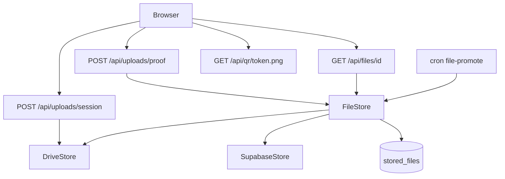

# O1 FileStore — Drive first, fallback, Picker fix

Follow [`docs/ENGINEERING_RULES.md`](docs/ENGINEERING_RULES.md) (S2/S5/S6), [`docs/17-connections-system.md`](docs/17-connections-system.md) §8/§10 (`drive.file` only), [`docs/22-event-module-overhaul.md`](docs/22-event-module-overhaul.md) A4–A6 / O1.

**Delivery cadence (from O1):** implement **items 1–4**, pause for review; then **items 5–9**, pause again.

**Reuse:** Phase A gate [`assertOrganizerDriveAndGmail.ts`](src/features/connections/server/assertOrganizerDriveAndGmail.ts), [`eventDriveUpload.service.ts`](src/features/connections/server/eventDriveUpload.service.ts), [`GoogleDriveClient`](src/features/connections/providers/google/drive.ts), [`linked_files`](supabase/migrations/20261103220000_linked_files.sql), [`/api/connections/google/picker-token`](src/app/api/connections/google/picker-token/route.ts).

**Decision:** New table `stored_files` for binary upload metadata (checksum, category, fallback flag). Keep `linked_files` for Library/Picker Docs/Sheets. Drive uploads upsert both when appropriate. Drop the Drive **QR** folder kind (A6: QR never stored).

---

## Architecture

---

## Phase 1 — Items 1–4 (pause after)

### 1. FileStore + schema + lazy A6 folders

**New module** under `src/features/files/` (server-only):

- `types.ts` — `FileStore` interface: `put`, `get`, `stream`, `delete`, `link`
- `DriveStore.ts` — organizer connection (`drive.file`), wraps/extends `GoogleDriveClient`
- `SupabaseStore.ts` — private bucket (reuse `payment-screenshots` or new `file-fallback`), TTL via `expires_at`, plan quota from existing SaaS limits (default sensible caps)
- `fileStore.ts` — facade: try Drive → on failure put Supabase + `needs_promote=true`
- `folders.ts` — lazy layout from A6:

  `Avoeline / <Event title> (<shortId>) / Payment proofs | Certificates | Media | Exports | Submissions / <Competition> / <Team>`

  Refactor [`eventDriveUpload.service.ts`](src/features/connections/server/eventDriveUpload.service.ts) to call this; **remove `qr` kind**.

**Migration** `supabase/migrations/YYYYMMDDHHMMSS_stored_files.sql`:

| Column | Notes |
| --- | --- |
| `id` uuid PK | public file id for `/api/files/[id]` |
| `provider` | `drive` \| `supabase` |
| `provider_file_id` | Drive file id or storage object key |
| `connection_id` | nullable (Drive) |
| `name`, `size`, `mime`, `checksum` | sha256 |
| `category` | `payment_proof` \| `submission` \| `media` \| `certificate` \| `export` \| … |
| `entity_type`, `entity_id` | registration, event, team, task_submission, … |
| `organizer_id`, `event_id` | for auth + promote |
| `needs_promote`, `promoted_at` | fallback flag |
| `uploaded_at`, `expires_at` | TTL for supabase rows |
| RLS deny-by-default; service role writes |

Regenerate types (`npm run types:db`). Add `TABLES.STORED_FILES` in [`data/collections.ts`](data/collections.ts).

Route all new binary writes through FileStore; migrate call sites incrementally starting with payment proofs + event media + task submissions (leave website CMS / support on `uploadMedia` until a follow-up if out of scope—**default: wire event/hackathon/registration paths in O1**).

### 2. Public proof upload API

- Client: compress images in browser (canvas/webp or existing compress helper) before POST.
- **`POST /api/uploads/proof`** (nodejs runtime): rate-limit IP + `eventId` ([`rateLimit`](src/lib/rateLimit.ts)); magic-byte sniff; allowlist image + PDF; size + dimension caps; re-encode images (sharp already used in website CMS) to strip EXIF; random object name; FileStore.put → Drive, else Supabase + `needs_promote`.
- Return `{ fileId }` only; registration actions store `stored_files.id` (or `drive:`/`file:` ref) **after** upload success—update [`uploadRegistrationProofDrive.action.ts`](src/features/registration/actions/uploadRegistrationProofDrive.action.ts) / [`CustomFieldsRenderer`](src/features/registration/) to use this route.

### 3. Resumable large uploads

- **`POST /api/uploads/session`**: auth organizer/staff (or participant for submissions); block executable/script MIME+extensions; create Google resumable session with app origin; return session URL (not refresh token).
- Browser uploads to Google; **`POST /api/uploads/complete`**: verify file exists + size + mime via Drive metadata; insert `stored_files`; optional `linked_files` upsert.
- Wire organizer media / presentations / hackathon submissions through this path (replace small-body Supabase paths in [`tasks.action.ts`](src/features/hackathon/actions/tasks.action.ts) for file work where size > ~4MB threshold).

### 4. Viewing proxy

- **`GET /api/files/[id]`**: load `stored_files`; authorize via linked entity (registration owner, event staff/`assertEventActor`, organizer); stream via FileStore (Drive token server-side only); `Content-Type` + `X-Content-Type-Options: nosniff`; `inline` for image/PDF else `attachment`. Never return Drive URLs or tokens.
- Point attendee proof links / organizer lists at this route (fix ticket + attendees proof URLs that currently miss `drive:` refs).

**Pause here** for your review before items 5–9.

---

## Phase 2 — Items 5–9 (after Phase 1 approval)

### 5. QR never stored

- Add **`GET /api/qr/[token].png`**: resolve registration by UUID token (unguessable); `generateQrPng` from `qr_code_data` / rebuild payload; `Cache-Control: private, max-age=300` (or similar); no Drive upload.
- Change [`qr.ts`](src/features/registration/qr.ts): remove `generateAndHostQr` Drive upload; keep `generateQrPng` + payload helpers.
- Stop writing `registrations.qr_code_image_url`; deprecate column (comment in migration / stop writes—**do not DROP** yet, same as O0).
- Emails already inline PNG ([`registrationEmail.ts`](src/features/registration/registrationEmail.ts)) — keep; ticket page uses `/api/qr/{registrationId}.png`.

### 6. Drive health + fallback banners

- Service: derive status `active | needs_reconnect | full | blocked` from connection row + last Drive API errors / capacity.
- Surface banners on Files, Attendees (proofs), Certificates, Submissions when degraded; clear copy when `needs_promote` count > 0 (“Temporarily storing in secure fallback…”).
- Cron **`/api/cron/file-promote`**: move `needs_promote` rows to Drive, delete Supabase object, clear flag (`CRON_SECRET`).

### 7. Publish gating (required only when needed)

- Before publish (or when enabling paid proofs / file fields / certificate archive): if event collects files or archives certs → require active Drive (prompt connect); otherwise optional.
- Soften hard-require messaging for events that do not collect files (align Phase A gate with A6 “required only when…”).

### 8. Picker key invalid fix

- Keep/enhance [`picker-token/route.ts`](src/app/api/connections/google/picker-token/route.ts): always return `{ apiKey, appId, accessToken, clientId }` from server env.
- Startup/env validation in [`src/env.ts`](src/env.ts): fail-fast or warn when `GOOGLE_PICKER_API_KEY` / `GOOGLE_PICKER_APP_ID` missing in production.
- Admin-only diagnostics action/route: checks presence + format (length/prefix), **never returns key value**.
- Document A5 Google Cloud steps in [`docs/connections-picker-setup.md`](docs/connections-picker-setup.md) (already partial—expand to match A5 order).

### 9. Tests

Unit/integration under `src/features/files/__tests__/` (+ route tests where practical):

- Type/size rejection; executable blocked
- Re-encode strips EXIF (fixture with EXIF → assert gone)
- Drive down → Supabase + promote job moves + deletes temp
- `/api/files` permission deny/allow
- Responses never include tokens/Drive URLs
- QR endpoint sets cache headers

Also: `typecheck`, focused lint, knip on new module, update [`completeContext.md`](completeContext.md) + archive plan to `plans/`.

---

## Key files to touch

| Area | Paths |
| --- | --- |
| Core | `src/features/files/**`, migration `stored_files` |
| Drive folders | `eventDriveUpload.service.ts`, `linkedFiles.service.ts`, `providers/google/drive.ts` |
| APIs | `src/app/api/uploads/**`, `src/app/api/files/[id]/route.ts`, `src/app/api/qr/[token]/route.ts`, `src/app/api/cron/file-promote/route.ts` |
| Callers | registration proof/media, hackathon submissions, certificates archive |
| QR | `qr.ts`, `registration.service.ts`, ticket pages, import |
| Picker | `picker-token/route.ts`, `env.ts`, admin diagnostics, `docs/connections-picker-setup.md` |

---

## Out of scope this O1

- Dropping `qr_code_image_url` / old Supabase objects (deprecate + stop write only)
- Migrating every CMS/support upload in one pass (event/registration/hackathon first)
- Public Drive sharing or broader Google scopes
