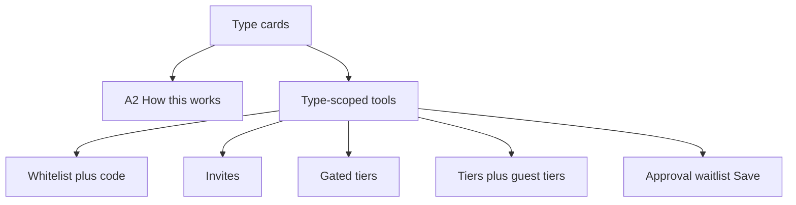

# O3 Access tab rebuild

## Locked decisions

- **Public DTO:** drop `promoHints` entirely (no promo material on the public page). Keep automatic student/group discounts only. Matches O3 §6–7 “never show promo codes / never in public DTO”.
- **Guest invite revoke:** soft-revoke (`status: revoked`) so the table can show revoked; expired computed at read from `expires_at` / single-use.
- **Public page gate:** route all view + register checks through `resolveEventAccess` / `decideAccess` (retire divergent `src/lib/access.ts` `checkAccessGate` usage on the public event path). Guest-list whitelist lives in `event_invites` and is loaded for the gate.
- **Hybrid `?invite=`:** unlock gated tiers only after a **validated** invite token (no bare query-string unlock).
- **Auth on Access writes:** `saveAccessSettings` uses `assertEventActor(eventId, "access")` (same as guest writes).
- **Visibility id:** store `tiered` everywhere; UI label “VIP / Tiered”; map any legacy `vip_tiered` at the boundary.
- **Build once** (ignore original O3 mid-pauses). Form-on-Access already removed — leave it off.

## Baseline (keep)

- [`AccessSettingsForm.tsx`](src/features/access/components/AccessSettingsForm.tsx) conditional fields + one Save; [`GuestListPanel.tsx`](src/features/access/components/GuestListPanel.tsx) CSV preview; [`TiersPromosOnAccess.tsx`](src/features/ticketing/components/TiersPromosOnAccess.tsx) hackathon hide; `decideAccess` / registration `resolveEventAccess`; Attendees Registration form drawer.

---

## A. Layout (items 1–2)

Files: [`access/page.tsx`](src/app/organizer/[organizer_id]/events/[eventId]/access/page.tsx), [`AccessSettingsForm.tsx`](src/features/access/components/AccessSettingsForm.tsx), new [`HowAccessWorks.tsx`](src/features/access/components/HowAccessWorks.tsx), slim/replace [`AccessFlowGuide.tsx`](src/features/access/components/AccessFlowGuide.tsx), [`AccessTypeSelector.tsx`](src/features/access/components/AccessTypeSelector.tsx).

1. Type selector as **cards** (reuse/adapt `AccessTypeSelector` on the Access tab; align `tiered`).
2. Restore **How this works** as the A2 table (who sees / who registers / setup / what they get).
3. Render tools only for the chosen type:
   - Private + Hybrid → whitelist + access code
   - Invite only → invites (no whitelist UI)
   - Hybrid → gated-tiers picker
   - VIP/Tiered → access tiers + optional guest list with tier column
   - Public → approval/waitlist only (+ tiers/promos when not hackathon)
4. Approval + waitlist + **one Save**; keep Attendees form link only (no builder on Access).

---

## B. Guest list (item 3)

Files: [`access/page.tsx`](src/app/organizer/[organizer_id]/events/[eventId]/access/page.tsx), [`GuestListPanel.tsx`](src/features/access/components/GuestListPanel.tsx), [`types.ts`](src/features/access/types.ts), [`guestList.action.ts`](src/features/access/actions/guestList.action.ts), [`inviteLinks.action.ts`](src/features/access/actions/inviteLinks.action.ts).

1. Split into **two tables**: Whitelist vs Invite links.
2. Invite status at read: `pending | opened | registered | expired | revoked` (derive expired; soft-revoke action).
3. Keep validation preview + CSV upload with filename; add **sample CSV download** (exact columns: whitelist `email,name` / invite `email,name,tier` as documented).
4. Scope add UI by type (whitelist kinds only on Private/Hybrid/VIP; invite kinds on Invite only / VIP optional).

---

## C. Email guests (item 4)

Files: new `GuestEmailComposer.tsx` + `guestEmailBatch.action.ts`; reuse [`organizerTransport.service.ts`](src/features/email/organizerTransport.service.ts) `requireConnectedSender` / `sendViaOrganizerConnection`; docs/18 send-limits helpers already used by attendee bulk mail.

1. Toolbar **Email guests**: subject/body with `{{inviteLink}}` or `{{eventLink}}`, recipient filters (all pending, selected, not opened, not registered), HTML preview.
2. Send via connected sender; when disconnected show banner + **copy-link** fallback (per-row invite/event URL).
3. Schedule / capacity through the same send-limits path as Attendees bulk mail; record send status; support resend for failed/pending rows.
4. Wire from [`access/page.tsx`](src/app/organizer/[organizer_id]/events/[eventId]/access/page.tsx) only when guest tools are visible.

---

## D. Tiers / public page / gates (items 5–6)

Files: [`ticketing.service.ts`](src/features/ticketing/ticketing.service.ts), [`publicEvent.service.ts`](src/features/events/publicEvent.service.ts), [`PublicTiersAndDiscounts.tsx`](src/features/events/components/public/PublicTiersAndDiscounts.tsx), [`PublicRegisterCard.tsx`](src/features/events/components/public/PublicRegisterCard.tsx), [`types.ts`](src/features/events/types.ts), [`access.service.ts`](src/features/access/access.service.ts), registration create path, [`accessSettings.action.ts`](src/features/access/actions/accessSettings.action.ts).

1. At read: promo expiry already demotes `active`; add the same for ticket tiers past `available_until`.
2. Public DTO: only active tiers inside window; expose seats left when `seats_available` tracked (`max(0, seatsAvailable - seatsSold)`); remove `promoHints` from DTO + UI.
3. Registration tier pick rejects inactive/out-of-window/sold-out tiers.
4. Unify public gate with `resolveEventAccess` (load guest whitelist + invites); validate hybrid invite tokens; rate-limit code/invite probes (keep existing `public-gate` limiter).
5. `saveAccessSettings` → `assertEventActor(..., "access")`.

---

## E. Tests + docs (item 7)

Unit tests (primary; no full Playwright O8 matrix in this pass):

- `decideAccess` / `inviteRefusal` for each access type + whitelist + invite single-use/expiry
- Guest parse preview statuses
- `listTiers` / public DTO: window filter, seats left, **no** `promoHints` / promo code keys
- Rate-limit key behavior for public gate (pure wrapper or existing `rateLimit` test pattern)

Update [`completeContext.md`](completeContext.md), [`docs/22-o2-o8-status.md`](docs/22-o2-o8-status.md) O3 section, archive [`plans/YYYY-MM-DD-o3-access-rebuild.md`](plans/) + INDEX.

## Out of scope

- Full Playwright O8 access matrix CI
- O4+ tabs
- Dropping deprecated DB columns
