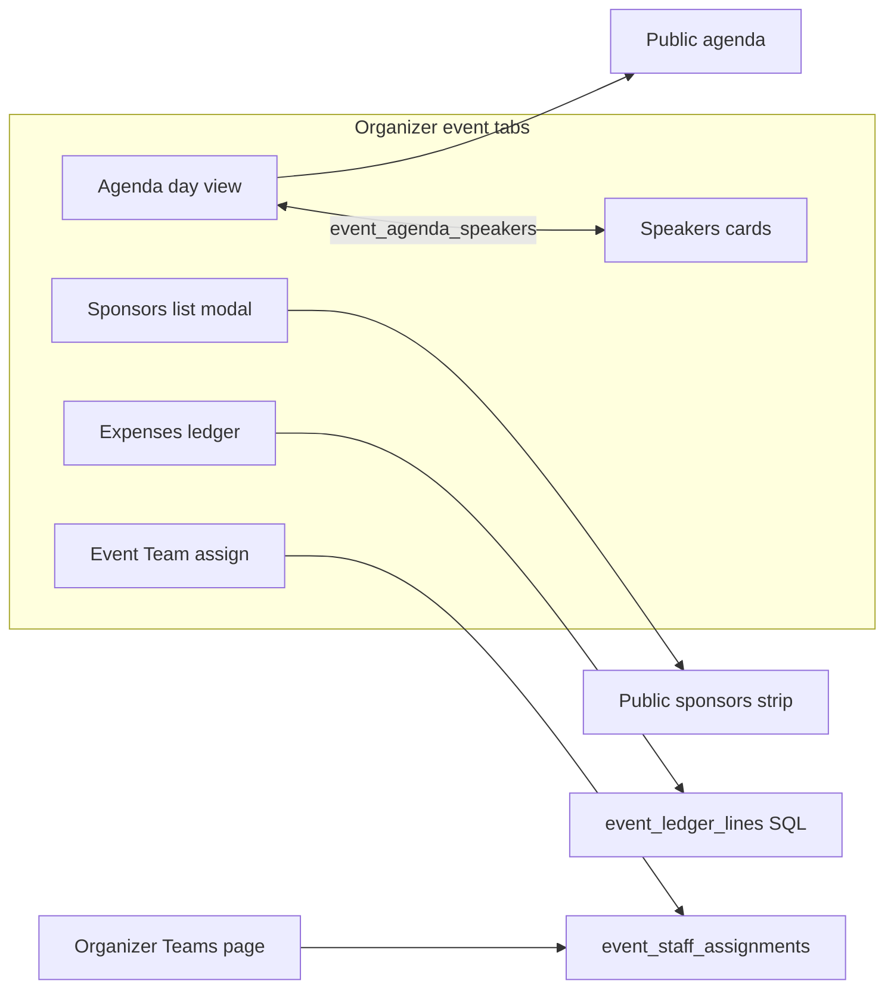

# O4 Agenda, Speakers, Sponsors, Expenses, Team

## Locked decisions

- **Build once** (ignore O4 mid-pauses), same as O2/O3.
- **Agenda types:** store canonical labels `Opening | Talk | Panel | Workshop | Competition | Break | Networking | Closing | Other`; map legacy `TALK`/`WORKSHOP`/… at the service boundary.
- **Competition link:** new nullable `event_agenda_items.track_id` → `hackathon_tracks` (only when type is Competition). Keep `linked_child_event_id` unused for this.
- **Overlap:** warn-only on create/edit (same location or shared speaker + overlapping time); do not block save.
- **Sponsor payments:** columns on `event_sponsors_partners`: `payment_status` (`pending|partial|received`), `amount_received numeric`, `received_on date`. Expected = `contract_value`.
- **Ledger:** new SQL view `event_ledger_lines` + RPC `event_ledger_totals(p_event_id)`; app reads only those. Manual `event_expenses.kind` gains `income` (keep `expense`/`credit`).
- **Double-count rule:** if a manual expense has `booking_id` (or own-vendor id), that booking’s automatic expense line is omitted from totals / marked superseded; the manual line is the cost.
- **Event lead:** add `lead_member_id uuid null` on `event_staff_assignments` (per assigned team on this event).
- **Team tab:** assignment-only UI; recruitment, grants, and member editing only on organizer Teams. Same tables → immediate sync.

## Baseline (keep / extend)

- Day tabs + timeline: [`AgendaClientContent.tsx`](src/features/agendas/components/AgendaClientContent.tsx), [`AgendaHeader.tsx`](src/features/agendas/components/AgendaHeader.tsx), [`AgendaTimeline.tsx`](src/features/agendas/components/AgendaTimeline.tsx), [`agendaSort.ts`](src/features/agendas/agendaSort.ts)
- Speaker ↔ session join: [`agendaSpeakers.service.ts`](src/features/agendas/agendaSpeakers.service.ts) (`setAgendaSpeakers` / `setSpeakerSessions` / `sessionsBySpeakerIds`)
- Public agenda: [`PublicAgenda.tsx`](src/features/events/components/public/PublicAgenda.tsx)
- Sponsors toggles: [`PublicShowToggles.tsx`](src/features/organizations/components/PublicShowToggles.tsx); form: [`OrganizationForm.tsx`](src/features/organizations/components/OrganizationForm.tsx)
- Manual expenses CRUD: [`event_expenses/*`](src/features/event_expenses/); today’s RPC [`event_expense_totals`](supabase/migrations/20261012160000_phase4_event_tabs.sql) + TS [`sumRegistrationRevenue`](src/features/event_expenses/expenses.service.ts) (not verified-only) — replace both for displayed totals with ledger RPC
- Own vendors table already exists (`event_external_vendors`) but is **not** unioned into expenses yet
- Assignments: [`event_staff_assignments`](supabase/migrations/20261006200000_organizer_staff_library.sql) (`team_id`, `member_ids` only today), [`EventStaffAssignForm`](src/features/teams/components/OrganizerTeamsBoard.tsx), [`saveEventStaffAssignmentsAction`](src/features/teams/actions/teamEngine.action.ts), [`TeamsManager`](src/features/teams/components/TeamsManager.tsx) (`hideRecruitment`; event tab still shows Grant access / Export / TeamCreator — use `hideChrome` + dedicated Assign CTA)
- Public sponsor preview building block: [`PublicSponsorsStrip.client.tsx`](src/features/events/components/public/PublicSponsorsStrip.client.tsx) (reuse on Sponsors tab preview modal)
- Tab order already matches A9 in [`layout.tsx`](src/app/organizer/[organizer_id]/events/[eventId]/layout.tsx) — no nav reorder

---

## A. Agenda (item 1)

**Files:** [`agenda.service.ts`](src/features/agendas/agenda.service.ts) (`agendaItemToSession` collapses non-canonical types today), [`CreateAgendaForm.tsx`](src/features/agendas/components/CreateAgendaForm.tsx) (form types diverge from model), [`agendaSpeakers.service.ts`](src/features/agendas/agendaSpeakers.service.ts) (`speakersByAgendaItem` unused on read), [`agenda.model.tsx`](src/services/models/agenda.model.tsx), public DTO/UI, migration for `track_id`.

1. **Single source of truth:** read/write `event_agenda_items` + `event_agenda_speakers` only; stop appending divergent ids to `events.extra.agenda` on create (keep read fallback temporarily).
2. Expand `SessionType` + badges for all nine types; align form options with the model (drop keynote/qna/registration collapse).
3. Add **list | timeline** toggle on the day view (client state; default timeline).
4. Replace `create-agenda` route with shared **Modal** “Add item” (and **edit/delete** — missing today): title, type, date, start/end, location/room, speakers multi-select, competition select (hackathon + type Competition), description.
5. Pure helper `findAgendaOverlaps(sessions, candidate)` → location conflicts + speaker conflicts; warn-only in the modal.
6. Persist speakers via `setAgendaSpeakers`; hydrate timeline from join + profile images (not denormalized `speaker_names` alone); write `track_id` when Competition.
7. Public: day tabs or day sections + type badges + location + speaker avatars; extend `PublicAgendaItem` with speaker photo refs / track when needed ([`PublicAgenda.tsx`](src/features/events/components/public/PublicAgenda.tsx)).

---

## B. Speakers (item 2)

**Files:** [`SpeakerCard.tsx`](src/features/event_speakers/components/SpeakerCard.tsx), [`speakers/page.tsx`](src/app/organizer/[organizer_id]/events/[eventId]/speakers/page.tsx) (already passes `sessionsBySpeakerIds`), [`CreateSpeakerForm.tsx`](src/features/event_speakers/components/CreateSpeakerForm.tsx), speakers service.

1. Regression pass: agenda create/edit and speaker session multi-select both maintain `event_agenda_speakers`; on agenda edit, refresh join + display names.
2. Cards already show linked session titles — keep that; fix agenda→speaker display path (timeline ignores join today).
3. No Speakers redesign beyond sync integrity (optional: ignore legacy purpose/time fields when sessions are linked).

---

## C. Sponsors (item 3)

**Files:** [`sponsors/page.tsx`](src/app/organizer/[organizer_id]/events/[eventId]/sponsors/page.tsx) (today: permanent left-column Add form + `?edit=`), [`OrganizationForm.tsx`](src/features/organizations/components/OrganizationForm.tsx), [`PublicShowToggles.tsx`](src/features/organizations/components/PublicShowToggles.tsx), [`PublicSponsorsStrip.client.tsx`](src/features/events/components/public/PublicSponsorsStrip.client.tsx).

1. **List-first:** cards/table of all orgs (logo, name, type, tier, payment/details). Remove the always-visible Add card and the `?edit=` expanding form pattern.
2. **Add / Edit** opens Modal: type-adaptive fields (reuse `OrganizationForm` body) → **Preview** step (public card mock) → Save.
3. Toolbar: **Preview public section** modal embedding/mirroring `PublicSponsorsStrip` with current `show_*` toggles; keep three switches with live preview in that modal (and on-page toggles next to the button).
4. Sponsor payment controls on edit: status + amount received + date; feed ledger expected/received.

---

## D. Expenses ledger (item 4 + A8)

**Migration + service rewrite.**

1. Migration: alter `event_expenses.kind` check to include `income`; create view `event_ledger_lines` unioning:
   - Ticket income: **verified** registration payments only (tighten vs today’s all `amount_paid`; refunds negative)
   - Competition fees: verified team/track payments
   - Sponsor expected (`contract_value`) and received (`amount_received` when status received/partial)
   - Vendor bookings (confirmed/completed) planned→paid
   - Own vendors (`event_external_vendors` budget/status) planned→paid
   - Manual `event_expenses` rows (including new `income`)
   Columns: `line_id`, `source` (`auto_*`|`manual`), `direction` (income|expense), `status` (received|expected|paid|planned), amounts, category, `source_path`, `booking_id`, `superseded` flag for auto lines paid by linked manual.
2. RPC `event_ledger_totals`: income received/expected, expenses paid/planned, net, projected net, budget vs actual by category — **all in SQL**, applying double-count exclusion. Stop using `event_expense_totals` / `sumRegistrationRevenue` for the summary tiles.
3. UI [`ExpensesClient`](src/features/event_expenses/components/ExpensesClient.tsx): ledger table; auto rows read-only + link to source; manual full CRUD (income/expense/credit); filters; export covers automatic + manual (extend today’s manual-only xlsx).

---

## E. Event Team tab (item 5)

**Files:** [`staff/page.tsx`](src/app/organizer/[organizer_id]/events/[eventId]/staff/page.tsx), [`TeamsManager.tsx`](src/features/teams/components/TeamsManager.tsx) (`hideChrome` + Assign CTA), [`EventStaffAssignForm`](src/features/teams/components/OrganizerTeamsBoard.tsx), `teamEngine` service/action.

1. Show assigned teams/members only; promote **Assign team** (reuse `EventStaffAssignForm` fields: library pick + member subset + new per-event lead); per-row **Remove from event**; member details stay read-only (drawer already).
2. Persist `lead_member_id` on `event_staff_assignments` (today lead is only library `team_members.role`); migrate action/service.
3. Keep / surface **Manage in Teams** → `/organizer/{id}/teams` (already in board/drawer).
4. Event tab chrome: `hideRecruitment` + **`hideChrome`** (strip Grant access, Export, TeamCreator); stop loading applicants/forms/positions on `/staff` (advancedDetails unused when recruitment hidden).

---

## F. Tests + docs (item 6)

Unit tests (primary; Playwright deferred with O8):

- `findAgendaOverlaps` location + speaker cases
- Speaker session sync helpers (join set/clear)
- Sponsor preview payload / visibility: toggles off → empty public strip filter (extend existing org filter tests)
- Ledger totals: auto+manual, booking-linked manual does not double-count, sponsor expected vs received
- Assignment sync: set/list assignments + lead_member_id round-trip (service-level with mocked client or pure mappers)

Update [`completeContext.md`](completeContext.md), [`docs/22-o2-o8-status.md`](docs/22-o2-o8-status.md) O4 section, archive [`plans/2026-11-08-o4-agenda-sponsors-expenses-team.md`](plans/) + INDEX. Regenerate types after migrations (`npm run types:db`).

## Out of scope

- Full Playwright O8 matrix
- O5+ competitions rebuild
- Dropping deprecated DB columns
