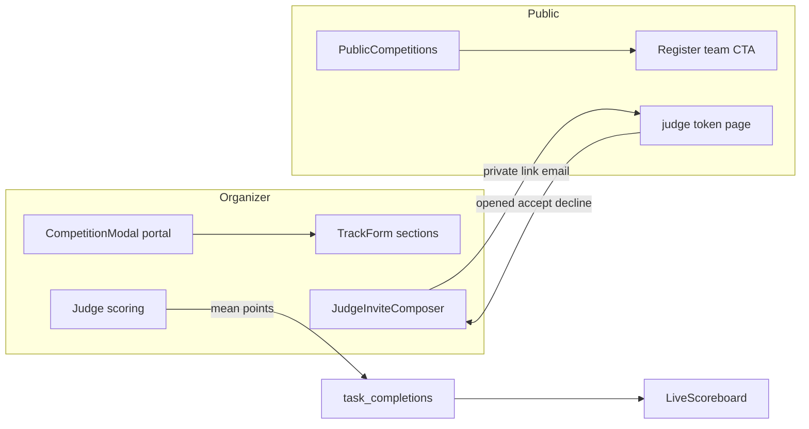

# O5 Competitions, Judges, Public Parity

## Locked decisions

- **Build once** (same as O2–O4); final docs/tests pass is the review gate.
- **Modal bleed root cause:** `CompetitionModal` under Card `action` inherits `opacity-80`. Fix shared [Modal.tsx](src/components/ui/Modal.tsx) with `createPortal` to `document.body`, solid `bg-paper` panel, `bg-black/60` overlay, scroll lock, `z-[100]`, and focus trap. Keep one shared Modal (C3).
- **Effective close:** `track.registrationClosesAt` if set, else event `registrationCloseDate` (end-of-day for date-only). **Full** = dates open but event `seatsLeft === 0` and waitlist off (one team = one seat). No new per-track team-cap column.
- **Judge invite:** composer on track configure (`requireConnectedSender` + `sendViaOrganizerConnection`); statuses `invited | opened | accepted | declined` in `hackathon_judges.extra`; **opened** on `/judge/[token]` load; **resend** reuses token (reset to invited only from declined).
- **Judge scoring (no rubric):** accepted judge scores each submission `0..task.points` + optional comment. New table `hackathon_judge_submission_scores`; on write, mean of scores upserts `hackathon_task_completions` so existing [scoreboardAggregate.ts](src/features/hackathon/scoreboardAggregate.ts) keeps working.
- **Public DTO:** allowlisted `PublicCompetition` only; never tasks/flags/hints/judge tokens or links.

---

## 1. Modal opacity + TrackForm sections

**Files:** [Modal.tsx](src/components/ui/Modal.tsx), [CompetitionModal.tsx](src/features/hackathon/components/CompetitionModal.tsx), [TrackForm.tsx](src/features/hackathon/components/TrackForm.tsx), [HackathonWorkspace.tsx](src/features/hackathon/components/HackathonWorkspace.tsx).

1. Portal Modal to `document.body`; overlay `z-[100]`; focus trap + Escape + body scroll lock; opaque `bg-paper` panel.
2. Regroup TrackForm: Basics (name, description, image, This is a CTF); Team and pricing (sizes, fee, discount, sponsor); Prizes; Rules and instructions (+ file); Registration closes (own section).
3. Close modal on successful save via `onSuccess`.

---

## 2. Effective close + per-competition Register

**Files:** [publicEventStatus.ts](src/lib/publicEventStatus.ts), [publicEvent.logic.ts](src/features/events/publicEvent.logic.ts), [publicEvent.service.ts](src/features/events/publicEvent.service.ts), [types.ts](src/features/events/types.ts).

1. Pure helpers: `effectiveRegistrationClosesAt`, `competitionRegisterState` returning `open | closed | full`.
2. Wire `buildDto` with `effectiveRegistrationClosesAt` + `registerState` on each competition; keep `registrationOpen` as `state === open` for form filters.
3. Align `trackRegistrationOpen` with the same helper.

---

## 3. Judges: composer, lifecycle, scoring to scoreboard

**Files:** [judging.action.ts](src/features/hackathon/actions/judging.action.ts), [judging.ts](src/features/hackathon/judging.ts), [HackathonJudgeInvitePanel.tsx](src/features/hackathon/components/HackathonJudgeInvitePanel.tsx), [JudgeInviteRespondForm.tsx](src/features/hackathon/components/JudgeInviteRespondForm.tsx), [app/judge/[token]/page.tsx](src/app/judge/[token]/page.tsx), new scoring UI, migration under `supabase/migrations/`.

1. Migration: `hackathon_judge_submission_scores` (judge_id, submission_id, points, comment, unique pair); indexes; RLS aligned with other hackathon tables. Leave deprecated rubric/scores unread.
2. Invite composer: gate with `requireConnectedSender`; editable subject/body with name/link tokens; `resendJudgeInviteAction`.
3. On invite page load, if `invited` then set `opened` (light rate limit).
4. Organizer table: statuses + Resend.
5. Accepted-only scoring list for judge token tracks: zod clamp `0..task.points`, comment; upsert judge score; recompute mean; upsert completion; set `last_scored_at`.

---

## 4. Public Competitions section

**File:** [PublicCompetitions.tsx](src/features/events/components/public/PublicCompetitions.tsx).

Per card: image, name, CTF badge, description, team size, fee, discount, prizes, expandable rules/instructions, effective close copy, Register team button (`open` links to event register with track preselect; `closed`/`full` disabled).

---

## 5. Tests + docs

- Modal portal/opacity helper + focus-trap Tab cycle
- Effective close + register state cases
- Invite status transitions + resend rules (pure mappers)
- `clampJudgePoints`
- Extend `dtoContainsForbiddenKey` for tasks/flag/hint/inviteToken/judge links

Update [completeContext.md](completeContext.md), [docs/22-o2-o8-status.md](docs/22-o2-o8-status.md) O5, archive `plans/2026-11-08-o5-competitions-judges.md` + INDEX; patch types after migration.

## Out of scope

- O6 scoreboard movement / settings matrix
- Dropping deprecated DB columns
- Full Playwright O8
