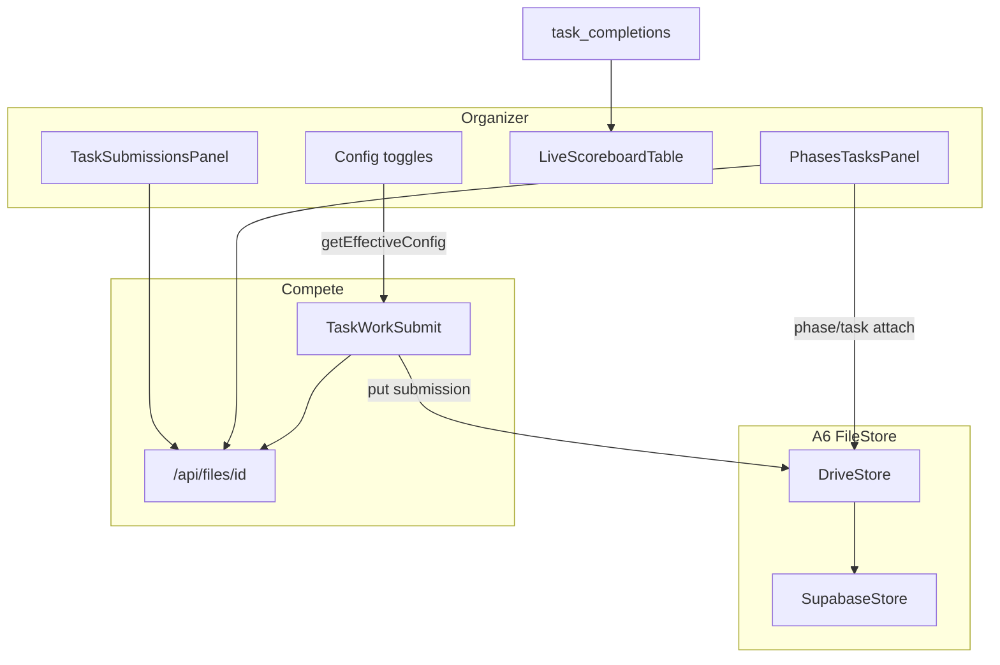

# O6 Phases, Submissions, Scoreboard, Settings

## Locked decisions

- **Build once** (same as O2–O5); final docs/tests is the review gate.
- **FileStore for all new organizer + participant file bytes** (A6 Drive-first via existing [`eventDriveUpload.service.ts`](src/features/connections/server/eventDriveUpload.service.ts) / `fileStore.put`). Participant downloads only through [`/api/files/[id]`](src/app/api/files/[id]/route.ts) after expanding [`authorizeStoredFileAccess`](src/features/files/authorizeFileAccess.ts) to admit compete-cookie team members for that event’s competition files.
- **Phase windows always gate work** for tasks that belong to a phase: `phaseIsOpen` enforced on submit/flag regardless of `phase_lock_no_revisit` (that toggle keeps meaning “no revisit after close” / UI lock messaging; open/close still always apply). Visibility still respects `phased_structure` / `day_wise_tasks`.
- **Resubmission:** new config key `allow_resubmission` (boolean, default on). When off, server rejects a second `hackathon_task_submissions` row for the same team+task.
- **Multi-link:** form accepts up to 5 HTTPS links (array); store primary in `link_url`, extras in submission `extra.links[]` (no schema break).
- **Scoreboard movement:** pure helper `rankMovement(rowsNow, rowsAt)` comparing ranks from completions with `attempted_at <= now-1h` vs now — **no snapshot table**. ▲▼/— column on [`LiveScoreboardTable`](src/features/hackathon/components/LiveScoreboardTable.tsx).
- **Settings:** keep deprecated DB columns unread; scrub any remaining app writes/UI for online/livestream. Enforce `live_scoreboard` on organizer scoreboard data path. Add **unit test per non-`toggleOnly` key** (stubs stay metadata-only in matrix).

---

## 1. Phases and Tasks — attachments + working time

**Files:** [`HackathonPhasesTasksPanel.tsx`](src/features/hackathon/components/HackathonPhasesTasksPanel.tsx), [`tasks.action.ts`](src/features/hackathon/actions/tasks.action.ts), [`tasks.service.ts`](src/features/hackathon/tasks.service.ts), phase schema via `hackathon_phases.extra` (or nullable `attachment_*` columns in a small migration).

1. Phase create/edit: optional FileStore attachment (same pattern as task organizer brief); persist `stored_file_id` + display name in `extra.phaseAttachment`.
2. Task attachments: keep FileStore for reference file; route CTF challenge upload through FileStore when Drive connected (fallback bucket only if FileStore fails — same A6 pattern as proofs).
3. Participant links to attachments use `/api/files/{id}` only.
4. Extend `authorizeStoredFileAccess`: if row `eventId` + category in `hackathon_phase|hackathon_task|hackathon_submission`, allow user who is a member of a `hackathon_teams` row for that event (via compete session / registration membership already used on compete page).
5. Unconditionally reject `submitTaskWork` / `submitTaskFlag` when task’s phase exists and `!phaseIsOpen(now)`.
6. Phase edit in panel (not add-only).

---

## 2. Participant submission form

**Files:** [`TaskWorkSubmit.tsx`](src/features/hackathon/components/TaskWorkSubmit.tsx), [`taskSubmissions.action.ts`](src/features/hackathon/actions/taskSubmissions.action.ts), [`tasks.action.ts`](src/features/hackathon/actions/tasks.action.ts) `submitTaskWork`, [`taskSubmissions.service.ts`](src/features/hackathon/taskSubmissions.service.ts).

1. Replace Supabase-bucket signed PUT with FileStore put under `Submissions / <Competition> / <Team>` (reuse `uploadEventAssetToOrganizerDrive` or a dedicated helper); store `stored_files` id on the submission row (`extra.storedFileId` + legacy path fields for old rows).
2. Form: details text, up to 5 links, file (presentations allowed; size = `max_attachment_mb`), second-precision `submitted_at`.
3. Enforce `allow_resubmission` + phase window + existing link/timer settings on server.
4. MIME/size verification server-side after put (read metadata from FileStore).

---

## 3. Organizer Submissions list

**File:** [`TaskSubmissionsPanel.tsx`](src/features/hackathon/components/TaskSubmissionsPanel.tsx), [`taskSubmissions.service.ts`](src/features/hackathon/taskSubmissions.service.ts).

1. Table columns add **file name, size, points** (fields already on row type).
2. Filters keep competition/phase/task/team/status/date; empty state when none; matching rows only (drop dimmed non-matches).
3. Preview/download via `/api/files/{id}` (or server action that returns that URL) instead of raw storage signed URL when `storedFileId` present; fall back for legacy rows.
4. Raise list limit / keyset pagination (default 100, “load more”) so “always show list” scales past 50.

---

## 4. Scoreboard movement

**Files:** [`scoreboardAggregate.ts`](src/features/hackathon/scoreboardAggregate.ts), [`LiveScoreboardTable.tsx`](src/features/hackathon/components/LiveScoreboardTable.tsx), [`tasks.service.ts`](src/features/hackathon/tasks.service.ts) `trackTaskScoreboardDetail`, [`LiveRefresh.tsx`](src/features/hackathon/components/LiveRefresh.tsx) (keep 15s).

1. Pure `aggregateScoreboardDetailAt(input, atMs)` filtering completions by `attempted_at`.
2. `computeRankMovement(nowRows, hourAgoRows)` → `up | down | same | new` + delta.
3. Column ▲▼/—; tooltip with prior rank.
4. Isolation test remains; add movement unit test.

---

## 5. Settings cleanup + enforcement

**Files:** [`configKeys.ts`](src/features/hackathon/configKeys.ts), [`HackathonWorkspace.tsx`](src/features/hackathon/components/HackathonWorkspace.tsx), [`tasks.action.ts`](src/features/hackathon/actions/tasks.action.ts), [`docs/hackathon-settings-matrix.md`](docs/hackathon-settings-matrix.md), [`live.ts`](src/features/hackathon/live.ts) / column inventories.

1. Add `allow_resubmission` to catalog + Settings UI + matrix.
2. Gate organizer scoreboard fetch/UI on `live_scoreboard` (show empty/locked when off).
3. Confirm no online/livestream UI or writes; leave DB columns deprecated.
4. For each non-`toggleOnly` key: one focused unit test asserting the server helper/action rejects or hides when the setting is off (table-driven in `settingsEnforcement.test.ts`).
5. Refresh matrix Test column from Manual → named test ids.

---

## 6. Tests + docs

- File authorize: staff vs compete team vs stranger
- Submission validation (phase closed, resubmit denied, link required, size)
- Submissions list visibility / filter pure helper
- Scoreboard movement
- Per-setting enforcement suite

Update [`completeContext.md`](completeContext.md), [`docs/22-o2-o8-status.md`](docs/22-o2-o8-status.md) O6, [`docs/hackathon-settings-matrix.md`](docs/hackathon-settings-matrix.md), [`docs/12-teams-and-staff.md`](docs/12-teams-and-staff.md) Phase 8 note if needed, archive `plans/2026-11-08-o6-phases-submissions-scoreboard-settings.md` + INDEX.

## Out of scope

- O7 certificates/files polish
- Dropping deprecated DB columns
- Full Playwright O8
- Provisioning real Docker sandboxes (`docker_sandboxing` stays stub)
","todos":[{"id":"o6-phases-files","content":"Phase/task FileStore attachments + compete proxy auth + phase window enforce + phase edit"},{"id":"o6-participant-submit","content":"TaskWorkSubmit FileStore upload, multi-link, allow_resubmission, server validation"},{"id":"o6-submissions-ui","content":"Submissions table columns, proxy download, filter-only rows, pagination"},{"id":"o6-scoreboard-move","content":"Hour-ago rank movement pure helper + LiveScoreboardTable column + test"},{"id":"o6-settings-tests","content":"allow_resubmission + live_scoreboard gate + per-setting tests + matrix/docs/archive"}]}
