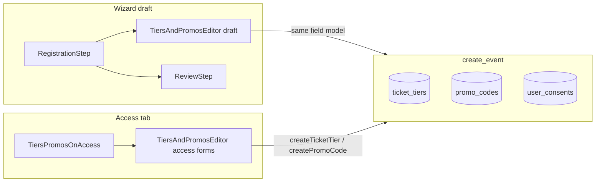

# N2 — Event creation wizard fix

## Locked decisions

- Extract a real client [`TiersAndPromosEditor`](src/features/ticketing/components/TiersAndPromosEditor.tsx); refactor [`TiersPromosOnAccess.tsx`](src/features/ticketing/components/TiersPromosOnAccess.tsx) to render it (Access stays server-owned list + FormData actions). Wizard Registration uses the same component in **draft** mode.
- Add DB column `ticket_tiers.available_from` (timestamptz null) so “Available from” is real, not fake UI. Wire `is_early_bird` and promo `usage_limit` through Access actions + create path (they already exist in schema/service for early bird / usage limit).
- Change wizard `EventFormData.promoCodes` from `string[]` to structured `WizardPromoDraft[]` and persist them in [`EventService.create_event`](src/services/event.service.ts) into `promo_codes` (today tiers insert; promos are ignored).
- Seed + route CMS legal docs `organizer-agreement` and `content-rights`; publish records acceptance for `terms` + those two with context `event_publish` (registration consent stays `privacy`+`terms`).

## Current gaps (why this work)

| Spec | Today |
|------|--------|
| Labeled shared tiers/promos editor | Unlabeled 4-col tier grid in [`RegistrationStep.tsx`](src/features/events/components/wizard/steps/RegistrationStep.tsx); Access-only [`TiersPromosOnAccess.tsx`](src/features/ticketing/components/TiersPromosOnAccess.tsx); name `TiersAndPromosEditor` docs-only |
| Summary never shows “0 seats” | [`ReviewStep.tsx`](src/features/events/components/wizard/steps/ReviewStep.tsx) prints `{totalSeats} seats` |
| Legal links + versioned accept | Plain checkboxes; no links; [`create_event`](src/services/event.service.ts) never calls [`recordLegalAcceptance`](src/features/website/consent.service.ts) |
| Remove show-on-public switches | Still in Review publish panel |
| Review = public banner + key details | Text cards only; banner unused |
| Wizard promos | `promoCodes: string[]`, unused on create |

## 1. Shared `TiersAndPromosEditor`

New client component under `src/features/ticketing/components/`:

**Tier fields (always labeled):** Name, Price, Seats (helper: “Leave seats empty for unlimited”), Available from, Available until, Active, Early bird.

**Promo fields:** Code, Type (percent/flat), Value, Scope (whole event + track options when hackathon), Usage limit, Expiry, Active.

**Modes**

- `draft`: controlled `tiers` / `promos` + `onChange`; empty seats → `null` (not `0`); hide tier section when `ticketType === "free"` / `hideTiers`.
- `access`: same field markup inside existing FormData create forms; list + toggle/delete stay as today.

Refactor Access to use this component so wizard and Access cannot drift.

Extend [`TicketTier`](src/services/models/event.model.tsx) / drafts with `availableFrom`, `active`, `isEarlyBird`, and `seatsAvailable: number | null`. Add `WizardPromoDraft`. Update [`INITIAL_FORM`](src/features/events/components/wizard/EventWizardLayout.tsx) and Registration validation (paid still requires ≥1 tier; seats optional when event `totalSeats === 0`).

## 2. Schema + ticketing write path

- Migration: `ticket_tiers.available_from timestamptz null`; regenerate types.
- [`TicketingService.createTier` / `updateTier`](src/features/ticketing/ticketing.service.ts) + [`createTicketTierAction`](src/features/ticketing/actions/ticketing.action.ts): pass `availableFrom`, `isEarlyBird`, optional seats (`Number(...) || undefined` → null).
- [`createPromoCodeAction`](src/features/ticketing/actions/ticketing.action.ts): pass `usageLimit` from form (service already supports it).
- [`create_event` tier insert](src/services/event.service.ts): write `available_from`, `is_early_bird`, `active`; treat empty/0 seats as `null` when unlimited intent; insert `promo_codes` from drafts via same column map as `createPromo`.

## 3. Registration summary helper

Add pure `formatRegistrationSummary(form)` in [`wizardUtils.ts`](src/features/events/components/wizard/wizardUtils.ts) (or sibling `wizardSummary.ts`):

Target shape: `Registration: 1 paid tier (Rs 100) · Unlimited seats · Approval required · 1 extra question`

Rules: free → `Free`; paid → `N paid tier(s) (Rs X)` using first/min active price; `totalSeats <= 0` → `Unlimited seats` (never `0 seats`); include approval only when required; pluralize questions. Use it in Review’s Registration card (and any other summary surface if present).

## 4. Publish: legal links + versioned acceptance

- Seed CMS rows + v1 bodies for `organizer-agreement` and `content-rights` (migration mirroring existing legal seed).
- Marketing pages: [`/organizer-agreement`](src/app/(marketing)/) and [`/content-rights`](src/app/(marketing)/) cloned from [`terms/page.tsx`](src/app/(marketing)/terms/page.tsx).
- Review checkboxes: Links open in new tab like [`ConsentCheckboxes`](src/features/website/components/ConsentCheckboxes.tsx) — Terms of Service → `/terms`, Event Organizer Agreement → `/organizer-agreement`, content-rights statement → `/content-rights`.
- Extend [`getCurrentLegalVersions` / `recordLegalAcceptance`](src/features/website/consent.service.ts) with optional slug list (default remains `privacy`,`terms` for registration/signup).
- On successful `create_event` when checkboxes are required for publish path: call `recordLegalAcceptance({ userId, email, context: "event_publish" })` for `["terms","organizer-agreement","content-rights"]`. Fail create with a clear error if docs missing (S2/S4 — do not trust client-only gates).

## 5. Review UX cleanup

- Remove “Show on public page” Sponsors / Collaborators / Partners block from [`ReviewStep.tsx`](src/features/events/components/wizard/steps/ReviewStep.tsx). Keep **Publish immediately**. Leave `showSponsors*` defaults `false` (Sponsors tab remains source of truth).
- Add banner preview from `formData.bannerImage` (cover, 16:9-ish) plus key details: title, category/format, schedule, location, registration summary — aligned with what the public page currently surfaces from the create payload (full public redesign is N3).

## 6. Tests + docs

Unit / RTL (vitest):

- `formatRegistrationSummary` unlimited / paid / free / approval / questions.
- Editor: labels present; free hides tiers; empty seats → null.
- create mapping / consent slug helper: promos + tier columns; publish context records expected slugs.
- Legal page getters resolve seeded slugs (or marketingData fetch stubs).

Update [`completeContext.md`](completeContext.md) (wizard + Access + legal slugs + change log) and archive this plan to `plans/2026-11-09-n2-event-wizard.md` + [`plans/INDEX.md`](plans/INDEX.md) when implementing.

## Primary files

- [`RegistrationStep.tsx`](src/features/events/components/wizard/steps/RegistrationStep.tsx), [`ReviewStep.tsx`](src/features/events/components/wizard/steps/ReviewStep.tsx), [`EventWizardLayout.tsx`](src/features/events/components/wizard/EventWizardLayout.tsx)
- New `TiersAndPromosEditor.tsx`; thin [`TiersPromosOnAccess.tsx`](src/features/ticketing/components/TiersPromosOnAccess.tsx)
- [`ticketing.action.ts`](src/features/ticketing/actions/ticketing.action.ts), [`ticketing.service.ts`](src/features/ticketing/ticketing.service.ts), [`event.service.ts`](src/services/event.service.ts), [`event.model.tsx`](src/services/models/event.model.tsx)
- [`consent.service.ts`](src/features/website/consent.service.ts) + marketing legal pages + migration(s)
