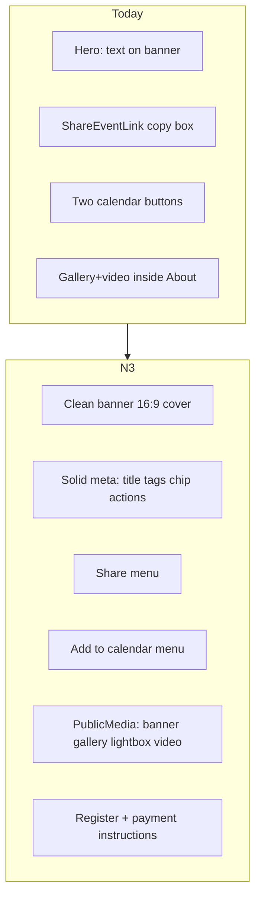

# N3 — Public event page redesign

## Locked decisions

- Keep **`PublicEventDto` / `getPublicEventView`** as the only public data path. Extend the allowlist with **`paymentInstructions: string | null`** (plain organizer text for paid events). Do **not** expose structured bank/IBAN fields (`PUBLIC_EVENT_FORBIDDEN_KEYS` stays).
- Visual language: product tokens from [`globals.css`](src/app/globals.css) (`ink` / `paper` / `line` / `font-display`), spacing/radii aligned with [docs/19 §2](docs/19-marketing-website.md) (generous whitespace, `rounded-2xl`, Lucide). **docs/17 is Connections, not visual** — ignore for UI. **docs/12 has no §D** — use the live matrix in [`resolveRegisterButtonState`](src/features/events/publicEvent.logic.ts) (`admin_preview` … `open`).
- **Add to calendar** on the public page when the event is published (or staff preview) and lifecycle is not `cancelled` / `archived`. Ticket-page “confirmed only” remains ticket-side (docs/23 A1); this plan only changes the public page.
- Payment instructions editor lives on **Edit basics** ([`EditBasicsForm.tsx`](src/features/events/components/EditBasicsForm.tsx)) for paid events; column `events.payment_instructions`.

## Current → target

Primary compose file: [`src/app/events/[eventId]/page.tsx`](src/app/events/[eventId]/page.tsx). Components under [`src/features/events/components/public/`](src/features/events/components/public/).

## 1. Hero — clean banner + meta below

Rewrite [`PublicEventHero.tsx`](src/features/events/components/public/PublicEventHero.tsx):

- Full-bleed / edge-to-edge banner: `aspect-video` (mobile) / taller wide desktop, `next/image` `fill` + `object-cover` + `object-center` (safe focal default). Meaningful `alt` (event title).
- **No** gradient overlay, glass chips, or title on the image.
- Solid section immediately below: lifecycle badge (preview → “Admin preview”), title, short description, tags, organizer chip, then action buttons.
- Optional slight overlap: meta card `-mt-*` over the bottom of the banner **without** covering image content with text (card sits on solid paper below, edge may overlap for polish only).

## 2. Actions — Share + Add to calendar menus

- Replace [`ShareEventLink`](src/features/events/components/ShareEventLink.tsx) usage on this page with a **Share** dropdown: Copy link, WhatsApp, LinkedIn, X, Email (`mailto:` / `wa.me` / intent URLs from `dto.sharePath` absolute). Keyboard-operable menu (Escape/close, focus trap light).
- One **Add to calendar** menu: Google Calendar + Apple/Outlook `.ics` via existing [`addToCalendar.ts`](src/features/events/components/public/addToCalendar.ts). Remove the two separate hero buttons.
- Helper `calendarActionsAllowed(dto, preview)` — hide menu when cancelled/archived (and when unpublished non-preview).

## 3. Media

- New [`PublicMedia.tsx`](src/features/events/components/public/PublicMedia.tsx): ordered items = banner (if set) + `galleryImages`; grid + lightbox (dialog, Esc, focus return); promo video as lazy YouTube/Vimeo iframe (host allowlist already used elsewhere).
- Strip gallery/video out of [`PublicAbout.tsx`](src/features/events/components/public/PublicAbout.tsx) so About is description-only.
- Empty: no gallery and no video → section omitted (or banner-only still shows if banner exists).

## 4. Details icon grid

Update [`PublicEventFacts.tsx`](src/features/events/components/public/PublicEventFacts.tsx):

- Rows: date+time+timezone, venue + **Open in Maps**, format, **seats only when `seats.left !== null`** (hide unlimited), registration window, admission.
- No truncation (`break-words` / full strings); keep maps link + optional embed.

## 5. Sections order

In [`page.tsx`](src/app/events/[eventId]/page.tsx) (mobile register-first unchanged):

1. Hero (banner + meta)
2. Grid: sticky [`PublicRegisterCard`](src/features/events/components/public/PublicRegisterCard.tsx) | content column
3. Content: Facts → Media → About → Tickets & discounts → Agenda by day → Speakers → Competitions (hackathon) → Sponsors strips (if enabled) → Organizer card → Report

Polish [`PublicTiersAndDiscounts`](src/features/events/components/public/PublicTiersAndDiscounts.tsx) as cards (price, seats left if limited, availability, automatic discounts only — never promo codes). Organizer card: solid chip/card from `organizerChip` (not buried in footer only).

## 6. Registration card + payment instructions

**Schema:** migration `events.payment_instructions text null` + types regen.

**DTO:** `paymentInstructions` filled in `buildDto` when `!isFree` and text non-empty; otherwise `null`.

**Organizer edit:** [`EditBasicsForm`](src/features/events/components/EditBasicsForm.tsx) + [`updateEventBasics.action`](src/features/events/actions/updateEventBasics.action.ts) textarea “Payment instructions” when ticket type is paid (bank/wallet/reference free text).

**Register card:**

- Tier / competition selection as today; form from `formFields`.
- For paid + open/waitlist/preview form: **Payment instructions** block **before** the payment screenshot field (pass instructions into [`RegistrationForm`](src/features/registration/components/RegistrationForm.tsx) or render above it in the card).
- Map every `RegisterButtonState` to clear copy (existing `RegisterBody`); add one plain **What happens next** line (approval / payment verify / ticket email — driven by `requiresApproval` + `isFree`).
- Preview: keep `previewOnly` / disabled submit (already wired).

## 7. Polish

- Tighten page spacing (`space-y-*`, max-w consistent); improve [`loading.tsx`](src/app/events/[eventId]/loading.tsx) skeleton to match new hero/meta/register layout.
- `next/image` sizes for banner (`100vw`) and gallery thumbs; lazy non-LCP media.
- a11y: headings hierarchy, button labels, lightbox dialog, reduced-motion for any motion.
- Preserve CSP-friendly embeds (YouTube/Vimeo allowlist).

## 8. Tests

Extend / add vitest (node:test) under `src/features/events/__tests__/`:

- Hero/meta: pure helper or DOM-free assertion that overlay classes are not used / `bannerHasOverlay` false (component contract test or snapshot of class list helper).
- Share/calendar menu builders (URLs, calendar gated false when cancelled).
- Media item list: banner-only; empty gallery+video → empty extras.
- Facts: seats row omitted when unlimited (`left === null` and total 0).
- Payment instructions: present on DTO only when paid + text; register UI shows block only when paid.
- Preview: register state `admin_preview` disables submit (existing + guard).

Update [`completeContext.md`](completeContext.md) public UI section + change log; archive plan to `plans/2026-11-09-n3-public-event-page.md` + INDEX on implement.

## Primary files

- [`page.tsx`](src/app/events/[eventId]/page.tsx), [`PublicEventHero.tsx`](src/features/events/components/public/PublicEventHero.tsx), new `PublicShareMenu` / `PublicCalendarMenu` / `PublicMedia`
- [`PublicEventFacts.tsx`](src/features/events/components/public/PublicEventFacts.tsx), [`PublicAbout.tsx`](src/features/events/components/public/PublicAbout.tsx), [`PublicRegisterCard.tsx`](src/features/events/components/public/PublicRegisterCard.tsx), [`RegistrationForm.tsx`](src/features/registration/components/RegistrationForm.tsx)
- [`types.ts`](src/features/events/types.ts), [`publicEvent.service.ts`](src/features/events/publicEvent.service.ts), [`EditBasicsForm.tsx`](src/features/events/components/EditBasicsForm.tsx), migration for `payment_instructions`
