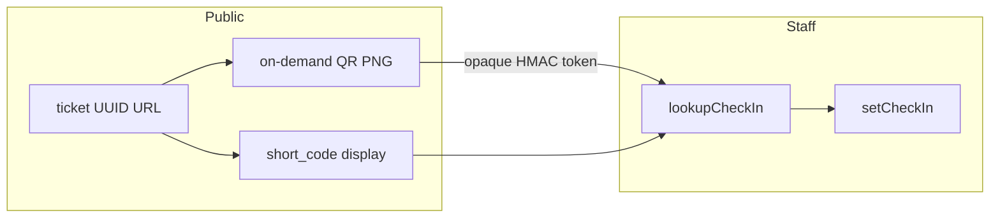

# N4 — Ticket page, short codes, QR, calendar

## Locked decisions

- **Display code ≠ access:** `registrations.short_code` (e.g. `AVO-K7Q4M2`) is unique, searchable, shown everywhere people currently see a registration UUID. It is never enough to open a ticket.
- **Ticket capability stays the UUID URL:** keep `/events/[eventId]/ticket/[registrationId]` (random UUID at insert — already unguessable). Do **not** introduce a second public token column; avoid breaking existing links, emails, and compete sessions. UUID is never labeled/shown in UI, emails, or exports.
- **QR payload:** opaque HMAC token only (no name/email/JSON). One ticket URL; remove separate QR link / dual-link copy. PNGs stay on-demand (`GET /api/qr/...`), never stored.
- **Calendar on ticket:** one Add to calendar menu (Google + Apple/Outlook `.ics`), **only** when status is `confirmed`, `checked_in`, or `attended`, with tooltip `Adds this event to your calendar`. Reuse helpers from [`addToCalendar.ts`](src/features/events/components/public/addToCalendar.ts); replace dual buttons in [`TicketCalendarActions.tsx`](src/features/events/components/public/TicketCalendarActions.tsx).
- **Secret:** new server env `REGISTRATION_QR_SECRET` (min 16) + `requireRegistrationQrSecret()` in [`src/env.ts`](src/env.ts) (fail-closed like compete). Document in `.env.example`.
- **N5 out of scope:** no full Attendees card redesign; N4 wires short code into list/drawer/search/exports/emails and adds check-in lookup.

## 1. Schema + short-code generator

**Migration** `supabase/migrations/20261109200000_n4_registration_short_codes.sql`:

- Column `registrations.short_code text`.
- Unique index on `upper(short_code)`.
- Backfill existing rows in SQL (plpgsql): Crockford alphabet `0123456789ABCDEFGHJKMNPQRSTVWXYZ`, format `AVO-` + 6 chars, retry on collision; then `NOT NULL`.

**App helper** [`src/features/registration/shortCode.ts`](src/features/registration/shortCode.ts):

- `generateShortCode`, `normalizeShortCode`, `formatShortCode`.
- Allocate with retry on unique violation (cap ~8).

**Assign on create:** [`createPublicRegistration`](src/features/registration/registration.service.ts) and [`attendeeImport.service.ts`](src/features/event_attendee/import/attendeeImport.service.ts).

**Hydration:** [`hydrateRegistrationRow`](src/services/registeration.service.ts) + [`reg.type.ts`](src/services/models/reg.type.ts) field `shortCode`. Regen types (`npm run types:db`).

**Search:** [`registrationMatchesSearch`](src/features/event_attendee/roster.ts) matches normalized short code (with/without prefix or hyphen).

## 2. Signed QR + API

New [`src/features/registration/checkInToken.ts`](src/features/registration/checkInToken.ts) (`server-only`):

- Sign/verify `base64url(JSON).hexHmac` with `REGISTRATION_QR_SECRET` + `timingSafeEqual` (mirror [`competeSession.ts`](src/features/hackathon/competeSession.ts)).
- Payload shape: `{ v: 1, rid, eid }`. No expiry; check-in rejects non-admitting statuses.

Update [`qr.ts`](src/features/registration/qr.ts):

- PNG encodes the opaque token string only (not PII JSON).
- Ticket img / emails use signed token path; stop writing PII into `qr_code_data`.

Update [`src/app/api/qr/[token]/route.ts`](src/app/api/qr/[token]/route.ts):

- Accept signed token (not UUID regex). Verify, load by `rid`+`eid`, return PNG of same token.

**One link rule:** [`registrationEmail.logic.ts`](src/features/registration/registrationEmail.logic.ts) and [`eventEmail.service.tsx`](src/features/event_attendee/eventEmail.service.tsx) — primary CTA is ticket URL only; QR is inline image or open-ticket copy, never a second QR URL. Replace Registration ID fact with Short code.

## 3. Ticket page redesign

Rewrite [`src/app/events/[eventId]/ticket/[registrationId]/page.tsx`](src/app/events/[eventId]/ticket/[registrationId]/page.tsx) plus small clients under `src/features/registration/components/ticket/`:

- **Status hero:** pending → Awaiting approval; awaiting_payment → Awaiting payment; waitlisted; confirmed/checked_in/attended → Confirmed; rejected; cancelled.
- **Details card:** title, date/time/tz, venue, tier/competition, short code + copy.
- **What happens next:** status-driven copy.
- **QR:** confirmed family only — on-demand PNG + Download (`download` on same `/api/qr/...png`).
- **Team:** hackathon lead sees team name, competition, each member short code + QR.
- **Calendar:** single menu only when confirmed; tooltip as locked above.
- **Save link:** keep existing note.
- Remove labeled Registration ID / UUID display. Replace TicketCalendarActions with a confirmed-gated menu (pattern from [`PublicCalendarMenu`](src/features/events/components/public/PublicCalendarMenu.tsx)).

## 4. Staff check-in lookup

- Extend [`checkIn.action.ts`](src/features/event_attendee/actions/checkIn.action.ts) (or sibling action):
  - `assertEventActor(eventId, attendees)`
  - `rateLimit` keyed by user for lookup
  - Input: trim → verify signed token for this event, else normalize short code and query scoped to event
  - Set `check_in_method` to `qr_scan` or `short_code`; keep sheet refresh
- Minimal toolbar field on [`AttendeeClientSide.tsx`](src/features/event_attendee/components/AttendeeClientSide.tsx): paste QR contents or type short code. Drawer keeps existing `setCheckIn` toggle.

## 5. Display / export surfaces

- Drawer [`SingleAttendeeView`](src/features/event_attendee/components/SingleAttendeeView.tsx): short code; QR via signed token; ticket link unchanged.
- List: show short code (N4); full card polish stays N5.
- Exports [`eventSheets.ts`](src/features/exports/eventSheets.ts): column Short code replaces Registration ID; keep Ticket URL.
- Email facts/tokens: `shortCode` instead of UUID.

## 6. Tests + docs

Unit tests under `src/features/registration/__tests__/` (plus roster/export helpers as needed):

- Short code alphabet/format, normalize, uniqueness retry
- Display helpers never emit UUID as Registration ID
- Calendar menu allowed only for confirmed family
- Token sign/verify; reject tampered / wrong event
- Email/QR helpers: one ticket link; opaque QR payload
- Lookup resolves short code and token

Update [`completeContext.md`](completeContext.md); archive to `plans/2026-11-09-n4-ticket-short-codes.md` + INDEX on implement.

## Primary files

- Migration, `shortCode.ts`, `checkInToken.ts`, `qr.ts`, `/api/qr/[token]/route.ts`
- `registration.service.ts`, import service, hydrate/`reg.type.ts`, `env.ts`
- Ticket page + calendar menu; `roster.ts`; `SingleAttendeeView`; `eventSheets.ts`; email logic
- Check-in action + Attendees toolbar; unit tests; `completeContext.md` / `plans/`
