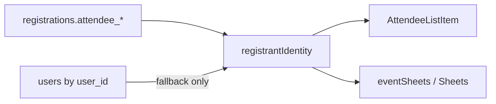

# N5 — Attendees tab

## Locked decisions

- **Identity is snapshot-canonical:** Display name/email/phone always come from `Registration.attendee` (`attendee_name|email|phone`), then fall back to linked `User` only if snapshot fields are empty. Do not change `user_id` write behavior; fix the join/display layer that currently prefers the account (docs/23 A6).
- **Approve disable rule (paid only):** Approve is disabled when the event is paid and there is no payment proof (`payment.proofPath` empty), with tooltip `No payment proof yet`. Free events keep Approve enabled for pending. Reject stays enabled.
- **Import:** Free events only in toolbar; paid shows disabled control + tooltip `Paid events need registration so payments can be verified`. Import commits as `confirmed` + `extra.imported` (no email unless organizer chooses later via Email).
- **Proofs:** Keep FileStore `file:{uuid}` refs; drawer preview via `/api/files/{id}`; Open in Drive when `stored_files.provider = drive` and a webViewLink exists. Fallback banner when Drive unhealthy / proofs on Supabase fallback (docs/22 A6).

## 1. Identity helper + wire-through

Add pure helper [`src/features/event_attendee/registrantIdentity.ts`](src/features/event_attendee/registrantIdentity.ts):

- `registrantIdentity(reg, user?)` → `{ name, email, phone, initials }`
- Order: `reg.attendee.*` → `user.profile` / `user.email` → placeholders

Use in:

- [`AttendeeListItem.tsx`](src/features/event_attendee/components/AttendeeListItem.tsx) (stop rendering `attendee_user.profile` alone)
- [`TeamGroupView.tsx`](src/features/event_attendee/components/TeamGroupView.tsx) lead line
- [`exportEventSheet.action.ts`](src/features/exports/actions/exportEventSheet.action.ts) name/email resolution
- [`sheetSync.service.ts`](src/features/connections/server/sheetSync.service.ts) `buildAttendeeMatrix`
- Keep drawer order already correct in [`SingleAttendeeView.tsx`](src/features/event_attendee/components/SingleAttendeeView.tsx); route it through the helper for one source of truth

Optional page cleanup in [`attendees/page.tsx`](src/app/organizer/[organizer_id]/events/[eventId]/attendees/page.tsx): still load users for secondary context, but list UI never treats User as primary identity.

Team cards: show **team name + lead** (lead via `registrantIdentity` of lead registration).

## 2. List cards, approve rules, bulk, search

Rewrite [`AttendeeListItem.tsx`](src/features/event_attendee/components/AttendeeListItem.tsx) (and grouped rows) to show:

avatar initials · name · email · phone · short code · tier or competition · status badge · payment status (if paid) · proof indicator · check-in status · Approve/Reject

Add [`approveDisabledReason.ts`](src/features/event_attendee/approveDisabledReason.ts):

- Input: `{ isPaid, status, proofPath, paymentStatus }`
- Returns `string | null` (null = Approve enabled)
- Paid + no proof → `No payment proof yet`

Wire tooltip + `disabled` on Approve (list + drawer).

**Bulk select:** checkbox on cards in [`AttendeeClientSide.tsx`](src/features/event_attendee/components/AttendeeClientSide.tsx); toolbar Bulk approve / Bulk reject calling a new `bulkDecideRegistrations.action.ts` (auth `assertEventActor`, per-id status update reusing decide/mail hooks where safe; skip rows with approve-disabled reason on approve).

**Search:** [`roster.ts`](src/features/event_attendee/roster.ts) already matches short code + attendee fields — keep registrant fields primary; drop reliance on organizer account email for display searches (search may still hit user as secondary).

## 3. Drawer

In [`SingleAttendeeView.tsx`](src/features/event_attendee/components/SingleAttendeeView.tsx):

- Proof preview: always use platform proxy URL for `file:` / `/api/files/` (fix broken signed/Drive-only paths). Support image lightbox; PDF opens in new tab.
- **Open in Drive** button when server provides `proofDriveUrl` (from `stored_files` / Drive metadata for that file id).
- Payment verify / reject with reason (extend existing payment controls + `decideRegistration` / payment status updates; require reason on reject).
- Ticket link copy; on-demand QR (N4 signed image URL already on `registration.qrCode`).
- All answers, status history, check-in (time, method, who via `checkInByNames`).
- Remove any empty **Location** block if still present (academic/location leftovers).

Page loader: batch resolve Drive links for proof file ids alongside `proofUrl`.

## 4. Storage + Drive banner

Confirm register proof path still uses [`uploadRegistrationProofDrive.action.ts`](src/features/registration/actions/uploadRegistrationProofDrive.action.ts) → FileStore (Drive first, Supabase fallback).

On Attendees tab: show Connections/Drive health banner when organizer Drive is disconnected or proofs exist with `provider = supabase` (fallback in use), linking to Connections — reuse existing Drive health helpers from connections/files.

## 5. Toolbar

Consolidate toolbar in `AttendeeClientSide`: **Registration form · Email · Export · Import**.

- Move [`AttendeeImportPanel`](src/features/event_attendee/import/AttendeeImportPanel.tsx) into Import menu/modal from toolbar (not a buried `extra` block only).
- Free: full import (CSV name/email/phone, dedupe, preview, commit confirmed+imported).
- Paid: Import control visible but disabled with the exact tooltip from docs/23 A4.

## 6. Exports

Extend [`eventSheets.ts`](src/features/exports/eventSheets.ts) / export action:

- Columns: Short code, Ticket URL, Payment status, **Payment proof (platform)**, **Payment proof (Drive)** when known, check-in details (time/method/who), every form field.
- Name/email/phone via `registrantIdentity`.
- Teams + Members sheets unchanged structurally.
- Apply [`sanitizeSheetCell`](src/features/connections/lib/sheetSanitize.ts) on xlsx cell values (Sheets sync already sanitizes matrices).

## 7. Tests + docs

Unit tests under `src/features/event_attendee/__tests__/`:

- Identity: organizer-linked `userId` + different snapshot → UI helper returns registrant
- `approveDisabledReason` paid/no-proof vs free/pending
- Proof URL builder prefers `/api/files/{id}` for `file:` refs
- Import `paidBlocked` / free-only toolbar gate helper
- Export column headers include ticket + proof URLs; short code search in roster

Update [`completeContext.md`](completeContext.md) `event_attendee` + change log; archive to `plans/2026-11-09-n5-attendees-tab.md` + INDEX on implement.

## Primary files

- [`attendees/page.tsx`](src/app/organizer/[organizer_id]/events/[eventId]/attendees/page.tsx), `registrantIdentity.ts`, `approveDisabledReason.ts`
- `AttendeeListItem.tsx`, `AttendeeClientSide.tsx`, `SingleAttendeeView.tsx`, `TeamGroupView.tsx`
- `AttendeeImportPanel.tsx`, `bulkDecideRegistrations.action.ts`
- `eventSheets.ts`, `exportEventSheet.action.ts`, `sheetSync.service.ts`
- FileStore / Drive banner hooks; unit tests; `completeContext.md` / `plans/`
