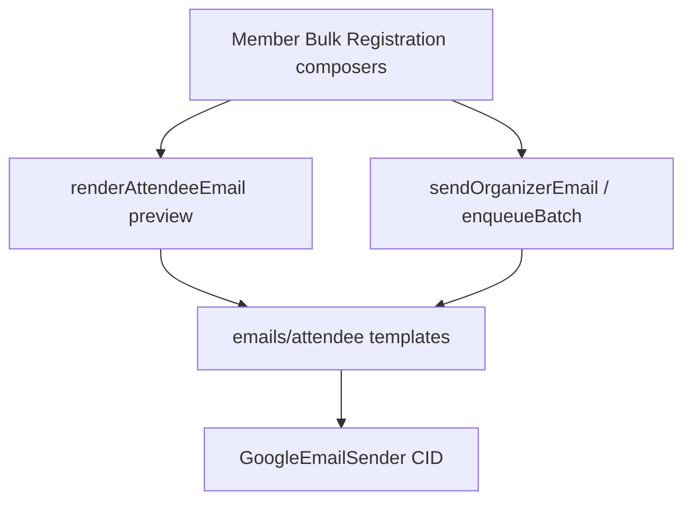

# N6 — Attendee emails (composer + React Email)

Implements [docs/23 N6](docs/23-fixes-wizard-public-attendees-emails-connections.md) against [docs/22 O2](docs/22-event-module-overhaul.md) email rules, [docs/18](docs/18-email-send-limits-and-scheduling.md) capacity UI, and [ENGINEERING_RULES](docs/ENGINEERING_RULES.md) (escape all values, rate-limit bulk, fail-closed auth). Platform Resend templates in [`emails/layout.tsx`](emails/layout.tsx) stay for SaaS; organizer attendee mail gets its own shared shell.

## Locked decisions

- **One render path:** `@react-email/render` → `{ html, text, attachments? }` → `sendViaOrganizerConnection` / outbox. Retire string HTML in [`eventEmail.service.tsx`](src/features/event_attendee/eventEmail.service.tsx) for the listed templates (keep thin wrappers that call the new renderer).
- **Layout:** new [`emails/attendee/AttendeeEmailLayout.tsx`](emails/attendee/AttendeeEmailLayout.tsx) at **600px** (platform `TransactionalEmail` stays 560px). Dark-mode-safe colors via `@media (prefers-color-scheme: dark)` in `<Head>` style; all values through `escapeHtml` / React text nodes.
- **One ticket CTA:** exactly one `View ticket` button (`/events/{eventId}/ticket/{registrationId}`). QR images use `cid:` only — no second QR URL. Teams &gt;10: member list without per-member ticket links; the same single lead ticket URL remains the only CTA.
- **CID QRs:** extend [`GoogleEmailSender`](src/features/connections/providers/google/email.ts) nodemailer path with `cid` attachments (`multipart/related`). ≤10 members: inline `cid:qr-{regId}` + short-code text fallback under each image. &gt;10: names/short codes only + one ticket button.
- **Calendar in email:** Google Calendar URL from [`calendarFallbacks.ts`](src/features/connections/lib/calendarFallbacks.ts) + HTTPS `.ics` from a small public route (reuse [`addToCalendar.ts`](src/features/events/components/public/addToCalendar.ts) / `buildIcs`) — no `blob:` / data URLs.
- **Free events:** no payment/price rows in received/confirmed/custom bodies.
- **Bulk personalization:** enqueue stores subject/body/blocks/kind; outbox worker re-renders **per recipient** at send time (same pattern as certificate bodies). Stop cloning sample #1 HTML for all recipients.

## 1. Shared layout + templates

Add under `emails/attendee/`:

| File | Kind |
|------|------|
| `AttendeeEmailLayout.tsx` | Header (organizer name + banner thumb), title, status chip, details card, primary CTA, calendar links, reply-to + “Sent via Avoeline”, `<Preview>`, size guard helper |
| `registration-received.tsx` | Answers the attendee entered |
| `registration-confirmed.tsx` | Details + optional team/competition + CID QR slots |
| `registration-rejected.tsx` | Reason + no ticket CTA (or soft status only — still no second links) |
| `custom-message.tsx` | Wrapper around organizer body + optional include blocks |
| `access-invite.tsx` | Replace hand HTML in [`guestEmails.tsx`](src/features/access/guestEmails.tsx) |
| `certificate-ready.tsx` | Organizer lane; keep website `/certificate/[code]` primary (Drive link only if opted in) |
| `judge-invite.tsx` | Replace plaintext HTML in [`judging.action.ts`](src/features/hackathon/actions/judging.action.ts) |

Shared props builder in e.g. [`src/features/email/attendeeEmail.model.ts`](src/features/email/attendeeEmail.model.ts): event datetime+tz, venue+maps URL, ticket type, short code, ticket URL, calendar links, organizer reply-to, `isFree`, team/members for confirmed.

Renderer: [`src/features/email/renderAttendeeEmail.ts`](src/features/email/renderAttendeeEmail.ts) (`server-only`) — `@react-email/render`, plain-text twin, assert HTML+images &lt; 100 KB (downscale/omit banner thumb if needed), return CID attachment buffers for QRs.

Wire [`sendOrganizerEmail`](src/features/event_attendee/eventEmail.service.tsx), reject paths in [`registrationDecision.action.ts`](src/features/access/actions/registrationDecision.action.ts) / bulk decide, [`certificateEmail.ts`](src/features/certificates/certificateEmail.ts), guest + judge send sites through this renderer. Delete or narrow unused [`sendRegistrationEmail`](src/features/registration/registrationEmail.ts) / legacy [`buildRegistrationEmail`](src/features/registration/registrationEmail.logic.ts) once callers are gone.

## 2. Composer E2E (member, bulk, registration)

Unify UI in [`EventEmailPanels.tsx`](src/features/event_attendee/components/EventEmailPanels.tsx):

- **Every compose surface** shows: `SenderPicker` (“Sending as …”), [`CapacityStrip`](src/features/connections/components/CapacityStrip.tsx), and for multi-recipient flows: count + first five emails.
- **Preview:** all three call a shared server preview action that runs the same `renderAttendeeEmail` as send (replace client-only `previewSubstitute`). Checkboxes (`team_name`, `team_members`, `competition`, `event_details`, `ticket_url`) must change both iframe preview and outbound HTML — drive via `includeBlocks` into the React templates (drop reliance on unused `composerPreviewBody` or make it the single client mirror of server block semantics).
- **`sendMemberEmailAction`:** pass `connectionId` into `sendOrganizerEmail` / `sendViaOrganizerConnection` (today picker is ignored).
- **Bulk:** keep filter resolution + capacity dialog; fix per-recipient render at enqueue/worker; keep rate limit (S6).
- **RegistrationEmailsModal:** preview with sample registration + blocks; save templates still to `event_email_templates`; auto-send already uses saved `include_blocks`.
- Unit tests: each include block toggles a stable marker in rendered HTML; free event hides payment; connected-sender missing fails closed.

## 3. Gmail CID + transport

In [`email.ts`](src/features/connections/providers/google/email.ts): when attachments include `cid`, use nodemailer with `cid` + related MIME so HTML `src="cid:…"` resolves. Keep multipart/alternative text part. Do not log full emails (S1).

QR PNG buffers from existing check-in QR helpers (same as today’s data-URL path), attached as `qr-{registrationId}@avoeline`.

## 4. Local preview + Mailpit + snapshots

- npm scripts: `email:dev` (react-email preview for `emails/attendee/**`), optional `mailpit` docker-compose snippet or doc’d equivalent for catch-all SMTP in local.
- Dev-only escape hatch: when `EMAIL_TRANSPORT=mailpit` (or existing test flag), organizer send can target Mailpit SMTP without Google — **local/dev only**, not production.
- Snapshot tests under `src/features/email/__tests__/attendeeEmail.snapshots.test.ts`: render each template with fixed fixtures; assert structure (one ticket href, status chip, short code, no payment when free, CID refs for ≤10 members, ticket-page CTA only when &gt;10). Prefer stable HTML snapshots (normalize dates/ids).

## 5. Docs

Update [`completeContext.md`](completeContext.md) `event_attendee` / email sections + change log; archive plan to `plans/2026-11-09-n6-attendee-emails.md` + INDEX; touch docs/23 N6 status if that doc tracks completion.

## Primary files

- New: `emails/attendee/*`, `src/features/email/renderAttendeeEmail.ts`, `attendeeEmail.model.ts`, ICS route, snapshot tests
- Edit: `eventEmail.service.tsx`, `EventEmailPanels.tsx`, `eventEmail.action.ts`, `emailCompose.logic.ts`, `connections/providers/google/email.ts`, `guestEmails.tsx`, `certificateEmail.ts`, `judging.action.ts`, outbox/batch send path for per-recipient render
- Tests: composer block parity + template snapshots + one-link contract
