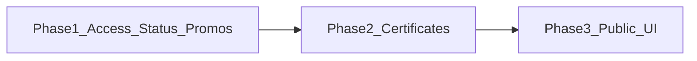

# Access, certificates, hackathon status, public page

**Default ship order (locked):** Phase 1 critical correctness (Access + registration window + promos) → Phase 2 certificates → Phase 3 public UI redesign. One PR/session can stop after a phase if needed; each phase updates [`docs/11-events-and-hackathon-complete-spec.md`](docs/11-events-and-hackathon-complete-spec.md) and [`completeContext.md`](completeContext.md).

---

## Phase 1 — Access gates + registration status + promos

### 1A. Access settings blank / wrong save

**Root causes (confirmed):**
- Wizard [`AccessTypeSelector.tsx`](src/features/access/components/AccessTypeSelector.tsx) uses `primary-*` / `neutral-900` tokens that read as a black panel on the organizer shell; Access tab uses `ink`/`paper`/`line`.
- [`saveAccessSettings`](src/features/access/actions/accessSettings.action.ts) writes `visibility: "tiered"` and a top-level `access` column that **does not exist** on `events` (Postgres CHECK wants `vip_tiered`; nested flags belong in `extra.access`).
- [`ReviewStep.tsx`](src/features/events/components/wizard/steps/ReviewStep.tsx) maps `hybrid` and `vip_tiered` to `invite_only` on create.
- Browse excludes `vip_tiered` while VIP should list ([`browse.service.ts`](src/features/events/browse.service.ts)).

**Fixes:**
- Align AccessTypeSelector (and Access tab) to product tokens; only show type-specific controls (code/whitelist for private; guest list for invite/VIP; gated tiers for hybrid; attendee tiers for VIP).
- Persist via `update_event`: map UI `tiered` → DB `vip_tiered`; merge `gatedTiers`, `attendeeTiers`, flags into `extra.access` (no fake `access` column).
- Fix ReviewStep visibility mapping; load `event_access_tiers` / `extra.access` into runtime model.
- Public browse: include `vip_tiered` when listed.
- **Private unlock:** after valid code, set httpOnly same-origin cookie (or signed short-lived unlock token) so registration works without keeping `?code=` forever; keep `?code=`/`?invite=` as entry; rate-limit via existing `rateLimit` on [`publicEvent.service.ts`](src/features/events/publicEvent.service.ts).
- Invite-only: keep [`GuestListPanel`](src/features/access/components/GuestListPanel.tsx) + tokens; polish [`GuestEmailComposer`](src/features/access/components/GuestEmailComposer.tsx) to match Attendees composer patterns (`SenderPicker`, `CapacityStrip`, preview) using organizer Gmail (`requireConnectedSender` / fail-closed).
- Hybrid/VIP: enforce `decideAccess` + `resolveEventAccess` on register; public DTO stays allowlisted ([`PUBLIC_EVENT_FORBIDDEN_KEYS`](src/features/events/publicEvent.logic.ts)).

**Tests:** extend [`decideAccess.test.ts`](src/features/access/__tests__/decideAccess.test.ts); Access save mapping unit; ReviewStep visibility; DTO forbidden keys.

### 1B. Hackathon “Closed” when open is in the future

**Root cause:** [`resolveRegisterButtonState`](src/features/events/publicEvent.logic.ts) returns `competitions_closed` when `openCompetitionCount === 0` **before** checking `opens_at`. Before event open, tracks are filtered closed → count 0 → wrong CTA. Banner in [`publicEventStatus.ts`](src/lib/publicEventStatus.ts) also says “closed” for pre-open.

**Fixes:**
- CTA order: if event registration has a future open date → `opens_at` (with date copy); then closed/competitions_closed; use event timezone via `fromEventLocalInput` / schedule TZ (not host-local midnight alone).
- Per-competition: `registration_closes_at` else event close ([`effectiveRegistrationClosesAt`](src/lib/competitionRegistration.ts)); states Not yet open / Open / Closed / Full.
- **Server enforce** window + competition close in [`registration.service.ts`](src/features/registration/registration.service.ts) / [`publicRegistrationEligibility.ts`](src/features/registration/publicRegistrationEligibility.ts) (UI-only today).
- Align `/tracks` copy with same helpers.

**Tests:** regression for hackathon + future `registrationOpenDate` → `opens_at` not `competitions_closed`; TZ window; submit rejects outside window.

### 1C. Promo / discount rules

**Schema:** migration adding `promo_codes.visibility` check (`public` | `private`), default **`private`** (existing codes stay code-entry only; organizer opts into listing).

**Behavior:**
- Public promos: listed as selectable chips on register form (and optional compact UI on public page) from server allowlisted fields only (`id`, `label`/`code` display name if public, discount summary—not private codes).
- Private: never in DTO; only “Promo / discount code” field → [`previewPromo`](src/features/ticketing/ticketing.service.ts) / `redeem_promo`.
- One discount at a time (already mostly true); show original price first; after verify show discounted; scope by `track_id` (competition) vs null (event-wide); if both apply, attendee picks one.
- Multi-competition: show each track’s structural fee; promo applies to selected scope only.
- Rate-limit preview; atomic redeem unchanged.

**Tests:** visibility filtering; preview/redeem scope; stacking forbidden; DTO never contains private codes.

---

## Phase 2 — Certificate editor

**Primary files:** [`CertificateEditor.tsx`](src/features/certificates/components/CertificateEditor.tsx), [`layout.types.ts`](src/features/certificates/layout.types.ts) `defaultLayout()`, [`making-template/page.tsx`](src/app/organizer/[organizer_id]/events/[eventId]/certificates/making-template/page.tsx), [`certificates.service.ts`](src/features/certificates/certificates.service.ts), [`emailCertificates.action.ts`](src/features/certificates/actions/emailCertificates.action.ts), [`certificateJobs.service.ts`](src/features/certificates/certificateJobs.service.ts), [`folders.ts`](src/features/files/folders.ts).

**Fixes:**
- Ensure empty/corrupt layout always hydrates to `defaultLayout()` (title, `{{attendeeName}}`, body, number, QR); re-sync client state when `initial.layout` loads (fix blank Konva after async).
- Replace always-on “LIVE SVG PREVIEW” with **Preview** button → shared [`Modal`](src/shared_components/ui) overlay calling `renderCertificate(layout, sample, assets)`.
- Keep on-demand render from cert `data` JSON; no stored PDFs by default (existing download routes).
- Email: link-first to `/certificate/[code]`; wire `SenderPicker` `connectionId` into enqueue; use `requireConnectedSender` / fail-closed; Drive share link only when opted in + acknowledge (already partly there).
- Archive: keep FileStore path under Avoeline / `{Event title (id)}` / Certificates (existing A6 labels).
- Editor: Konva `Transformer` for resize; selection, drag, z-order, duplicate, delete for text/image/shape/line/QR; inspector bound to selected node; logo/signature via existing upload pattern into `TemplateAssets` + save `assets` on draft.
- Publish version bump only for new issues (existing `publishTemplate` / issue snapshot)—verify with test; no change to historical certs unless “Re-render all”.

**Tests:** defaultLayout seed; render with data tokens; email includes verify link not PDF by default; archive folder kind; optional editor logic helpers for z-order/selection.

---

## Phase 3 — Public event / competition UI

**Keep** [`PublicEventDto`](src/features/events/types.ts) allowlist. Polish existing public components under [`src/features/events/components/public/`](src/features/events/components/public/) to marketing calm + product tokens ([`docs/19`](docs/19-marketing-website.md)): stronger hero/facts hierarchy, competition cards (image, CTF, team size, **original** fee, status, expandable rules), clear CTA states from Phase 1 helpers, share/calendar, sponsors only when toggles on.

**Also:**
- Wire `?track=` → `RegistrationForm` initial competition.
- Align `/events/.../tracks` list/detail to same DTO-driven cards + `PublicShareMenu` (stop dual `getEventForVisitor` chrome where possible).
- Registration form: original prices first; discount after preview; multi-comp fees.

**Defer (intentional):** full marketing dark-hero brand rewrite of public pages; Konva rotation; attaching PDF to certificate emails by default.

---

## Cross-cutting

- Actions: `safeAction` + zod; S2 auth; explicit selects; `Promise.all` for independent reads; `rateLimit` on code/invite/promo/register.
- Docs: update docs/11 Access, Certificates, Public page, Competitions, Registration; completeContext Change log + feature pointers.
- Verify: `typecheck`, targeted unit tests, `build` before push.
